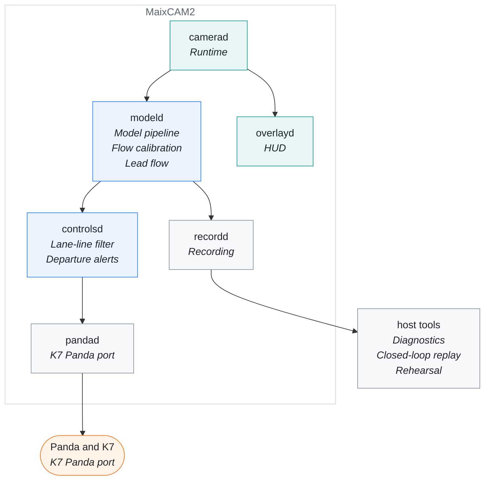

# Documentation

[← edgepilot](../README.md)

Everything about building, running and changing edgepilot, beyond the
overview in the root README. If you are new, read the four documents under
[Start here](#start-here) in order; the rest can be read when you need them.

This map shows which document covers each part of the system:

## Start here

1. [Board setup](board-setup.md): get SSH and the web console's packages onto
   the stock image.
2. [Build and deploy](build-and-deploy.md): build in the arm64 container and
   copy the runtime to the board.
3. [Runtime](runtime.md): the processes, how the manager runs them, and what
   they cost.
4. [Runtime options](runtime-options.md): the switches, the parameter files
   and the web console.

## Get started

| Document | What it holds |
| --- | --- |
| [Board setup](board-setup.md) | SSH, the web console's packages, what to avoid on the stock image |
| [Build and deploy](build-and-deploy.md) | SDK fetch, the arm64 build container, upload, build version, host tests |
| [Boot time](boot-time.md) | what the boot tuning changes and how long the board takes to start |
| [Rehearsal](rehearsal.md) | replaying a recorded drive through the whole runtime on the board |

## How it works

| Document | What it holds |
| --- | --- |
| [Runtime](runtime.md) | the processes, start-up and supervision, CPU and hardware engine load |
| [Model pipeline](model-pipeline.md) | from the frame ring through the warp and the NPU to `ModelState` |
| [HUD](hud.md) | what `overlayd` draws on the LCD and how |
| [Recording](recording.md) | the route layout, the event log and its versions |
| [Source layout](source-layout.md) | where the code lives and how the libraries depend on each other |

## Operate and tune

| Document | What it holds |
| --- | --- |
| [Runtime options](runtime-options.md) | environment variables, parameter files and the web console |
| [Parameters](../params/README.md) | every value in the K7 YG HEV parameter files |
| [Diagnostics](diagnostics.md) | procedures and results of the replay and HUD tools |
| [Verification](verification.md) | how the ported openpilot math is checked |

## Design notes

| Document | What it holds |
| --- | --- |
| [K7 Panda port](k7-panda-port.md) | the K7's CAN signals, the Panda link and the transmit gates |
| [Departure alerts](departure-alerts.md) | the lead-departure and green-light alerts at a stop |
| [Closed-loop replay](closed-loop-replay.md) | replaying a drive with the car's response simulated |
| [Flow calibration](flow-calibration.md) | the camera mount measured from optical flow |
| [Lead flow](lead-flow.md) | the lead's closing speed from optical flow, the lead track, the vision cruise |
| [Lane-line filter](lane-line-filter.md) | steadying the ego lane lines without lag |
| [Lateral NN](lateral-nn.md) | the learned torque feed-forward trained on the K7's own drives |

## Code and tools

| Document | What it holds |
| --- | --- |
| [Style guide](style-guide.md) | how code, comments, documents and diagrams are written |
| [Host tests](../tests/README.md) | what each host test covers and how to add one |
| [Diagnostic tools](../diagnostics/README.md) | the replay, dataset and HUD tools and their options |
| [Scripts](../scripts/README.md) | build, deploy and the board-side Python |
| [Model tools](../tools/model/README.md) | the recording readers and model analysis scripts |
| [axmodel pipeline](../tools/model/axmodel/README.md) | building the NPU model from openpilot's release |
| [Model package](../models/README.md) | the axmodel in the repository and its manifest |
| [Panda firmware](../firmware/panda/README.md) | the vendored Panda firmware and how it is flashed |
