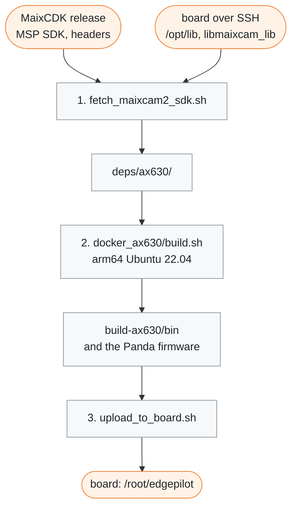
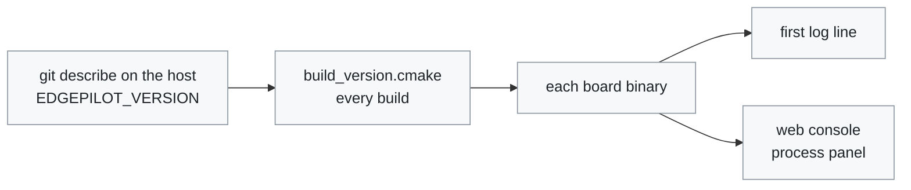

# Build and deploy

[← Documentation](README.md)

How to build the runtime on your computer and copy it to the board. The build
runs in an arm64 Ubuntu 22.04 container against libraries copied from the
board, so the binaries match the board's image exactly.



All CMake executables are written to `bin/` below the build directory. Build
directories are generated output and are not tracked:

| Directory | Build |
| --- | --- |
| `build-ax630/` | MaixCAM2 runtime (`tools/docker_ax630/build.sh`), the upload default |
| `build-host/` | host tests and tools (`scripts/run_host_tests.sh`) |
| `build-linux-test/` | the same, built with the board's compiler in Docker (`scripts/run_host_tests.sh --linux`) |

The runtime build produces `camerad`, `modeld`, `overlayd`, `controlsd`,
`pandad`, `panda_flash`, `recordd`, `imud`, `locationd` and `replayd`.
`-DEDGEPILOT_BUILD_PANDA=OFF` drops `pandad`, `panda_flash` and the
libusb dependency; the manager skips a binary that is not installed.
`-DEDGEPILOT_BUILD_DIAGNOSTICS=ON` adds the tools in
[diagnostics/](../diagnostics/README.md) without changing the runtime.

> [!WARNING]
> Do not build the runtime on the board: a native build runs out of its 1 GB
> of memory.

## 1. Fetch the SDK and board libraries

```sh
scripts/fetch_maixcam2_sdk.sh root@<board-ip>
```

This fills `deps/ax630/` (not tracked):

- the AX620E MSP SDK `v3.0.0_20250319114413`, the version the board runtime
  uses, from the MaixCDK release, checked by SHA256
- MaixCDK headers at commit `30f4b8b`: `ax_middleware.hpp` (the C++ interface
  of `libmaixcam_lib`), the `maix_basic`/`maix_image` headers it uses, and the
  OS04D10-aware MSP sample sources
- from the board over SSH, copied as-is so the ABI matches: `/opt/lib` (the AX
  runtime), `/usr/lib/libmaixcam_lib.so.1.2.5` and `libsamplerate`

The SDK download needs the network and the board copy needs SSH; after that the
build is offline. Run the script again after a board image update.

## 2. Build in the container

```sh
tools/docker_ax630/build.sh
```

The script checks `deps/ax630`, builds the `edgepilot-ax630-build` image
(`linux/arm64` Ubuntu 22.04, the same distribution as the board image, so the
binaries run against the board's glibc and libstdc++), and configures and builds
`build-ax630/` inside it with `AX_LIB_DIR=deps/ax630/lib` and an rpath of
`/opt/lib`. On an Apple Silicon Mac, an arm64 Docker VM such as colima builds
natively without emulation. The same run builds the [Panda
firmware](../firmware/panda/README.md) into `build-ax630/panda/obj/` with the
image's `gcc-arm-none-eabi`, the 10.3 the board's apt has, so a build on the
board gives the same bytes.

CMake stops with a clear message if `libax_engine`/`libax_sys` or the MaixCDK
headers are missing.

### Build version

Every board binary carries the `git describe` of the tree it was built from,
such as `v0.0.4-6-g1a2b3c4`: the last release tag, the commits since, and the
commit. `-dirty` means tracked files had uncommitted changes; `unknown` means
there was no git.



`cmake/build_version.cmake` runs on every build and rewrites the generated
`build_version.cc` only when the value changes, so an unchanged tree does not
recompile or relink. `build.sh` reads the value on the host and passes it into
the container as `EDGEPILOT_VERSION`. Set that variable yourself to pin it, for
example to check that two builds differing only in comments or formatting give
the same bytes:

```sh
EDGEPILOT_VERSION=pinned tools/docker_ax630/build.sh
```

The value shows in three places:

- the first log line of each binary, `modeld: edgepilot v0.0.4-6-g1a2b3c4`
- the web console's process panel
  ([Runtime options](runtime-options.md#web-console))
- the binary itself: `grep -ao 'EDGEPILOT_VERSION=[A-Za-z0-9._+-]*' modeld`

## 3. Upload to the board

```sh
scripts/upload_to_board.sh root@<board-ip>
```

The script copies the binaries from `build-ax630/bin`, the board-side Python,
the web console (`web_console/`, the server and its page, replaced as a whole),
the parameter defaults, `models/supercombo.axmodel`
([how it is built](../tools/model/axmodel/README.md)) and the learned torque
models `models/lateral_nn/` ([Lateral NN](lateral-nn.md)) to
`/root/edgepilot`. The 33 MB model is sent only when its SHA-256 differs from
the board's copy; the torque models, 0.2 MB each, are sent every time. The
Panda firmware image, when built, goes to `firmware/panda.bin.signed`; the
Panda itself is flashed from the web console or with `panda_flash`.

- A running binary cannot be overwritten, so files go to `.upload/` first and
  are moved into place.
- The manager is not restarted. Stop it before the upload (or restart it after)
  so the new binaries run. The web console's process panel shows a process
  whose installed binary changed since it started.
- Runtime tuning and calibration JSON files already in `params/` are never
  overwritten. Repository defaults go to `params.defaults/` and seed a runtime
  file only when it does not exist.
- When the board's `/usr/lib/libmaixcam_lib.so` differs from
  `deps/ax630/maix/libmaixcam_lib.so` (the 1.2.5 copy the build links against),
  the script installs that copy as `/usr/lib/libmaixcam_lib.so.1.2.5` and points
  `libmaixcam_lib.so` at it. A stock file is kept as `libmaixcam_lib.so.stock`.
- It does not upload `replayd`. Copy it into the install directory by hand
  ([Rehearsal](rehearsal.md#1-copy-replayd-to-the-board)).
- `EDGEPILOT_BOARD_DIR` changes the install directory and `EDGEPILOT_BIN_DIR`
  the binary directory. `EDGEPILOT_BOARD` stands in for the board argument, as
  in every script that reaches the board.

## Host tests

```sh
scripts/run_host_tests.sh
```

Builds `build-host/` with the runtime off and runs every test through `ctest`:
357 googletest cases, `check_web_console.py`, `check_manager.py`,
`check_recording_reader.py` and `check_docs.py`. It needs neither the board nor
`deps/`; googletest is downloaded on the first configure. See
[Host tests](../tests/README.md).

## Related

- [Board setup](board-setup.md): preparing the stock image before the first
  upload
- [Runtime](runtime.md): what the uploaded processes do once the manager starts
  them
- [Scripts](../scripts/README.md): every script used above, and the board-side
  Python
