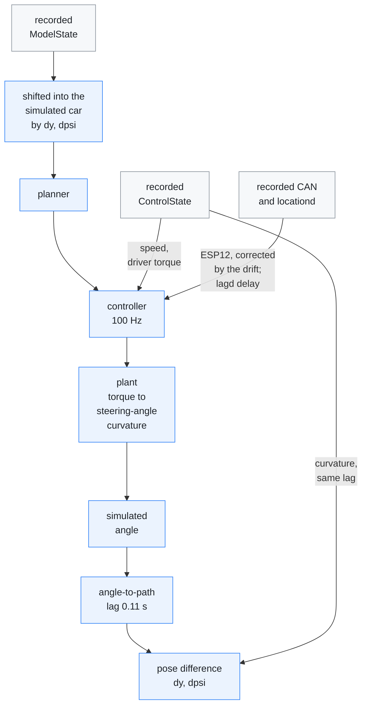
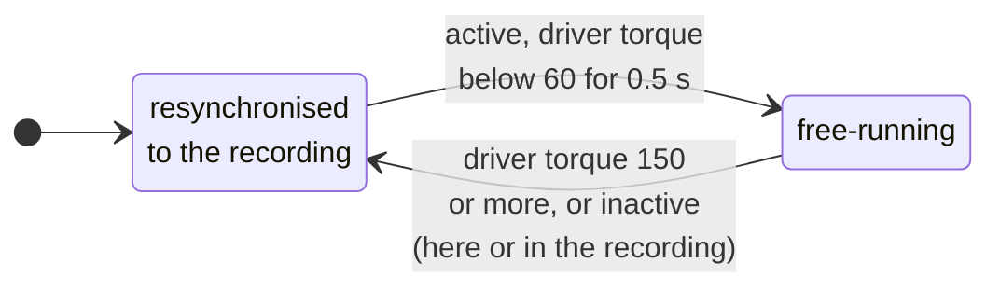

# Closed-loop replay

[← Documentation](README.md)

`diagnostics/replay_closed_loop.cc` replays a recording with the car's
response simulated, so a control change moves the car instead of being scored
against a frozen recording. Use it to rank controller and planner settings on
recorded drives before they reach the road.

Each step of the replay, from a recorded model frame to the simulated car's
drift:



The loop closes in two places: the simulated steering angle goes back into the
controller on the next tick, and the pose difference moves the next model frame.

## Why

`replay_planner` holds the car's response at whatever the recording captured.
Change a gain and the measured curvature does not move, so the error the
controller sees is fiction, and an offline prediction can point the opposite
way from the road.

The missing piece is not graphics, it is the plant. Curvature to the car's
pose is already in the code (`TorqueController::estimate_actual_curvature`);
only torque to lateral acceleration was missing.

## How

### Pose correction

The recorded perception is reused, not re-rendered. The simulated car
accumulates a pose difference against the recorded car,

```text
dpsi' = v * (k_path_sim - k_path_rec)
dy'   = v * (dpsi + lever(v) * (k_path_sim - k_path_rec))
```

`lever(v) = max(0, 2.33 - 0.0029 * v²)` m (`--camera-lever a,b`) is how far
the camera's path points outside the body axis per unit of curvature: the
tyres slip, so the camera does not travel along the body axis. It was
measured on 2026-10-22 from the lane direction at the camera against the
curvature in steady curves on five drives (51 km/h 1.74 m, 64 km/h 1.16 m,
78 km/h 0.78 m, 88 km/h 0.59 m). Before 2026-10-22 the replay used 0
(`--camera-lever 0,0` reproduces it exactly); the numbers in this document
from before then were made that way. The lane MPC's own rotation radius
(`lateral_planner`, `(L − a) − a/(L·cR)·v²`) is lower than the measured
lever, but in the replay with the lever, putting the measured value into the
MPC moved the car about 4.5 cm outward in both curve directions (right curves
+2.9 → −1.6 cm inside, left −2.3 → −6.9 cm) with the same overall RMS, and
upstream's 0 was worse (15.06 against 14.84 cm), so the MPC keeps its value.

`k_path` is the path the car travels: the steering angle's curvature delayed
by the angle-to-path lag (`--path-lag`, 0.11 s). The recorded side goes
through the same delay, so a simulation that matches the recording does not
drift. On the road the car's yaw follows the steering angle's curvature
0.10–0.11 s later (cross-correlation with the IMU yaw rate on five drives
from 2026-10-12 to 10-16, linear and learned feed-forward, 30–90 km/h; the
ESP12 yaw rate is 0–8 ms later than the IMU). A pure delay, a first-order lag
and the two combined reproduce it equally well (R² 0.94–0.98), so the replay
uses the delay.

Every model frame (the plan, the lane lines and the road edges) is rotated and
translated by that pose difference into the simulated car's frame before the
planner sees it. Real camera output, real model output, closed loop.

### Inputs from the recording

The controller gets what controlsd gets, apart from the steering angle:

- **ESP12** (yaw rate, lateral and longitudinal acceleration): decoded from the
  recorded CAN with controlsd's filter and parser, plus the extra turning of
  the simulated car (the path-curvature difference times `v` for the yaw rate,
  times `v²` for the lateral acceleration). The road-bank estimate
  (`lat_accel + yaw_rate * v`) therefore comes out as recorded, and with it
  the learned torque model's roll inputs and `live_bank_compensation`.
- **lagd delay:** from the recorded `LocalizationState`, used while it is
  estimated and under 2 s old (`ControlsTick::on_localization`).
- **Plan age:** from the frame's capture time, as controlsd measures it. The
  model output is about 64 ms later than the capture.

This holds while the deviation stays inside what the camera saw. A 2 m clamp
on `|dy|` (and 0.15 rad on `|dpsi|`) guards against reading the model's lines
beyond that.

### Resynchronising

Driver torque and inactive ticks are disturbances the simulation cannot
reproduce. Those ticks resynchronise to the recording, and the next
free-running segment starts from the real pose. A tick is inactive when the
simulated controller rests or when the recording shows the board did not
steer (disengaged, waiting at a stop); before 2026-10-19 only the first
counted, so a drive with long manual stretches was scored against the
driver's own steering (35 % of the scored ticks on
`2026-10-16--23-16-18-719`, RMS 0.0775 then, 0.0950 m/s² after; reading the
records in time order, also since 2026-10-19, gives 0.0941). As in
`controlsd`, a single invalid plan frame is held for up to 150 ms
(`PathHoldGate`).

The driver gate has hysteresis: 150 counts in, 60 counts and 0.5 s out. Driver
torque is noisy even hands-off, so a single threshold shatters a drive into
hundreds of sub-second segments; the hysteresis keeps the free-running
segments long.



### Plant

Torque to the steering angle's lateral acceleration (the curvature the
controller measures, times v²), as a pure delay and a second-order lag. The DC
gain is `1/kf`, the assumption the feedforward is already built on, times a
speed-scheduled correction for the error in that assumption.

The default plant is `wn = 16 rad/s`, `zeta = 3`, `delay = 0`, with this gain
(2026-10-17, [Evidence](#evidence)):

| Speed | 3 m/s | 8 m/s | 15 m/s | 25 m/s |
| --- | --- | --- | --- | --- |
| Gain | 1.05 | 0.385 | 1.04 | 1.74 |

The plant is accepted on **closed-loop reproduction**, not on an open-loop fit.
Run with `--open-loop`, the perception is exactly what the car saw and the
controller feeds back the simulated angle. If the plant is right, the
simulated lateral acceleration tracks the recorded one, and the simulated
angle follows the controller's request as late as the car's did.

### Metrics

`lane_y` is the lane-centre offset in the simulated car's frame. Unlike `dy`, it
does not refer to the recorded trajectory, so it does not favour whichever
configuration produced the recording. Use it for A/B, with the tracking error
and the fraction of ticks the rate limit binds.

### Running it

```sh
replay_closed_loop [options] <out.csv|-> <events.bin...>
```

The options are listed in
[Diagnostic tools](../diagnostics/README.md#replay_closed_loop). A 24-minute
drive replays in under a second on an M5. A sweep of 840 plant candidates over
a 6-minute drive takes about 30 s at 8-way parallelism.

## Evidence

**Identification (2026-10-17).** Fitting the recorded torque to the recorded
angle (output error, resynchronised like the replay, gains by least squares)
on five drives from 2026-10-12 to 10-16 explains the same 83% for delays of
0–60 ms and `wn` 6–16, so the fit cannot pin the timing down. The plant was
therefore chosen on timing: with the pose held (`--open-loop`) and the
controller each drive actually ran (linear on the three drives up to 10-15,
the learned model `k7_hev_v2` on the two of 10-16, as the routes carry it in
`models/lateral_nn.json`), how late the simulated
angle follows the controller's request, against the car:

| Plant | Linear | Learned model | Mean error | R² |
| --- | ---: | ---: | ---: | ---: |
| Car | 0.444 s | 0.563 s | | |
| `wn` 10, `zeta` 4 (before) | 0.548 s | 0.640 s | +0.093 s | 0.973 |
| `wn` 13, `zeta` 4 | 0.506 s | 0.601 s | +0.052 s | 0.975 |
| **`wn` 16, `zeta` 3** | **0.444 s** | **0.551 s** | **0.014 s** | **0.973** |
| `wn` 20, `zeta` 2 | 0.401 s | 0.510 s | 0.047 s | 0.968 |

The gains are the least-squares ones of the same fit; the 3 m/s node has no
data and keeps its value.

**Feedforward factor.** With the plant used before this identification, raising
the controller's `lat_accel_factor` to the torqued estimate (3.15) looked like a
12 cm push to the outside of left curves. With the re-identified plant the same
change is neutral (RMS 0.109 → 0.110 m). Before 2026-10-19, `--laf` also scaled
the plant, so a comparison made with it cancels out or, on a route that uses
torqued, moves only the plant; measure it again before relying on it.

The DC gain is fixed relative to `torque_lat_accel_factor` in the route's
`steering.json`; `--laf` changes the controller only. While the recording uses
torqued, the controller takes the learned factor and `--laf` does not reach
it (the tool warns); `--torque` replaces the learned values instead. So **a
feedforward factor can only be ranked with a plant identified on the same car
setup**. Check the open-loop R² against a gain scale before trusting such a
comparison.

## Limits

**What the numbers support.**

- A naive model that assumes the car follows the requested curvature exactly
  already explains most of the variance. Judge a plant by how much of the
  remaining error it removes, not by its R² alone.
- Rank configurations with this tool; do not read absolute numbers off it.
  Across plausible plants the absolute gap between two configurations moves,
  while their order holds.
- Replays before 2026-10-17 ran an earlier plant without the angle-to-path
  lag, the ESP12 and the lagd delay. Numbers quoted from them elsewhere (the
  lane-line filter weight) are not directly comparable with newer runs.
- The optimum `SAD` could not be found with the earlier plant: the sweep
  improved monotonically towards `SAD = 0`, which the road does not support.
  The angle-to-path lag makes lookahead matter again; this has not been
  re-checked.

**Structural.**

- Driver torque up to 150 counts is left in free segments as an unmodelled
  disturbance.
- The pose correction moves the plan's positions but not its yaw, which is
  all the Laneless law reads, so Laneless mode cannot be checked
  ([Lane-line filter](lane-line-filter.md#how)).

**Coverage.** The hands-off requirement is not a detail: it decides which
questions the tool can answer.

- Most straight driving falls in free segments, a third to a half of the
  moderate bends do, and almost no curve above 1 m/s² does.
- Real curves are curves the driver is co-steering, so the tool covers almost
  none of them. Lane keeping on straights and moderate bends is what it
  measures.

Feeding the recorded driver torque into the plant would raise that coverage and
must not be done. The driver's torque was produced by the driver reacting to
the real car, so replaying it hands the simulation the real trajectory through
the back door, and freezes the one response an A/B is supposed to change.

## Related

- [Lane-line filter](lane-line-filter.md): a filter weight chosen with this
  replay
- [Diagnostics](diagnostics.md): the open-loop planner and control-tick replays
- [Diagnostic tools](../diagnostics/README.md): the options of
  `replay_closed_loop`
- [Recording](recording.md): the event log the replay reads
- [Parameters](../params/README.md): `steering.json`, the tuning a replay can
  take from a route
