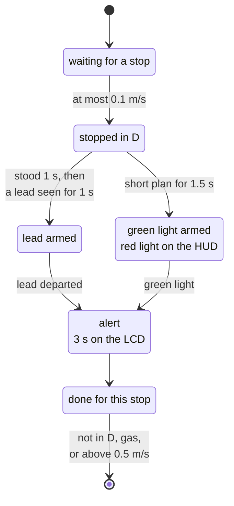
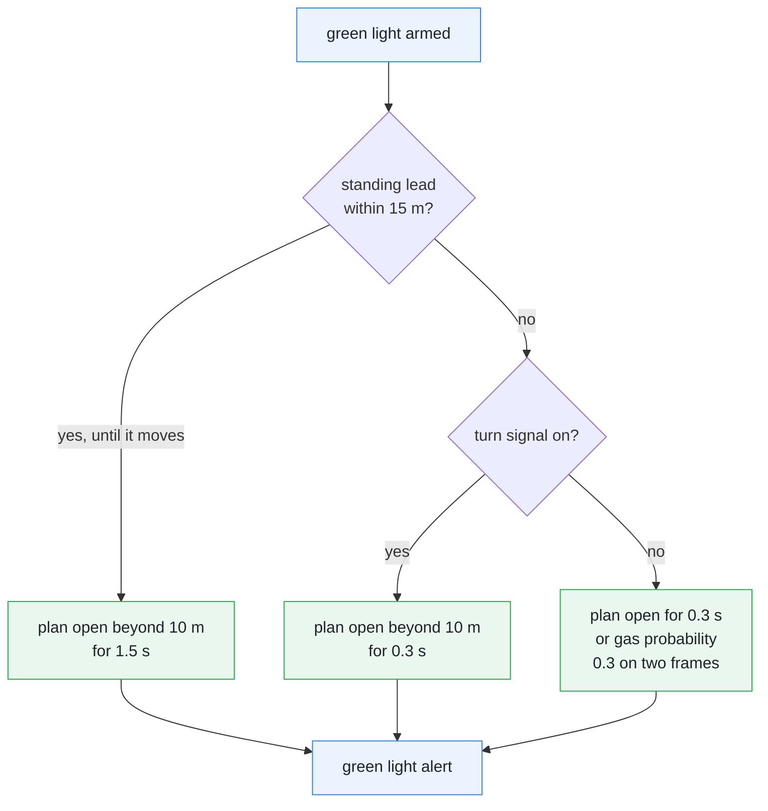

# Departure alerts

[← Documentation](README.md)

While the car waits at a stop in `D`, `controlsd` watches for two events: the
lead moving off, and the light turning green. It raises at most one alert per
stop, shown on the LCD for 3 s and sounded on the board speaker, whether or not
steering is engaged. The engage-refusal and take-control alerts, which share
the alert card and the speaker, are described here too.

One stop, from standing still to the alert (`controls/departure_alert`):

Leaving `D`, pressing the accelerator, moving above 0.5 m/s or a stale vehicle
state ends the stop from any state, not only from done. The lead and the green
light arm independently, so both can be armed at once; when both fire on the
same frame, the lead departure wins.

## Why

**No stop lines.** The deployed model (openpilot master supercombo) does not
output `stop_lines`, so the signal wait cannot be read from a stop line.
Instead the alert takes "the model plans to stop here" as the sign of a wait.
What fires the alert does not use stop lines either: the model's path opens
beyond 10 m, or the model expects the driver to press the accelerator. So a
wrong arming alone does not sound the alert: the model must also see the road
open or expect the car to set off.

**No radar.** The car's radar input is not used. The lead comes from the model:

- distance: the model's lead x minus 1.52 m, the camera-to-radar reference
  distance (`kRadarToCameraDistanceM`);
- relative speed: the model's lead speed minus the ego speed;
- the lead counts only at a probability of 50% or more.

Vision distance is noisy, so the distance and the relative speed conditions
must hold together for 0.3 s before a departure counts. The alert reads the
model's lead directly rather than the lead track, which lags by about 0.35 s
([Lead flow](lead-flow.md#limits)): the alert must not be late, and at a stop
the model's lead is already steady.

**No cluster chime.** Two CAN paths to a chime in the instrument cluster were
tried on the car and neither worked ([Cluster chime test](#cluster-chime-test)),
so the alerts use the LCD and the board speaker.

## How

### The stop cycle

`DepartureAlertDetector::update` runs on every `controlsd` tick:

- **Stopped.** The car counts as stopped at 0.1 m/s or less, in `D`, with the
  accelerator released.
- **Reset.** Any of these ends the stop and readies the next stop cycle: the
  gear leaves `D`, the accelerator is pressed, the car moves above 0.5 m/s, or
  the vehicle state goes stale.
- **Creeping.** Between 0.1 and 0.5 m/s the stop time and both trackers start
  again, but the close-lead guard and whether this stop has already alerted
  are kept.
- **One alert.** A stop gives one event at most. The alert stays on the LCD
  for 3 s.

If both events are found on the same frame, the lead departure wins, since it
is the more specific reason.

### Lead departure

A vision lead counts at 1-30 m. Once the car has stood for 1 s and the lead has
been seen for 1 s, the lead tracker is armed. The lead has departed when, for
0.3 s:

- its distance is more than 0.5 m beyond the closest distance seen since it was
  first tracked, and
- its relative speed is above 0.5 m/s.

A vision lead that drops out for less than 0.5 s counts as still there. Before
that hold, a single missing frame restarted the arming, so the lead tracker was
almost never armed.

### Green light

While stopped, a short plan, one that reaches less than 5 m in 10 s, means the
model plans to stop here. After 1.5 s of that, the stop counts as a signal
wait: the green light tracker is armed and the HUD shows a red traffic light.
If the path opens beyond 10 m before then, the timing starts again.

Once armed, the green light comes in one of two ways:

- the path opens beyond 10 m for 0.3 s;
- the model's probability that the driver will be pressing the accelerator in
  2 s (meta `GAS_PRESS`) is 0.3 or more on two frames in a row.

The tracker arms with a lead in front too. When the lead pulls away the path
opens the same way, so the alert is still right.

Two exceptions keep the green light from firing early:

- **A standing lead within 15 m** (seen in the last 1 s). The alert waits
  until the path stays open for more than 1.5 s, or the lead really moves away
  (distance +0.5 m and relative speed above 0.5 m/s), after which the usual
  conditions apply. The gas probability is not used while the lead stands. The
  vision distance of a standing lead wobbles by up to 1 m while its relative
  speed stays below 0.12 m/s, so both are checked together.
- **A turn signal on.** While the driver waits with a blinker on, the gas
  probability is not used, and the alert comes when the path opens.

Which condition confirms the green light, once it is armed:

### On the LCD and the speaker

A departure alert shows on the alert card for 3 s, titled `LEAD VEHICLE MOVING`
or `GREEN LIGHT` ([HUD](hud.md#alert-card)). It plays the `signal_changed`
sound, three bright notes (B5 D6 G6), and leaves the log line
`overlayd: alert=signal_changed`. How `overlayd` picks and plays the sounds,
and what sets their volume, is in [HUD](hud.md#alert-sounds);
`alert_sound_preview` writes them to WAV files
([Diagnostics](diagnostics.md#alert-sounds)).

### Engage refusal

When the car or control conditions refuse an engage, the alert card shows
`UNABLE TO ENGAGE` with the reason on the line below for 3 s, and the `unable`
sound plays (one note twice, then down a fourth: A5 A5 E5). It matches
openpilot's refuse alert.

Right after `SET`, the Panda reports `not ready` or `controls off` until its
next health reply, which is normal, so for these two the refusal waits up to
1 s:

- If the Panda allows control within that time, the engage goes ahead and
  only the `engage` sound plays.
- If it does not, or another blocking condition is left once the Panda is
  ready, the engage is refused then.

A condition that would also end steering while engaged (calibration, MDPS
fault, paramsd) refuses at once and names itself, without waiting for the
Panda, and also while the car stands. Before 2026-10-22 such an engage was
first accepted: while waiting for the Panda it showed as engaged for up to
0.16 s, and at a standstill it stayed engaged until the 3 s soft disable.

### Take control

The take-control warning (`overlayd: alert=take_control`) plays the `unable`
tone once when it comes on, and stays on the alert card while it is on.
It matches openpilot's alerts:

- **`TAKE CONTROL: CALIBRATING / RECALIBRATING / CALIB INVALID`.** The camera
  calibration is not complete.
  - Engaging is refused (`UNABLE TO ENGAGE` / `CALIBRATING`).
  - If this happens while engaged (a mount change is detected, for example),
    steering goes on for 3 s more with the warning shown and then disengages
    (openpilot's soft disable). If the calibration completes again within 3 s,
    it does not disengage. The 3 s keep counting through a stop or a short
    invalid path in between, as in openpilot.
- **`TAKE CONTROL: STEER UNAVAILABLE`** (openpilot's `steerTempUnavailable`).
  While engaged, the MDPS reported a fault (MDPS12 `ToiFlt` or `ToiUnavail`),
  the driver was not holding the wheel, and at least 1.5 s had passed since
  they let go.
  - During the fault, steering rests (torque 0, the request bit off) and
    engaging is refused. If the fault does not clear within 3 s, control
    disengages.
  - If the fault came while the driver was holding the wheel, had just let
    go, or the car was stopped, only `STEERING FAULT` shows, with no warning
    of a disengage, and steering resumes when the fault clears.
- **`TAKE CONTROL: MODEL LOST / CAR STALE / PLAN STALE / PLAN INVALID /
  PANDA CTRL OFF`.** An input stopped while engaged: the model went stale or
  invalid, the car's CAN went stale, the plan went stale or invalid, or the
  Panda took back `controls_allowed` after the engage.
  - Steering rests at once (torque 0, the request bit kept), since the old
    input must not steer for 3 s.
  - If the input is back within 0.5 s, nothing is shown. Short gaps of this
    kind (up to 0.3 s in the recordings) are normal.
  - After 0.5 s the warning shows. If the input is back within 3 s of the
    stop, steering resumes; otherwise control disengages (openpilot disengages
    on `commIssue` and `canBusMissing`).
- **`TAKE CONTROL` / `Turn exceeds steering limit`** (openpilot's
  `steerSaturated`). All of these hold:
  - the speed is 36 km/h or more;
  - for more than 0.4 s, the target curvature is cut by the lateral
    acceleration limit (3.0 m/s²), or the output stays at its limit;
  - the plan's target lateral acceleration (before the cut) is above
    1 m/s² and at least 1.2 times the actual one;
  - the driver has not held the wheel in the last 2 s.

## Evidence

**Arm time.** The signal wait used to need 3 s of standing. On the car on
2026-10-04 that missed a light that turned green 2.7 s after the stop, so the
wait was cut to 1.5 s.

**Gas probability.** The drives of 2026-10-04 replayed with the fp32 model:

- At all eight green lights with no lead, the probability passed 0.3 within
  0.25 s of the green, including the two where the path never opened.
- During red lights it stayed below 0.21.
- The board's U16 model (the SmoothQuant build) passes 0.3 at six of the eight
  on the same input. At the other two, quantisation flips the model's decision
  to set off.
- With a lead standing in front it does not rise even at a green light; it
  rises when the lead moves.

**False alarms.** On 2026-10-05 the recordings up to that day (ten of them)
held two false alarms, which led to the two exceptions:

- Behind a car stopped 3 m ahead, the path opened for 0.3-0.5 s and closed
  again, and the alert sounded 23 s early. The standing lead's vision distance
  wobbled by up to 1 m, its relative speed stayed below 0.12 m/s.
- Waiting to turn left with the blinker on, the model saw the straight-ahead
  signal, the gas probability rose to 0.33, and the alert sounded 37 s early.

Replaying the recordings with the exceptions:

- The two false alarms became alerts 1.2-1.3 s before the car set off.
- Stops with no lead did not change.
- Eleven stops behind a lead lost their alert. In each of them the driver had
  already pressed the accelerator almost at the moment the lead set off.

**Steering faults.** With the K7's large-angle fault avoidance on, the
recordings since 2026-10-04 hold two MDPS faults of 0.1 s each, at highway
speed.

**Saturation.** `Turn exceeds steering limit` never applied in three drives on
the car, 2026-09-25 to 2026-09-27.

### Cluster chime test

The current setup sends no CAN for a cluster chime:

- In openpilot_c2, `chimeAtResume` does not use the car's cluster: the
  device's own `soundd` plays `dingdong.wav`.
- `CF_Lkas_SysWarning` in the K7's `LKAS11` (`0x340`) is not a separate chime
  but the steering and LDWS warning state. Using it for a chime can make icons
  blink or warning lights come on.

On 2026-07-30 on the K7 YG HEV:

- The stock `LFAHDA_MFC` (`0x485`) arrived from the camera on bus 2 as
  `03 00 00 00` at about 20 Hz.
- With the stock forwarding suppressed, `HDA_Chime` was sent alone for 300 ms.
- `LKAS11.CF_Lkas_SysWarning=9`, as used on the Grandeur IG, was sent.
- `CF_Lkas_SysWarning=3` and `CF_Lkas_LdwsSysState=3`, as on openpilot_c2's
  K7 YG path, were sent for 2 s.
- The last test was in gear `D`, with the cluster speed and all four wheel
  speeds at `0 km/h`.
- No test had Panda blocks, CAN send errors or checksum errors, but neither
  the cluster display nor the chime responded.

So the K7 YG HEV does not use these two CAN paths for a cluster chime, and the
departure alerts use the LCD and the board speaker.

## Limits

- **Quantised model.** The board's U16 model misses the gas probability at two
  of eight green lights with no lead; there the alert waits for the path to
  open.
- **Driver first.** Behind a lead the alert waits for the lead to move, so a
  driver who presses the accelerator as the lead sets off ends the stop before
  any alert (eleven stops in the replay).
- **One per stop.** After an alert, no second departure alert comes until the
  stop cycle resets.

## Related

- [HUD](hud.md): the alert card, the alert sounds and the red traffic light on
  the LCD
- [Lead flow](lead-flow.md): the lead track the alert deliberately does not
  use
- [K7 Panda port](k7-panda-port.md): the K7's brake signals and the CGW1 body
  signals, among them the blinkers the alert reads
- [Runtime options](runtime-options.md): the alert sound variables and the web
  console's device settings
- [Parameters](../params/README.md): `alert_volume_percent` in
  `params/display.json`
- [Diagnostics](diagnostics.md): `alert_sound_preview`
