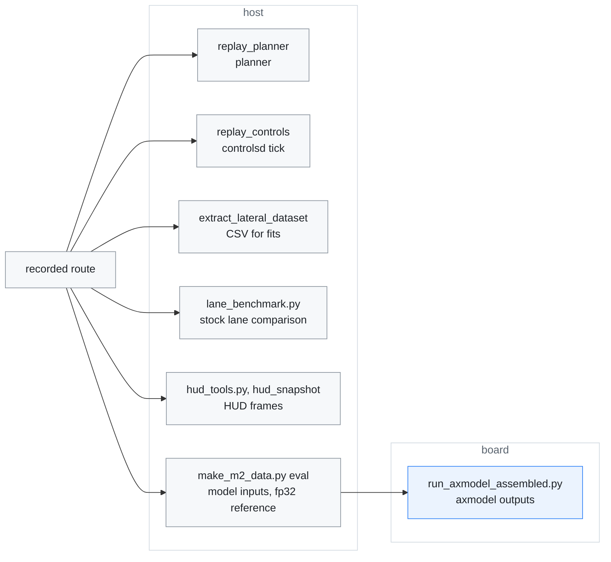
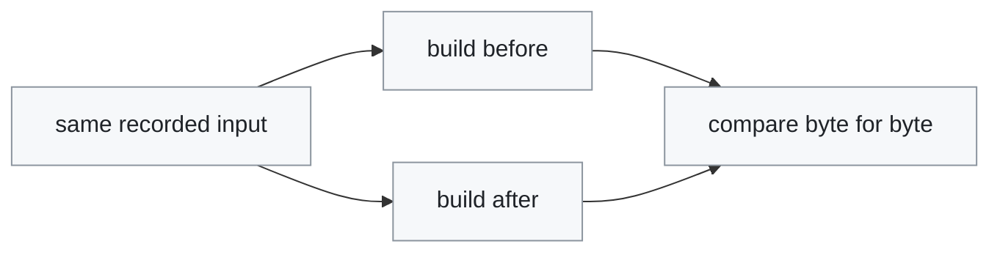
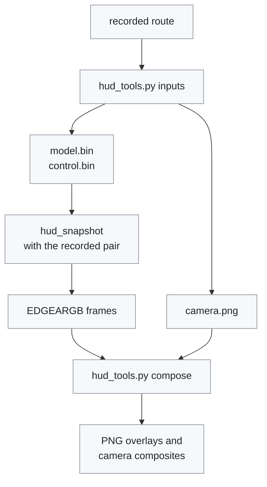

# Diagnostics

[← Documentation](README.md)

Procedures for the diagnostic tools, and the results they measured. Read it to
replay a recorded drive through one part of the runtime, to check that a
refactor left the output unchanged, or to verify a model swap on the board. The
tools themselves, their options and how to build them are in
[Diagnostic tools](../diagnostics/README.md).

Most procedures start from a `recordd` route. The host tools need only the
route; the model checks need the board's NPU:



## Lateral planner replay

`replay_planner` re-runs `LateralPlanner` over a recording and writes what the
planner asked for, one row per `ModelState`. The MPC has no board-specific
dependency, so a recorded route can be re-planned without the board:

```sh
cmake --build build-host --target replay_planner -j2
./build-host/bin/replay_planner out.csv <route>/events/*.bin
```

Columns include the recorded and re-planned desired curvature, the MPC's own
`target_curv`/`heading0`, the lane observations behind the plan, and the
`laneless`/`mpc_valid` flags. The re-planned curvature is lag-adjusted as
`controlsd` does it: the plan's age counts from the frame's capture time, which
includes the model's latency, and the delay and roll are the ones the recorded
`LearnerState` says were in use (`steer_actuator_delay` for routes that predate
its `plan_delay_s`). On the 10-18 routes this reproduces the recorded desired
curvature 2 to 2.5 times closer, tick by tick, than the age from the model's
output with the fixed delay did. The options are listed in
[Diagnostic tools](../diagnostics/README.md#tools). `--laneless` and `--lane`
re-plan the same route both ways without editing `params/steering.json`, and
lane changes run only with `--vehicle`.

For a planner refactor, run the route with `--exact` through the builds before
and after it. Two builds that plan identically give byte-identical files:

```sh
R=<route>; ./build-host/bin/replay_planner --exact --vehicle --lane \
  --steering $R/params/steering.json out.csv $R/events/*.bin
```

## Control tick replay

`replay_controls` runs a recording through `ControlsTick`, the logic of one
controlsd tick, at 10 ms ticks. The recorded CAN, `ModelState`, `PandaState`
and `Localization` records go in, the planner is computed in place and the
clock is the tick time, so identical code gives a bit-identical `--dump` and
digest on the same compiler. The Mac's clang and the board's GCC fuse
multiply-adds in different places (neither build sets `-ffp-contract`), so a
digest from the Mac can differ from the board binary's in the last bit of a
few ticks (11 of 6001 on `2026-10-18--01-05-10-822`). Check that a change keeps
the board's output with the tools built by `scripts/run_host_tests.sh --linux`
(`build-linux-test/bin`), which use the board's compiler. The dump has a line
per tick: the state, the torque and curvature, the
HUD flags, the wheel angle, the driver torque, the torque controller's
feed-forward and its friction share (`fr`, normalised torque; nnlc subtracts
it from the target, see [Lateral NN](lateral-nn.md)), the tick time and the
frames sent. It also reports how often
engaged, active and desire agree with the recorded `ControlState`, and warns
when, while both steer, the path source (`Laneless`) or the use of the learned
torque model differs in more than 10 % of the ticks: the route's `params/` and
`models/` copies are taken when the route starts, so a setting changed while
driving is not in them. A route engaged before recording started needs
`--force-engaged`. The cruise state is estimated from the driver's SET/RES, so
to look at the cruise, start the replay before that session begins.

```sh
R=<route>; ./build-host/bin/replay_controls --steering $R/params/steering.json \
  --cruise $R/params/adaptive_cruise.json --dump out.txt $R/events/*.bin
```

`--lateral-nn` loads the learned torque model ([Lateral NN](lateral-nn.md)):
the route's own copy is `$R/models/lateral_nn.json`. It takes effect only when
the `--steering` file turns `nn_feedforward` on, so two runs with
`--force-engaged`, one with the switch off and one with it on, compare the two
feed-forwards on the same inputs. With the switch on and no model, the tool
warns and runs the linear feed-forward. `replay_closed_loop` takes the same
option.

## Refactor checks

Three tools give byte-identical output from two builds whose behaviour did not
change, so a refactor is checked by running the same input through the build
before and after it and comparing the files:



| Tool | Output compared | Used for |
| --- | --- | --- |
| `replay_planner --exact` | every `LateralTarget` field as `%a` hex floats | planner refactors |
| `replay_controls --dump` | the dump and the digest | controlsd refactors |
| `hud_snapshot` | the `EDGEARGB` frames, within one compiler | HUD refactors ([HUD snapshots](#hud-snapshots)) |

## Stock lane comparison

The K7's stock camera keeps reporting its own lane lines in `LKA14` while
edgepilot drives. `tools/model/lane_benchmark.py` uses them as a second,
independent detector:

```sh
python tools/model/lane_benchmark.py <route_dir> [<route_dir> ...] --out DIR
```

It compares frames where both see the lanes clearly (stock quality 3, model
lane probability above 0.7, above 30 km/h). It leaves out 2 s around lane
changes, blinkers and the moments the car is on or crossing a line.

| Column | Meaning |
| --- | --- |
| `c0 rms L/R` | position difference at 1.5 m, per side |
| `corr L/R` | correlation of the in-lane wander with the means removed |
| `centre` | stock minus model lane centre; negative means the stock camera puts the car further right |
| `width` | stock minus model lane width (median) |
| `c1 str` | heading difference on straights (above 50 km/h, under 3° steering, under 0.6°/s yaw rate) |

The scenes are drawn on the video frames: model lanes solid orange, stock
lanes dashed blue. The stock line is its 1.5 m position and heading extended
straight, so it drifts on curves.

Results on the six drives of 2026-10-10 to 10-15, 121 minutes compared:
- position RMS 7–15 cm, wander correlation 0.80–0.90, 0.64 on the 10-15 night
  drive;
- lane-centre difference −7 to −9 cm on the pose-calibration drives and −2 to
  −4 cm after the switch to flow calibration;
- in 15 scenes where the two disagreed by more than 25 cm, the model's line
  was on the paint in 10 and the stock camera's in 3;
- road text, overpass shadows and lane widening pulled the stock line inward.

## Lateral dataset extraction

`extract_lateral_dataset` replays a recording and writes one CSV row per
`ControlState` record: 100 Hz from 2026-10-19; before that `recordd` read the
latest snapshot once per loop and missed about 4 % of them, in short runs where
it handled a video frame. It joins the CAN
state decoded by the runtime's own `vehicle_can`, so signs and scaling match
the board exactly. Records are read in time order
(`recording/time_ordered_events.h`), so each row sees the CAN and the model
frame that had arrived by then:

```sh
cmake --build build-host --target extract_lateral_dataset -j2
./build-host/bin/extract_lateral_dataset out.csv <route>/events/*.bin
```

A file truncated by the tmpfs fill stops at the zero-filled gap, with the byte
offset on stderr.

The columns are:

- time, wheel speed, `active`/`desire`/`block`, steering angle;
- driver and applied torque (`tq_norm` is sign-corrected and divided by
  the torque limit, 384);
- ESP12 lateral and longitudinal acceleration and yaw rate;
- the live bank estimate and its roll equivalent;
- requested and measured curvature;
- the NNFF-style future values `la_p03..p15` / `roll_p03..p15`, taken from the
  recorded model plan;
- the EPS state from MDPS12: `toi_active` (the MDPS takes the LKAS torque),
  `steer_fault`, and `eps_out_tq`, the torque the MDPS actually applies (raw
  minus 2048, in the DBC's 0.1 units; 0 while MDPS12 is stale);
- `blinker`, for picking training samples;
- `nn_ff`, set where the learned torque model gave the feed-forward
  (`hud_flags` bit 12), so training can leave those ticks out.

The event log is not in time order: recordd writes the queued CAN first and
then the latest state snapshots, each stamped by its publisher. On the 10-15
route a `ControlState` is written up to 14 ms after the CAN that follows it.
`ModelState` is up to 21 ms out of order there, and `Localization` up to
39 ms. Read in file order, a quarter of the rows lost the speed and the EPS
state, because the CAN looked newer than the row. 9 % of the active rows also
had a model frame from the future, and the training dropped those. Reading
through `TimeOrderedEvents` gives 15 % more training samples.
`TimeOrderedEvents` reorders within a 0.5 s window, so a route is never held
in memory.

Two deviations from the runtime are deliberate:

- The bank filter runs at row rate with a `dt`-derived alpha, rather than the
  controller's fixed 100 Hz step.
- Future lateral acceleration is `v * dpsi/dt` off the plan's yaw angles,
  because the recorded `ModelState` has no plan acceleration.

Both were checked against known results. Straight-line bank reproduces -0.178
on the 2026-08-28 route (logged: -0.176), and the total-least-squares torque
fit over the 2026-08-19 route returns `latAccelFactor` 4.00, the value that
route was fit to.

The separate [edgepilot-nnlc][nnlc] repository trains the
[lateral NN](lateral-nn.md) on these files; its [data format][nnlc-format]
describes every column.

## HUD snapshots

`hud_snapshot` runs the HUD renderer off-line, either on synthetic scenes or on
a recorded moment, and `tools/ui/hud_tools.py` prepares its input and turns its
frames into pictures:



Without input, `hud_snapshot` draws 27 scenarios at the HUD's 640x480 landscape
size: driving, alerts, cards, warnings and the less common branches (soft
disable, panda fault, radar-only lead, bar TPMS, engaged but blocked, ...). It
writes each frame as an `EDGEARGB` file and prints the draw timings:

```sh
./hud_snapshot --out /tmp/hud
```

- **Portrait.** To check the board's drawing path, draw with `--portrait`
  ([Diagnostic tools](../diagnostics/README.md#tools)).
- **Builds.** The renderer needs no board library, so the tool builds on the
  host as well as in the container build with
  `-DEDGEPILOT_BUILD_DIAGNOSTICS=ON`. Time it on the board, where the numbers
  matter (the host is 20-40x faster).
- **Refactors.** Frames from two builds of the same compiler are byte-identical
  when the drawing did not change, which is the check used for HUD refactors.
  Compare the host and the container build separately: GCC fuses multiply-adds
  that clang leaves apart.

To draw a recorded moment instead of the synthetic scenes:

1. `python3 tools/ui/hud_tools.py inputs <route_dir> <out_dir>` extracts a
   recorded `ModelState` / `ControlState` pair, plus the matching camera frame
   (decoded from the keyframe before it) when the route copy has its
   `segments/`.
2. `hud_snapshot --model model.bin --control control.bin --out /tmp/hud` draws
   that pair.
3. `python3 tools/ui/hud_tools.py compose /tmp/hud [camera.png]` turns the
   frames into PNGs and composites them over the centre 4:3 of the camera
   frame, as the screen shows it.

### Alert sounds

To hear a sound change on the host, write every alert sound `overlayd` plays
to WAV files (`/tmp/alert_engage.wav`, ...) with
`alert_sound_preview --out /tmp/alert`
([Diagnostic tools](../diagnostics/README.md#tools)). On the board,
`pkill -USR1 -f "[.]/overlayd"` plays them one by one through the speaker.

## Model on the board

A model swap changes three things at once: the warp input, the temporal
plumbing, and the network. The checks need the NPU, so the model runs on the
board with edgepilot stopped.

`tools/model/axmodel/make_m2_data.py eval` builds the fp32 reference with the
runtime's queue semantics from a MaixCAM2 recording, and
`tools/model/axmodel/run_axmodel_assembled.py` runs an axmodel on the same
inputs on the board. Compare the two on the slices that drive control (plan
lateral offset, lane positions) rather than on the raw vector, and check that
the hidden-state slice evolves smoothly: a dead temporal buffer still produces
plausible single-frame output.

Measured when the master axmodel was brought up (a 200-frame board replay):
the board output against the host axengine runner gave a plan lateral
difference of 0.0008 m at 2 s, and a hidden-state cosine similarity of 0.9994.

## Related

- [Diagnostic tools](../diagnostics/README.md): every tool, its options and how
  to build it
- [Host tests](../tests/README.md): the unit tests and Python checks
- [Closed-loop replay](closed-loop-replay.md): replaying a drive with the car's
  response simulated
- [Rehearsal](rehearsal.md): replaying a recorded drive through the whole
  runtime on the board
- [Lateral NN](lateral-nn.md): the torque model trained on the extracted
  dataset, which `replay_controls --lateral-nn` loads
- [Recording](recording.md): the route layout the tools read
- [HUD](hud.md): what the renderer that `hud_snapshot` runs draws, and the
  alert sounds
- [Model pipeline](model-pipeline.md): the warp and the NPU the model runs on
- [axmodel pipeline](../tools/model/axmodel/README.md): building the model a
  swap verifies
- [Runtime options](runtime-options.md): the runtime's switches
- [Departure alerts](departure-alerts.md): which events sound the alerts that
  `alert_sound_preview` writes
- [K7 Panda port](k7-panda-port.md): the K7 CAN signals that the replays decode
  with `vehicle_can`

[nnlc]: https://github.com/cwal1220/edgepilot-nnlc
[nnlc-format]: https://github.com/cwal1220/edgepilot-nnlc/blob/main/docs/data-format.md
