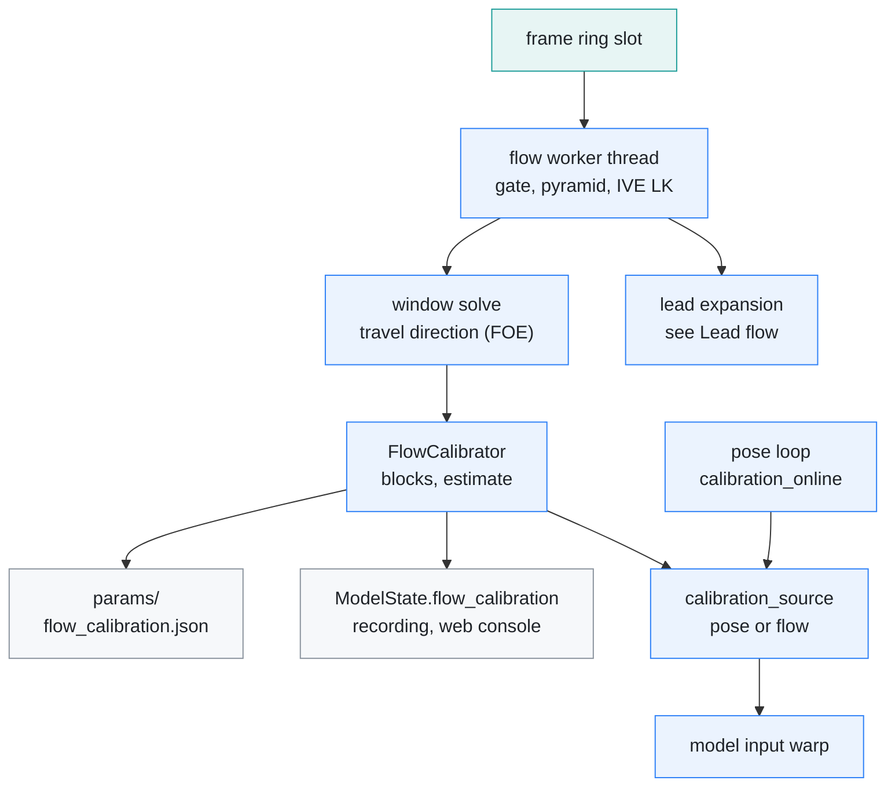
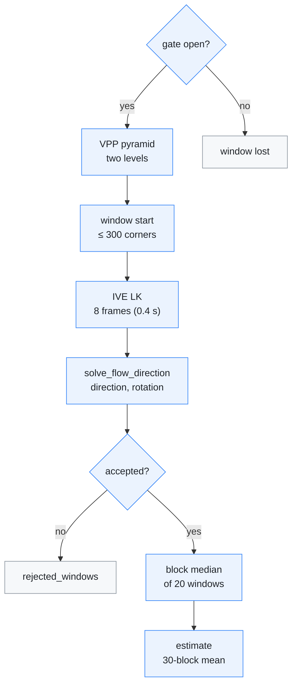
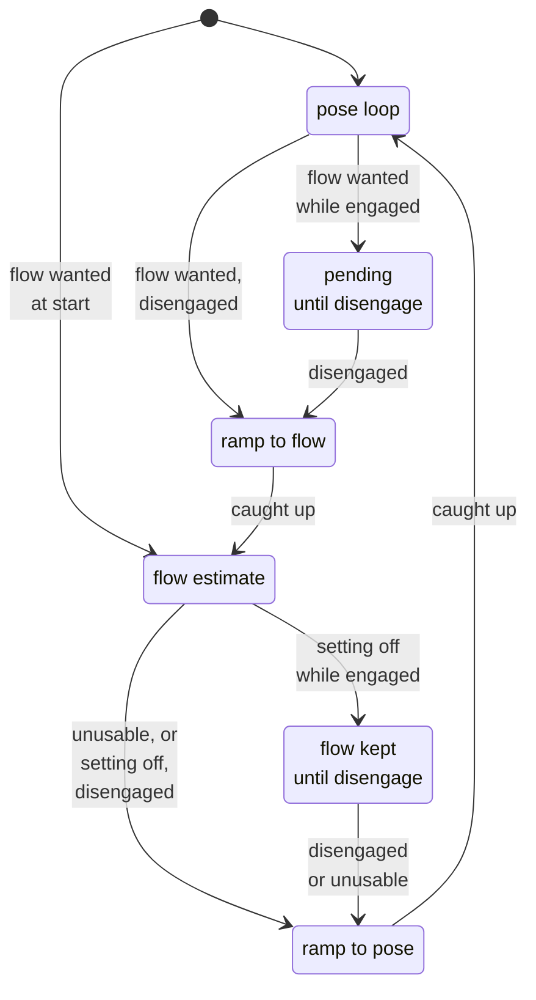
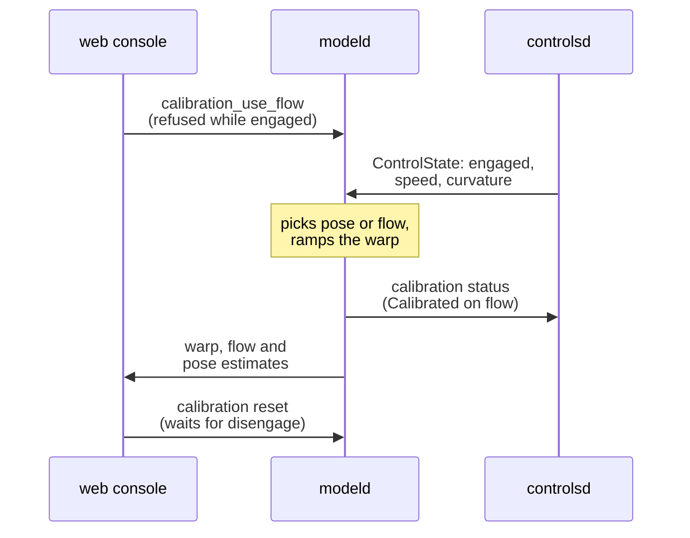
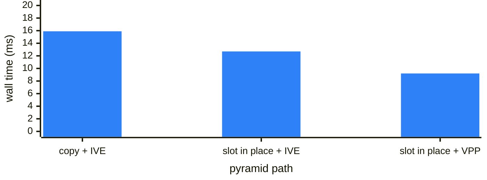

# Flow calibration

[← Documentation](README.md)

`modeld` warps the camera into the model's frame with a roll, pitch and yaw
calibration. The flow calibrator measures pitch and yaw straight from the image,
as the direction the camera actually travels, whereas the online calibrator
(`model/calibration_online`, a port of openpilot's `calibrationd`) learns them
from the model's own pose output. It runs on every frame of the GDC zero-copy
path and is recorded; the device setting `calibration_use_flow` (web console,
default off) makes the warp take its pitch and yaw.

Where the measurement goes, each model frame:

The same flow worker also measures how fast the lead car's image grows; see
[Lead flow](lead-flow.md). `EDGEPILOT_FLOW_CALIB=0` or an IVE that cannot be
set up turns the worker off, and the lead flow with it
([Outputs](#outputs)).

## Why

`calibrationd` closes a loop through the model. Every sample is the current warp
composed with the travel direction the model's pose reports, so the loop settles
where the pose says "straight ahead". That works when the pose follows the warp
one to one. On the MaixCAM2 it does not:

- In a controlled fp32 test, rotating the warp by 1° moved the pose's travel
  angle by only 0.185° and the lane direction by 0.31°.
- The quantised model behaves the same; quantised minus fp32 is 0.01°.
- With a restoring gain of about 0.18, a small pose bias moves the fixed point
  by bias / 0.18.
- On the 2026-10-10 drives the yaw crept back to about -0.5° after every reset.
  The measured direction of travel was about -0.05°.
- The offset is not a constant: it was -0.18° on the morning mount and about
  -0.5° in the evening.

The weak response belongs to our images, not to the model alone. On a public
comma segment from an OS04C10 device (the same sensor family, night, city
streets), the same fp32 model follows a warp change by about 0.5 (travel angle)
and 0.85 (lane direction). On our footage it is 0.15 to 0.32 and 0.2 to 0.48,
day and night.

- **Resolution:** resampling the comma footage to our pixel density does not
  change it. Neither does building both inputs from one camera, or degrading our
  own footage 2.5 times further. So a higher-resolution frame ring would not
  help.
- **Highlights:** clipping the brightest 10% of the comma footage halves the
  travel-angle response, while a linear 2x brightening does not change it. Our
  night exposure clips highlights.

The flow calibrator does not ask the model. It measures where the camera is
actually going: the focus of expansion (FOE). The result is an absolute
measurement with no feedback loop, so a bias cannot build up and averaging only
removes noise.

## How

A measuring window starts on a gated frame and follows its points for 8 frames.
Each accepted window is one sample of the travel direction:

| Step | Where | Notes |
| --- | --- | --- |
| Gate | `flow_gate_open` | ≥ 40 km/h, yaw rate (curvature × speed) ≤ 0.25°/s, no blinker or desire, fresh CAN |
| Pyramid | VPP (`modeld`'s own sync queue) | 640x360 and 320x180 in one call, read straight from the ring slot. The ring slot itself is the full-resolution level, with no copy |
| Corners | IVE Sobel + CornerDet response, then `pick_flow_corners` | at each window start, strongest response per 8x8 cell of the 640x360 road band, up to 300 points |
| Tracking | IVE pyramidal LK | one frame at a time for 8 frames (0.4 s), about 5 ms of IVE per frame |
| Solve | `solve_flow_direction` | windows whose median point displacement is under 1 px are dropped first; then travel direction (a, b, 1) plus a small rotation, Sampson epipolar residuals, Cauchy-weighted Gauss-Newton, then two rounds of trimming at three robust scales (1.4826·MAD) |
| Aggregate | `FlowCalibrator` | median of every 20 windows (a block), mean of the last 30 block medians, status 2 after 3 blocks; a mount change keeps only the newest blocks |

Yaw is `atan(a)` and pitch is `-atan(b)`, the same convention as the
calibration's rpy. A window is accepted when at least 50 tracks survive all 8
steps, their median displacement is at least 1 px, at least 40 fit the solution,
and the camera turned less than 0.5° in the window.

- **Parallax gate:** with no motion, every direction fits the epipolar
  constraint. A parked desk test with the gate forced open accepted 45% of its
  windows with random directions.
  - Real windows at 40 km/h and up have a median displacement of 0.85 px
    (night) and 0.32 px (day) at their 1st percentile.
  - Below 1 px the yaw leans 0.1° to 0.2° (only distant points are left).
  - The 1 px gate drops 2.5% of night windows and 8% of day windows.
- **Mount change:** a block median is 20 windows. Its spread within one drive
  is 0.08° (median over 13 drives). When the three newest blocks all sit more
  than 0.5° to the same side of the older blocks' mean, and within 0.5° of each
  other, the older blocks are dropped. The estimate then follows the new mount
  within three blocks instead of 30.
  - Until 2026-10-22 the threshold was 1°. That evening the board went back
    into the car with the camera turned 0.8° in yaw and 0.7° in pitch, and the
    saved estimate moved 0.05° in five minutes. Meanwhile the car ran more than
    30 cm left of the lane centre, until the calibration was reset by hand.
  - At 0.5° the third new block (306 s, town driving gives one block every 1–4
    minutes) catches it.
  - Down to 0.4°, no block sequence in the 340 blocks of the drives since
    2026-10-12 triggers it.

### Load on the board

Per gated frame, the flow worker spends about 1.2 ms of CPU, measured in the
board replay with the VPP pyramid ([Time per frame](#time-per-frame)). That
includes the corner pick, about 2 ms at each window start, and the solve, both
spread over the window's frames. It comes to about 2.4% of one core while
driving straight, and nothing otherwise.

The IVE does the LK, about 5 ms per frame. It is otherwise unused. The pyramid
goes to the VPP queue that `modeld` holds anyway; see
[Hardware engines](runtime.md#hardware-engines).

`modeld`'s model loop hands each frame to the flow worker thread and does not
wait for it. When three frames are queued, the oldest is dropped, and the
window in progress with it.

### What the IVE actually does

The AX630C IVE (MSP v3.0.0) differs from its header documentation in ways that
shaped the design (`platform/maixcam2/maix_ive_flow.h`):

- **LK start points:** they are given in top-level pixels, the level-0
  position / 2^(levels - 1). The output points are level-0 pixels.
- **LK range:** the total displacement clips at ±8 px, and negative moves come
  back +16 px.
  - `bUseInitFlow` does not extend the range.
  - So the tracker steps one frame at a time, unwraps the result, and drops
    tracks that move more than 7.5 px.
  - Within range the LK is precise: synthetic shifts come back to a 0.002 px
    median, and real frames agree with OpenCV to 0.08 px median.
- **Corners:** `AX_IVE_CornerDet` never fills its corner list in Shi-Tomasi
  mode.
  - Its response image equals the 5x5-window minimum eigenvalue exactly, so the
    points are picked on the CPU from that image.
  - Sobel accepts only a U16C1 output, but the values are signed.
- **Query:** `AX_IVE_Query` with block set returns `AX_ERR_IVE_QUERY_TIMEOUT`
  after a few ms while a task is still running, and has to be asked again.
  - That macro is the full `AX_DEF_ERR` code `0x80150054`, not the enum value
    `0x54`.
  - Not asking again leaves tasks running and makes the following ones fail.
- **Scalers:** the IVPS scalers (TDP/VPP) have four sync queues per board, one
  pair per process that calls `AX_IVPS_Init`, and the runtime takes all four.
  Inside `modeld` the flow calibrator uses `modeld`'s own queue; a fifth
  process gets `AX_ERR_IVPS_BUSY`.
- **VPP output:** the VPP refuses YUV400 output, so the levels come out as NV12.

### Using the estimate

`model/calibration_source` picks what the warp uses, each model frame:

- **Setting off (default):** the pose loop's value, unchanged from before.
- **Setting on, flow estimate usable:** pitch and yaw from the flow estimate,
  roll from the pose loop (flow cannot see roll).
  - Usable means status 2 (3 blocks or more), a standard deviation of the block
    medians under 0.5°, and pitch and yaw inside upstream's calibration limits.
  - Until then the pose loop is used, so a fresh install calibrates the same
    way as before.
- **While engaged:** a change of the setting, in either direction, waits for
  disengage (the web console refuses it too), and so does an estimate that
  becomes usable mid-drive. Only an estimate that becomes unusable falls back
  to the pose loop at once, even while engaged. An applied estimate that moves
  (a new block, a mount change) is followed while engaged too.
- **Hysteresis:** the estimate starts being used below a 0.5° block-median
  standard deviation and stops above 0.8°, so it does not toggle at the edge.
- **Ramp:** when the source changes or the flow estimate moves, the warp moves
  by 1/5 of the remaining difference per second, but at least 0.05°/s.
  - The model sees two frames and a 4.8 s feature history, so a step would jerk
    the path.
  - A 0.3° switch takes about 6 s, 1° about 12 s and a 2° mount change about
    15 s (within 0.25° after 10 s).
  - Back on the pose source, once caught up, the warp follows the pose loop
    directly again.

The warp's source moves between these states. "Flow wanted" means the setting
is on and the estimate is usable; a moving flow estimate ramps the warp without
leaving the flow state. A setting change waits for disengage in both
directions, while an estimate that becomes unusable starts the ramp to the pose
loop at once:

The pose loop pauses while the flow estimate drives the warp, and while the warp
ramps between the two. Like upstream, it composes each sample onto its own
output, assuming the model saw an image warped with that output. With another
value in the warp that assumption breaks:

- there is no feedback through the warp, so the loop would settle at the flow
  value plus the model's own pose bias;
- the pitch-yaw cross term of the rotation composition would build up roll
  block after block (about 0.05°/h at -1° pitch and a 0.1° bias), with nothing
  pulling it back.

Paused, the loop keeps its last estimate and its saved `calibration.json`. Back
on the pose source it carries on from there. `model/calibration_online` stays a
plain port of upstream; `model/calibration_service` decides when to feed it.

`ModelState.calibration` always describes the source the warp used. On the flow
source it reports Calibrated with the estimate's block count and standard
deviations, so engagement is not held back by the pose loop.

The blocks are saved to `params/flow_calibration.json`:

- the first block and every mount change are saved at once, otherwise once a
  minute and at exit;
- they are restored at start, so the flow estimate is used from the first frame.

The web console's calibration reset clears both the pose calibration and the
flow blocks, and both start over. If the car engaged between the request and
`modeld` picking it up, the request waits for disengage.

How the processes take part (`modeld` reads the setting and the reset request
once a second; `overlayd` shows the source on the HUD's CAL card):

### Outputs

- `ModelState.flow_calibration` (`FlowCalibrationState`, recording v10; v11
  appended four fields):
  - `status`: 0 off, 1 collecting, 2 estimate.
  - `windows` and `blocks`: counts so far. `blocks` goes on counting while
    `modeld` runs, but starts again from the saved blocks (at most 30) after a
    restart; `estimate_blocks`: blocks in the current estimate, up to 30.
  - `yaw` and `pitch`: the estimate, in rad.
  - `sd_yaw` and `sd_pitch`: the standard deviation of the block medians (v10
    stored their range in the same place).
  - The last accepted window: `window_frame_id`, `window_yaw`, `window_pitch`,
    `window_rotation`, `window_tracks` and `window_inliers`. Per-window results
    can be pulled from a recording by watching `window_frame_id` change.
  - `window_parallax` (median displacement of the last solved window, px),
    `rejected_windows` and `mount_changes`.
- `ModelState.calibration_source` (`CalibrationSourceState`, recording v11):
  - `source`: 0 pose, 1 flow; `requested`: the setting as `modeld` last read
    it.
  - `flags`: flow usable, switch pending while engaged, warp ramping.
  - `pose_*`: the pose loop's own estimate and status, frozen while it is
    paused.
- `ModelState.calibration` (`CalibrationState`) is the value the warp used. Its
  status, block count and spread belong to the same source: on the pose source
  the pose loop's status, valid blocks and block range; on the flow source
  Calibrated, `estimate_blocks`, and the pitch and yaw standard deviations.
- The `modeld` log gets one `flowcal:` line per block. It holds the estimate,
  the last window, frame and window counts, and the wall and CPU time per frame.
  It also logs `calibration: warp source flow|pose` on every switch.
- The web console's camera calibration card (vehicle tab) has the source switch.
  It sends `POST /api/calibration/source`, which is refused while engaged. The
  generic parameter API does not take `calibration_use_flow`. The card shows the
  warp's value, the flow estimate, the pose loop's estimate and their
  difference. The HUD's CAL card reads FLOW instead of OK while the flow
  estimate is applied.
- `EDGEPILOT_FLOW_CALIB=0` turns the calibrator off
  ([Runtime options](runtime-options.md#model-and-calibration)). If the IVE
  cannot be set up, `modeld` logs `flow calibration and lead flow off` and runs
  without it. In both cases the lead flow is off too, and the lead track runs on
  the model distance alone. A stored
  estimate is still recorded and can still be applied.

In `tools/model/recording_reader.py` the layouts are `FLOW_CALIBRATION_STATE`
and `CALIBRATION_SOURCE_STATE`; `flow_calibration(payload, version)` and
`calibration_source(payload, version)` read them from any version.

## Evidence

Offline, our solver matched OpenCV's essential matrix within 0.03° on the same
tracks. It also scattered three times less between one-minute segments.

### Board replay

A board replay tool (removed on 2026-10-22; the rehearsal now runs the same
code in `modeld`) decoded recorded segments with the VDEC and fed them through
the same `FlowTracker` that `modeld` runs. Over six night segments and four day
segments of 2026-10-10:

| Route | Flow calibrator on the board (median of accepted windows) | OpenCV reference (0.2 s pairs with a forward-backward check) |
| --- | --- | --- |
| 19:32, night, after the remount (646 windows) | yaw -0.02°, pitch -0.21° | -0.00°, -0.16° |
| 11:16, day, morning mount (265 windows) | yaw -0.58°, pitch -1.07° | -0.63°, -1.05° |

The online calibrator showed -0.16° to -0.51° on the night route and -0.79° on
the day route. The day gap is about one standard error of the median at 265
windows.

The corner threshold (0.2% of the strongest response) matters only at night. At
1%, two night segments kept 38 and 28 windows instead of 101 and 118, while the
day results did not change.

On the original copy-plus-IVE-pyramid path, the replay measured 15-17 ms of
wall time and 1.6-1.9 ms of CPU per gated frame across the segments. That
includes the corner pick and the solve, which are amortised over each window.
The current path is faster ([Time per frame](#time-per-frame)).

### Time per frame

In the replay, a gated frame took 15.9 ms of wall time and 1.6 ms of CPU with
the original copy-plus-IVE-pyramid path, whose IVE DMA copy of every gated
frame alone cost about 3 ms of IVE time and 2.8 MB of memory traffic. Reading
the ring slot in place cut the wall time to 12.7 ms with identical results; the
calibrator then checks both slots' seqlocks after each LK step. Moving the
pyramid to the VPP, the path `modeld` runs now, cut it to 9.2 ms, with 1.2 ms
of CPU:

Paired by window, the VPP and IVE pyramids agree to within 0.05° of median
difference.

### Road test

The drive 2026-10-12--22-37-07-989 (22 min, town) ran with the flow estimate as
the warp's source. It started from the 5 blocks learned in a rehearsal replay
(pitch -0.21°, yaw -0.13°), which proved off by 0.15-0.2°. Live blocks
corrected that within about 8 minutes: after 23 blocks the estimate stood at
pitch about 0.0° and yaw -0.27°, with block-median standard deviations of 0.18°
(pitch) and 0.11° (yaw).

- **Yaw:** it agrees with the pose loop's -0.30°. On the 2026-10-10 drives the
  pose loop's yaw had crept to -0.41° to -0.57°.
- **Lane position:** at 60-90 km/h the car's mean lane offset moved from
  -6.4 cm (2026-10-10) to +1.6 cm, so the car drove more centred, likely
  because of the calibration.

## Limits

- **Roll** is not observed; it is not observed by `calibrationd` either. The
  warp keeps the pose loop's roll.
- **Gated driving only.** Windows come only from frames that pass the gate
  (fast, straight, no blinker or desire), so the estimate changes only while
  driving that way.
- **Small mount changes.** A change under 1° is not detected as a mount change;
  it is absorbed by the running mean.

## Next

The board has run with `calibration_use_flow` on since 2026-10-12 (the default
stays off). One town drive is not much, so compare lane-relative position over
more drives with the flow source, by day and on faster roads. The calibration
moved the car's mean lane offset by about 8 cm on that drive
([Road test](#road-test)), so `camera_offset_m` gets rechecked from those
drives.

## Related

- [Lead flow](lead-flow.md): the lead's expansion rate from the same flow worker
- [Model pipeline](model-pipeline.md): the warp this calibration feeds
- [Runtime](runtime.md): the processes and the hardware engines they share
- [Runtime options](runtime-options.md): `EDGEPILOT_FLOW_CALIB` and the web
  console
- [Parameters](../params/README.md): the `calibration_use_flow` setting
- [Recording](recording.md): the event log versions that carry these states
- [Rehearsal](rehearsal.md): replaying a recorded drive through `modeld` on
  the board
