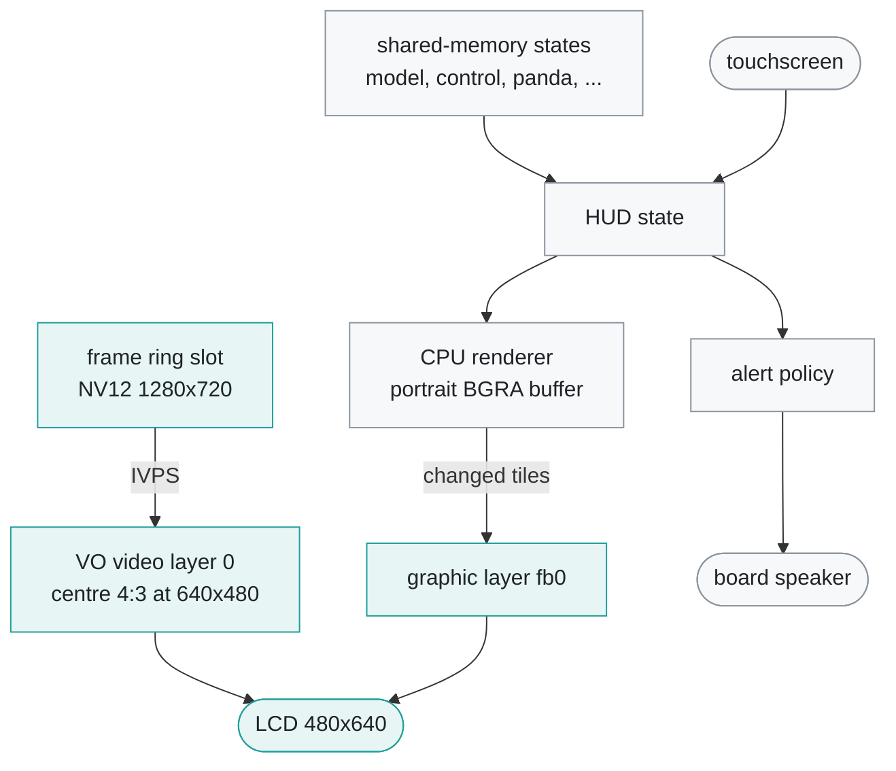
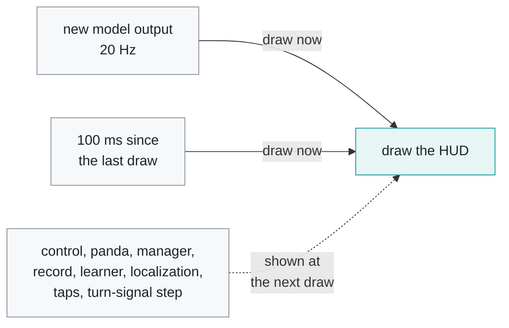
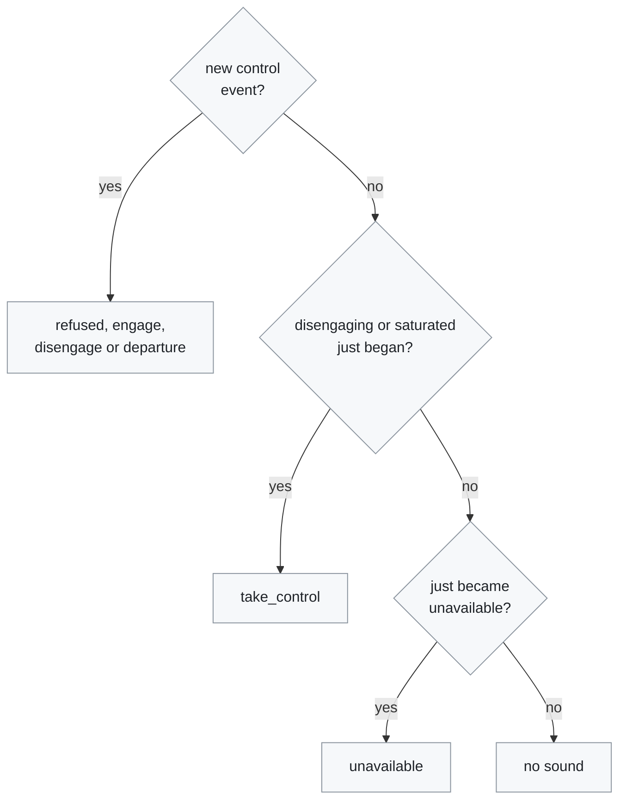

# HUD

[← Documentation](README.md)

`overlayd` drives the board's 2.4-inch LCD: the camera picture on one hardware
layer and the HUD, drawn by the CPU, on another. This document covers how the
two layers are made, when the HUD redraws, what it shows, and how touch, the
backlight and the alert sounds work.

The camera layer comes straight from the frame ring through IVPS; the HUD layer
is drawn from the shared-memory states:

## Two layers

The hardware composes the two layers for the 480x640 portrait panel.

- **Layer 0 is the camera.** IVPS reads the newest ring slot, crops the centre
  4:3 (960x720 of 1280x720), and scales it to 640x480, so the preview is not
  stretched. A frame overwritten during the read is dropped. The VO pipeline
  turns the picture 90° for the portrait panel and applies the board's
  `disp_flip`/`disp_mirror`. The video layer is updated on every camera frame.
- **The graphic layer (`/dev/fb0`) is the HUD.** It is straight-alpha BGRA,
  drawn by the CPU renderer in the panel's portrait orientation into a cached
  buffer. There is no rotation pass: IVPS TDP rotation smears 32-bit BGRA
  edges (it spread G, R and A into the neighbouring pixels, which gave the path
  stepped edges and a bright rim). Only the 16 px tiles drawn this frame or
  last frame are cleared and copied into the visible fb0 page.

The renderer draws in 640x480 screen coordinates and the canvas transposes them
into the portrait buffer, in the orientation of this board's `disp_flip=1`,
`disp_mirror=0` (the touchscreen mapping assumes the same). Lanes and path are
anti-aliased.

## Redraw timing

The HUD is redrawn as soon as a new model output arrives, which gives 20 Hz,
and otherwise 100 ms after the last draw:

- `overlayd`'s loop waits up to 5 ms for the next model output, so an output
  is drawn as soon as it is read. Drawing on a fixed 45 ms clock instead
  showed each output about 25 ms late on average (up to about 50 ms), because
  controlsd's 100 Hz state kept a redraw always pending.
- The other states, taps and the turn-signal step are read on every loop and
  show at the next draw. The 100 ms floor keeps the speed, alerts and cards
  moving when the model stops.
- With `EDGEPILOT_PROFILE=1` the status line's `lag=` is the mean time from a
  model output to the start of the draw that shows it.
- The turn-signal animation has its own 50 ms clock, counted from when the
  blinker changed, so it does not depend on how often the HUD redraws.
- A state older than 2 s counts as stale, and its values are zeroed: the speed
  shows 0, the set speed and gear cards show `-`, and the corner cards show
  `--`.

## What the HUD shows

The engaged HUD, from the off-line renderer (`hud_snapshot`, see
[HUD snapshots](diagnostics.md#hud-snapshots)):

| Where | What |
| --- | --- |
| Edge | border in the steering state colour |
| Top centre | speed with the turn-signal chevrons, `AUTO HOLD` under it |
| Top left | set speed and gear cards, steering mode chip, manoeuvre chip |
| Top right | status pill, network card, chips that apply, green-light wait icon |
| Road | road edges, lane lines, path, vision lead, lane-position marker |
| Left, low | board state card above the TPMS card |
| Right, low | learned values card above the camera calibration card |
| Bottom centre | alert card above the steering torque bar |

### Steering state colour

The border and the mode chip's dot take the steering state colour:

| Colour | When |
| --- | --- |
| Red | steering fault, Panda fault, or disengaging in 3 s |
| Amber | waiting for services: a process is down or there is no fresh model |
| Green | steering in Lane mode |
| Blue | steering in Laneless mode |
| Grey | engaged but not steering, including the large-angle pause |
| None | not engaged |

The mode chip reads `LANE` or `LANELESS` while control is active, `READY` or
`OFF` when not engaged, and the reason when engaged but blocked.

### Top of the screen

- **Speed** in the centre, with yellow turn-signal chevrons beside it (three
  light in turn; both sides for the hazard lights).
- **`AUTO HOLD`**, a large green badge under the speed while the car holds the
  brake.
- **Set speed card** (`MAX`) at the top left: the driver's set speed, with the
  vision cruise speed as an amber `SET` when it is lower.
- **Gear card** beside it (`R` in amber, `P` and `N` dim).
- **Steering mode chip** below them, with a manoeuvre chip below it while
  steering (`CHANGING LANES`, with an arrow to the side).
- **Status pill** at the top right: a red `REC` while `recordd` writes a route,
  and a Wi-Fi fan lit by signal, or `OFFLINE` unless a `wlan` link is
  associated with an AP. The USB link does not count.
- **Chips** below the pill only when they apply: `PANDA` (not connected or not
  healthy), `STORAGE FULL` (SD reserve exhausted), `SD CARD SLOW` (recording
  stopped because the tmpfs staging filled), and a lead that only the car's
  SCC radar sees (`LEAD` and its distance). The K7 has no SCC radar, so that
  chip never shows on it.
- **Green-light wait** as a traffic-light icon (red lamp lit) while the
  green-light alert is armed
  ([Departure alerts](departure-alerts.md#green-light)).

### Road scene

- Road edges (red) and lane lines (wider and brighter the surer the model is)
  are drawn in Lane mode only. The path is drawn in both modes.
- Lanes and path fade with distance, out to the end of the plan (10-100 m).
- The path is translucent white when not engaged, grey when engaged but not
  steering, and green (Lane) or blue (Laneless) while steering, turning amber
  as the steering output nears its limit.
- The vision lead is a chevron that turns from white to amber, then red, the
  closer it is within 40 m and the faster it closes in. Its label is the
  distance, and the closing speed when it closes in by 3 km/h or more.
- A **lane-position marker** lies across the ego lane about 7 m ahead: ticks at
  both lane lines, the lane centre above the line and the car below it at true
  scale, and the offset in cm. It shows only when both ego lines are sure, and
  the offset is smoothed over about 0.5 s.

### Corner cards

TPMS and camera calibration cards sit in the bottom corners, with a pair of
cards above them:

| Card | Shows | Colours |
| --- | --- | --- |
| Board state (`SYSTEM`), above TPMS | CPU temperature, CPU, RAM, disk | amber from 70 °C or 90% (disk also when recording stopped for space), temperature red from 80 °C |
| `TPMS`, bottom left | the four tyre pressures in the car's unit (psi or bar) | amber below 32 psi (2.2 bar), red above 45 psi (2.8 bar), header red on the car's TPMS warning |
| Learned values (`LEARNED`), above calibration | steer ratio, angle offset, lateral-acceleration torque factor, steering delay | white while control uses the learned value, dim while it still uses the parameter |
| Camera calibration (`CAL`), bottom right | roll, pitch and yaw of the warp; `OK`, `FLOW`, `INVALID` or the progress (titled `RECAL` while recalibrating) | amber while calibrating, red when invalid |

### Steering torque bar

The torque bar along the bottom edge shows while engaged. It is openpilot's
mici UI torque bar: the sent torque / 384 fills from the centre toward the
turn, white, turning amber above 75%. The driver's torque is on the same scale
as a light-blue tick.

### Alert card

The alert card sits above the torque bar. It shows one alert at a time, the
first that applies in this order:

| Title | Detail | Bar | When |
| --- | --- | --- | --- |
| `UNABLE TO ENGAGE` | the reason | amber | for 3 s after an engage is refused |
| `TAKE CONTROL` | the reason | red | disengaging in 3 s |
| `STEERING FAULT` | model, car and Panda links | red | the MDPS reports a fault |
| `PANDA FAULT` | model, car and Panda links | red | the Panda reports a fault |
| `STEERING PAUSED` | when steering resumes | amber | the wheel is past 85° or held by the driver |
| `TAKE CONTROL` | turn exceeds steering limit | amber | the curve needs more torque than allowed |
| `WAITING FOR SERVICES` | model, car and Panda links | amber | a process is down or the model is not fresh |
| `LANE CHANGE` | steer to start once safe | white | asks for the nudge that starts a lane change |
| `LEAD VEHICLE MOVING` | check the road and proceed | green | departure alert |
| `GREEN LIGHT` | check the road and proceed | green | departure alert |

`STEERING PAUSED` says the wheel is past 85° (steering resumes below it) or
that the driver holds it. Then steering resumes when the driver lets go below
15°, or below 80° once the wheel has followed the planned curve for 1 s, as on
a ramp the driver holds after a brief pass over 85°.

The card grows with its text up to the gap between the bottom corner cards,
344 px, so a title or detail may be at most 288 px wide. `gtest_hud_canvas`
measures every alert text against that; the driver-held `STEERING PAUSED`
detail was 354 px and ran out of the card.

<table>
  <tr>
    <td width="33%" align="center" valign="top"> <code>LANE CHANGE</code>: blinker on</td>
    <td width="33%" align="center" valign="top"> <code>GREEN LIGHT</code> while held at a stop</td>
    <td width="33%" align="center" valign="top"> <code>TAKE CONTROL</code>: steering limit</td>
  </tr>
  <tr>
    <td width="33%" align="center" valign="top"> <code>STEERING PAUSED</code>: grey border</td>
    <td width="33%" align="center" valign="top"> <code>STEERING FAULT</code>: red border</td>
    <td width="33%"></td>
  </tr>
</table>

### Diagnostics card

A tap on the left column adds a card with what no other card shows:

- camera, model and HUD FPS
- steering torques
- paramsd stiffness and average offset
- torqued raw estimates and progress
- lagd's blocks

The learner lines are amber until they are valid.

## Touch

`overlayd` reads the touchscreen (`hyn_ts`, rotated clockwise 90° like
MaixCDK). Only short taps count:

| Tap on | Action |
| --- | --- |
| the status pill | opens a network card for 10 s (SSID, IPv4, interface, signal, or `Not connected`, plus the USB link's address); a second tap closes it |
| the left column (set speed and gear cards, chips, board state card) | shows or hides the diagnostics card, which is off when `overlayd` starts |
| anywhere else | closes the network card |

Every tap is logged as `overlayd: tap x=... y=... <action>`.

## Backlight

`overlayd` is the only process that sets the backlight
(`/sys/class/pwm/pwmchip0/pwm3`). It turns it on at start, because the MaixCDK
display leaves it at 0 when it closes, at the level in `/boot/configs`
(`maix_backlight_value`). Right after, it applies `enabled` and
`brightness_percent` from `params/display.json`, and again within 1 s of each
change. The duty is the 100 µs period x the brightness x `disp_max_backlight`
from `/boot/board`. A restart of `overlayd`, which follows every `camerad`
restart, therefore keeps the chosen level, and a screen turned off at night
stays off.

## Alert sounds

`overlayd` plays the alert sounds, short bell-like tones
(`src/hud/alert_tones.cc`), on the board speaker. It also shows departure
alerts and engage refusals on screen, and writes every alert as an
`overlayd: alert=...` log line.

At most one sound plays per loop, chosen in this order:

| Sound | Tone | When |
| --- | --- | --- |
| `unable` | the same note twice, then a fourth down | an engage is refused |
| `engage` | a fifth up | engaged |
| `disengage` | a fifth down | disengaged |
| `signal_changed` | three notes up | a departure alert |
| `take_control` | as `unable` | disengaging in 3 s, or the steering limit is reached |
| `unavailable` | a tritone, twice | control goes stale, the Panda drops out or faults, or the steering faults |

- Control events come from `controlsd`'s event counters. The first snapshot
  after `overlayd` starts is a baseline, not an event, and a counter that goes
  down (a `controlsd` restart) sets a new baseline. A second event in the same
  loop plays in the next.
- A sound that cannot play in this loop because another did waits for the next
  loop, except `unavailable`, which is skipped.
- A sound thread opens the playback device (`/dev/snd/pcmC0D1p`, through
  ALSA ioctls) when an alert fires and closes it as soon as the alert has
  played out (the last 60 ms in the ALSA buffer). An alert never starts a
  process, so neither the alert nor the loop stalls on the SD card. While the
  device is open the codec driver keeps the speaker amplifier on, and an
  amplifier that is on plays the supply noise of CPU and Wi-Fi load (a crackle
  while a video was copied over ssh on 2026-10-25, gone with the device
  closed, unchanged with 6 dB less analog gain). So the device stays closed
  between alerts. 0.15 s of silence goes first while the amplifier powers up,
  so the first note is not cut (with 80 or 120 ms it was clipped). A new
  alert cuts off the one playing.
- The volume is the web console's alert volume (`alert_volume_percent` in
  `params/display.json`); a change plays the engage tone once at the new
  volume. `EDGEPILOT_ALERT_SOUND=0` turns the sounds off, and two more
  variables set the default volume and the ALSA device
  ([Runtime options](runtime-options.md#alerts)).
- `pkill -USR1 -x overlayd` plays the next sound in turn (engage, disengage,
  unable, signal_changed, unavailable), to check the speaker at the desk.

## Related

- [Runtime](runtime.md): the other processes and the topics `overlayd` reads
- [Departure alerts](departure-alerts.md): the lead-departure and green-light
  alerts at a stop
- [Diagnostics](diagnostics.md): rendering the HUD off-line with
  `hud_snapshot` and `hud_tools.py`
- [Runtime options](runtime-options.md): the alert sound switches and the web
  console's device settings
- [Flow calibration](flow-calibration.md): what `FLOW` on the calibration card
  means
