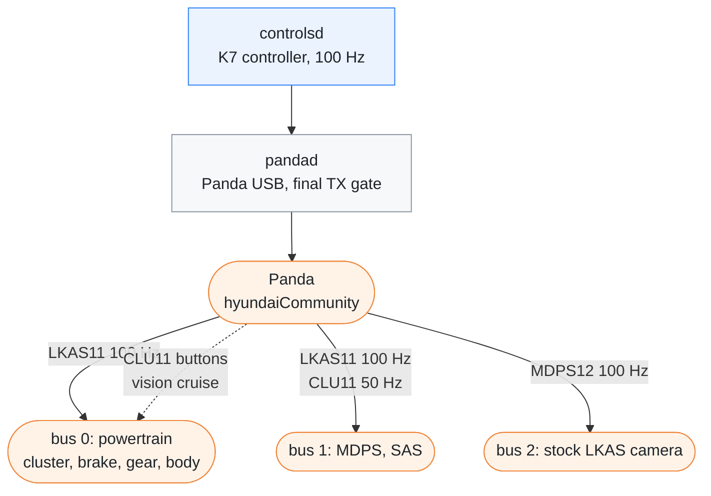
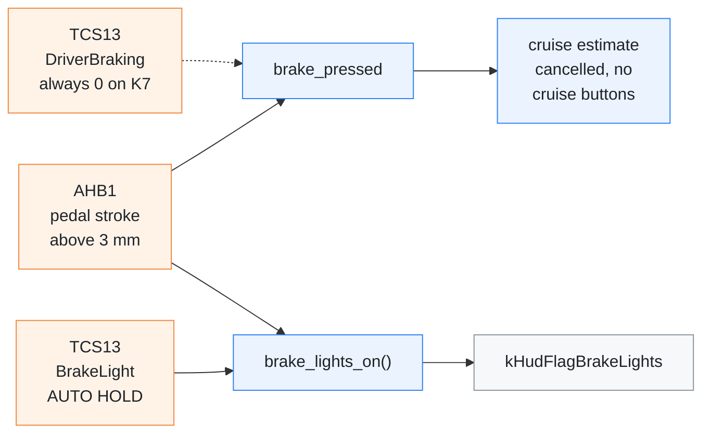
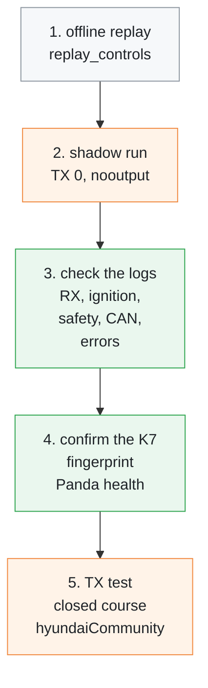
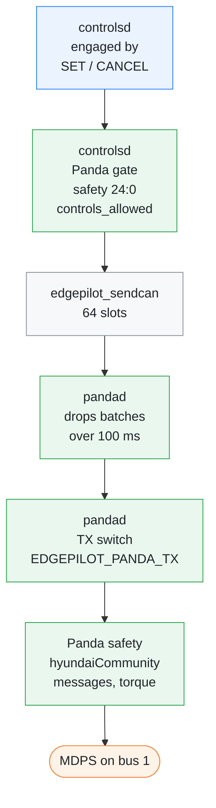

# K7 Panda port

[← Documentation](README.md)

How edgepilot drives the KIA K7 YG HEV through a Panda: the processes and
queues, the car's CAN bus split, the K7 signals that differ from the openpilot
DBC, and the checks and gates before a frame reaches the car. Read it before a
change to `src/car/`, `src/panda/` or the TX settings.

The Panda sits on the car's three CAN buses. `controlsd` builds the frames,
`pandad` hands them to the Panda, and the Panda sends them on these buses:



## Runtime

- `pandad` owns the Panda's USB through `libusb` and publishes CAN batches to
  the ordered `/dev/shm/edgepilot_can` shared-memory ring queue.
- `controlsd` runs the standalone K7 controller at 100 Hz and publishes the CAN
  batches it generates to the ordered `/dev/shm/edgepilot_sendcan` ring queue.
- `pandad` is the final TX gate. `EDGEPILOT_PANDA_TX=0` keeps every generated
  frame from reaching USB. `pandad` alone treats an unset value as `0`, but
  `manager.py` sets `EDGEPILOT_PANDA_TX=1` when it is unset, so under the
  manager (and the boot service) TX is on unless you set it to `0`.
- The board needs no openpilot checkout and no Python DBC extension.

The CAN queues:

- have 64 slots, and reject a new batch instead of overwriting older ones when
  full;
- are drained in sequence order;
- start a new generation when their producer starts, and `pandad` drops TX
  batches older than 100 ms.

`pandad`'s log line every second shows the queue depth, the full and stale
counts, the Panda's CAN errors, blocked frames, the heartbeat status, USB
retries and malformed RX batches.

The Panda runs the firmware in `firmware/panda`
([Panda firmware](../firmware/panda/README.md)): health packet version 7, CAN
packet version 2, and the `hyundaiCommunity` safety mode, which `pandad`
checks when it connects.

## Bus split

The controller uses the K7 YG HEV bus split validated on the car:

| Bus | Wiring | Read | Sent |
| --- | --- | --- | --- |
| 0 | powertrain | powertrain, cluster, brake, gear and body state | `LKAS11` at 100 Hz; `CLU11` cruise buttons from vision cruise |
| 1 | MDPS | MDPS state, `SAS11` | mirrored `LKAS11` at 100 Hz, `CLU11` at 50 Hz |
| 2 | stock LKAS camera | the camera's `LKAS11`, the seed for ours | `MDPS12` at 100 Hz |

Each sent frame is built on the latest one the car sent: `LKAS11` on the
camera's, `CLU11` on the cluster's, and `MDPS12` on the MDPS's (the same
fault-avoiding frame as openpilot's `create_mdps12`). `SAS11` is read on bus 0
or bus 1; this car sends it on bus 1 (`sasBus=1`, see
[Shadow run](#shadow-run)).

In `hyundaiCommunity` the Panda forwards the other traffic between the buses.
Where edgepilot sends a message of its own, the Panda stops forwarding the
car's while edgepilot's is live: the camera's `LKAS11`, the MDPS's `MDPS12`
towards the camera, and the cluster's `CLU11` towards the MDPS
(`firmware/panda/board/safety/safety_hyundai_community.h`). While edgepilot's
`LKAS11` is live, the Panda also drops the camera's `LFAHDA_MFC` (0x485),
which edgepilot does not send.

While steering is active below the MDPS threshold, the `CLU11` on bus 1
reports 60 km/h and keeps the source's decimal-speed field. This matches the
K7 branch of the reference openpilot controller.

The two `LKAS11` copies carry the same bytes, and the bus-1 copy goes first.
The Panda's torque checks (`driver_limit_check`) run on every `LKAS11` frame,
whatever the bus, and remember the last torque. While the torque ramps down
against the driver, each frame must come down from the one before, so the
second copy of a tick is refused. That copy should be the bus-0 one, which
the MDPS does not read. Until 2026-10-22 the bus-1 copy went second: all 22
refused frames in the nine routes before then were bus-1 `LKAS11`.

## Brake signals

The openpilot DBC's TCS13 brake signals do not report the brake pedal on this
car. This was checked against the drives of 2026-10-04:

- `DriverBraking` (bit 55) and `DriverOverride` are always 0. TCS13 also
  reports SCC and FCA as not equipped.
- `BrakeLight` (bit 11) lights only while the car stands, almost always during
  AUTO HOLD.

The pedal comes from `AHB1` (0x160), the hybrid's brake booster.
`CR_Ahb_StDep_mm` (bits 8–23, signed, 0.1 mm) is the pedal stroke:

- about 16 mm median while braking;
- 3 mm or less in 99% of driving without braking;
- above 3 mm, it agrees with the booster's active state 98% of the time while
  moving.

Where each brake signal comes from and what it drives:



- **Brake lights.** `brake_lights_on()` (`vehicle_can`) is true when the stroke
  is above 3 mm or TCS13 `BrakeLight` is set, that is, while the pedal is
  pressed or AUTO HOLD holds the car. `controlsd` publishes it as
  `kHudFlagBrakeLights`.
- **Brake pressed.** `VehicleCanState::brake_pressed` is `DriverBraking` or a
  stroke above 3 mm, so on this car it comes from AHB1. A press cancels the
  fixed-cruise estimate, as the brake cancels the stock cruise, and vision
  cruise sends no button while the pedal is down.

Until 2026-10-06 `brake_pressed` read only `DriverBraking`. The estimate
survived the brake, and vision cruise kept pressing `SET-`/`RES+`, which
re-engaged the stock cruise after the driver had braked.

## Body signals

CGW1's two-bit B-CAN signals use 3 for a B-CAN signal timeout
(`svrs_dl3_can_v6.dbc`). edgepilot reads the blinkers, the driver's door and
the seatbelt among them. `decode_cgw1()` reads a timeout as the safe value:

| Signal | A timeout reads as | Why |
| --- | --- | --- |
| blinkers | off | on would start a lane-change or turn desire |
| driver's door | open | blocks engaging |
| seatbelt | unlatched | blocks engaging |

No timeout appeared in the drives of 2026-10-02 to 2026-10-04.

Runtime parameters live in `params/`; see [Parameters](../params/README.md).

## MaixCAM2 connection

The MaixCAM2 has a single USB-C port. It carries the Panda in host mode, so the
board needs power from another source.

- The manager starts `pandad` only with `EDGEPILOT_ENABLE_PANDA=1`, which
  `scripts/edgepilot.service` sets.
- With it set, the manager switches the port to host
  (`/sys/class/usb_role/8000000.dwc3-role-switch/role`) before starting the
  processes, and restores the previous role on exit.
- `EDGEPILOT_USB_ROLE` fixes the role instead and leaves it on exit; the
  service sets `host`.

## Build

Build and upload as in [Build and deploy](build-and-deploy.md). The build
container installs `libusb-1.0-0-dev`; the board needs the `libusb-1.0` runtime
library for `pandad`.

## Shadow run

The steps from the host to the first transmission:



A shadow run reads the car and runs the controller, but sends nothing:

```sh
EDGEPILOT_ENABLE_PANDA=1 \
EDGEPILOT_ENABLE_CONTROL=1 \
EDGEPILOT_PANDA_TX=0 \
EDGEPILOT_PANDA_SAFETY=nooutput \
python3 /root/edgepilot/manager.py
```

Use `hyundaiCommunity` only after the connected vehicle's fingerprint and the
Panda's health confirm the expected K7 configuration. Logs collected from the
current car report `mdpsBus=1`, `sasBus=1` and `hyundaiCommunity:0`.

## TX gates

Transmitting to the car needs the settings below. `manager.py` defaults all of
them except `EDGEPILOT_ENABLE_PANDA=1`, and `scripts/edgepilot.service` sets
that one, so the boot service has TX on with no extra setting:

```sh
EDGEPILOT_ENABLE_PANDA=1
EDGEPILOT_ENABLE_CONTROL=1
EDGEPILOT_PANDA_TX=1
EDGEPILOT_PANDA_SAFETY=hyundaiCommunity
EDGEPILOT_PANDA_ENGAGED=1
```

The gates a steering frame passes before it reaches the MDPS:



`controlsd`'s Panda gate (`PandaHealthGate`) wants a fresh Panda state that
reports the Panda connected and healthy, TX on, no lost heartbeat, safety mode
24 with param 0, and `controls_allowed`.

> [!WARNING]
> Keep `EDGEPILOT_FORCE_ENGAGED=0` in a car. Engagement must come from the
> car's `SET`/`CANCEL` button state. Before any closed-course TX test, check in
> shadow mode the Panda's USB RX, the ignition, the safety mode and param,
> `controls_allowed`, CAN freshness, the checksum counters, and zero blocked
> and error counts.

## Related

- [Panda firmware](../firmware/panda/README.md): the firmware the Panda runs
  and how the board flashes it
- [Runtime](runtime.md): how the manager starts `pandad` and `controlsd`
- [Runtime options](runtime-options.md): the environment variables used above
- [Parameters](../params/README.md): the K7 parameter files
- [Diagnostics](diagnostics.md#control-tick-replay): `replay_controls`, the
  offline replay of a recorded drive through the controller
- [Departure alerts](departure-alerts.md): the alerts at a stop, which read
  the CGW1 blinkers
