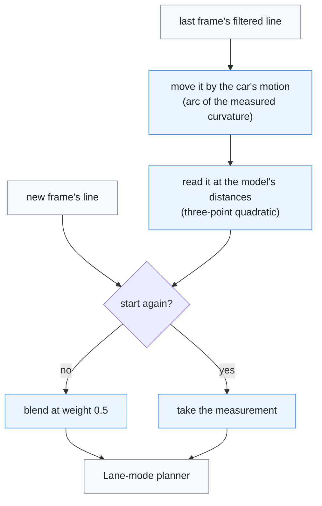
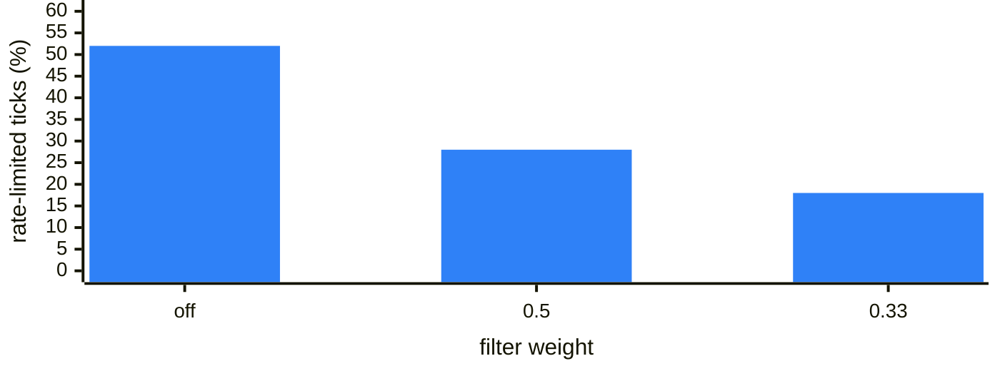

# Lane-line filter

[← Documentation](README.md)

`planning/lane_line_filter` smooths the two ego lane lines over time before the
Lane-mode planner uses them. It moves the last filtered lines by the car's own
motion and blends in the new frame, so it steadies the lines without lagging
behind the car.

Each model frame, for each ego line:

## Why

The model's lane lines move from frame to frame. The frame-to-frame noise of
the ego lines, above 30 km/h with both lines sure:

| Distance | Night (2026-10-10 19:32) | Day (2026-10-04 12:32) |
| --- | --- | --- |
| 7 m | 1.0 cm | 3.1 cm |
| 27 m | 1.3 cm | 3.6 cm |
| 48 m | 2.5 cm | 5.9 cm |
| 75 m | 5.5 cm | 14 cm |
| 108 m | 12 cm | 33 cm |

The planner reads the lines out to speed × 2.5 s, about 60 m at these drives'
median 81-88 km/h. The far end that shakes most in the web BEV is mostly beyond
that.

Feeding the planner lines smoothed both ways in time (σ 0.15 s) shows how much
of the steering command the shake causes:

- **Desired curvature.** Its frame-to-frame noise fell from 0.021 to
  0.002 m/s² at night, and from 0.036 to 0.005 m/s² in the day. So the lines
  cause almost all of the command's fast ripple.
- **Size.** The ripple is small: 0.1-0.2° of steering-wheel angle per frame.
- **Torque.** In a `controlsd` replay, the torque ripple within 0.25 s fell from
  2.7% to 1.6% of the maximum torque.
- **Rate limit.** The torque rate limit bound on about half the ticks of the
  closed-loop replay (52% night, 51% day). While it binds, `controlsd` freezes
  the integrator.

## How

`LanePlanner::parse` runs the steps in the diagram above for each ego line:

1. Move the last frame's filtered line into the current car frame. The car went
   v·dt along an arc of the measured curvature (`actual_curvature`, from the
   steering angle through the vehicle model).
2. Read that prediction at the model's point distances, with a three-point
   quadratic interpolation.
3. Blend: filtered = predicted + 0.5 · (measured − predicted)
   (`kLaneLineFilterWeight`).
4. Start again from the measurement when:
   - the points within 20 m are on average more than 0.5 m from the
     prediction (a lane change renames the lines, or a line is picked up again);
   - frames are more than 0.2 s apart.

   Points beyond the prediction's reach keep the measurement.

Lane lines are fixed to the road, so the prediction stays right while the car
moves. The filter only slows down the model changing its own estimate. It runs
in Laneless mode too, so it is warm on a switch, but nothing there reads the
lines' positions.

What did not work:

- **Blending points at the same distance**, without the motion, lags the car's
  own motion. In the closed-loop replay the lane-centre error doubled (RMS 8.75
  to 16.2 cm, weight 0.33).
- **Linear interpolation** of the prediction reads the chord of a curved line.
  - Each frame pulls the line towards the inside of the curve, and the filter
    adds it up.
  - In a synthetic curve at weight 0.33 (`gtest_lane_line_filter`) that was
    8 mm at curvature 0.002 and 17 mm at −0.004.
  - In the closed-loop replay it meant 0.6 cm more curve cutting than the
    quadratic interpolation.
- **Leaving the near points unfiltered** (a weight ramp over 10-40 m) traded
  ripple for lane-centre error at the same rate as a uniform weight.
- **Cubic interpolation** (four-point Lagrange, or a C1 Hermite with
  three-point slopes) matched the quadratic one:
  - on a circle the bias was 0.1 mm either way;
  - on a clothoid entry it was slightly larger (1.4-3.7 mm against 1.2-1.9 mm
    at 1e-4 1/m²);
  - the open- and closed-loop replays agreed to 0.01 cm.

  What is left on a clothoid comes from turning by one curvature over a frame
  whose curvature changes (c·d²/2), not from the interpolation.
- **Smoothing the output instead, as upstream did.** openpilot's modeld runs the
  desired curvature through a first-order filter, reads the plan τ further ahead
  and adds τ to the torque controller's delay (`LAT_SMOOTH_SECONDS`). It used
  0.1-0.3 s on several 2025 models and went back to 0 in 2026-01 ("lat is plenty
  smooth!"). Ported to the controller at 100 Hz, it was replayed in closed loop
  over 21 drives (377 min hands-off, without one drive where the simulation runs
  off):

  | | Lane-centre RMS | Drives better than off | Rate-limited | Torque ripple |
  | --- | --- | --- | --- | --- |
  | Off | 13.29 cm | | 46% | 8.0 |
  | This filter (0.5) | 13.29 cm | 10 of 21 | 25% | 5.4 |
  | Output τ 0.03 s | 13.41 cm | 4 of 21 | 24% | 7.3 |
  | Output τ 0.05 s | 13.65 cm | 0 of 21 | 14% | 6.3 |
  | Output τ 0.1 s | about +1 cm | | 6% | 4.3 |

  It lowers the rate-limit binding further, because it also smooths the steps
  at each 20 Hz model frame. But even with the delay compensation, it costs
  lane centring on nearly every drive, and the more so the larger τ is. Without
  the compensation, τ 0.1 s raised the lane-centre RMS by 3.5 cm. Laneless mode
  could not be checked this way: the closed-loop replay moves the plan's
  positions but not its yaw, which is all the laneless law reads.

  Since 2026-10-22 the controller blends each new plan in over 50 ms
  instead, from what the previous plan gives (`LateralController`). It is not
  a filter on the output: once blended in, the new plan alone counts. Alone,
  it cut the torque step RMS by 18 % and the rate-limit binding in curves from
  59 to 37 %, and moved the car 0.6–1.3 cm further inside in curves. Together
  with the lane MPC's start from the measured curvature, which centres more
  firmly, curves end 7 cm closer to the centre.

## Evidence

The weight was chosen on replays of the two drives above:

- **Open loop:** `replay_planner --vehicle` on 30 min blocks (night chunks
  095-124, day 000-029), against the command from the lines smoothed both ways.
- **Closed loop:** `replay_closed_loop` on the whole drives, on hands-off
  stretches above 30 km/h (night 114 min, day 24 min). See
  [Closed-loop replay](closed-loop-replay.md).

How often the torque rate limit binds in the closed-loop replay, night drive:

Open loop:

| Weight | Ripple, night / day | Error vs smoothed, night / day | Lag, night / day |
| --- | --- | --- | --- |
| Off | 0.021 / 0.036 m/s² | 0.033 / 0.035 m/s² | 0 / 2 ms |
| 0.5 | 0.009 / 0.015 m/s² | 0.023 / 0.021 m/s² | 33 / 16 ms |
| 0.33 | 0.006 / 0.010 m/s² | 0.022 / 0.021 m/s² | 57 / 35 ms |

Within 3 s of a lane change (day block, 1348 frames in a lane change), the error
fell from 0.030 to 0.019 m/s² at 0.5.

Closed loop:

| Weight | Lane-centre RMS, night / day | Rate-limited | Torque ripple | Tracking error |
| --- | --- | --- | --- | --- |
| Off | 8.75 / 13.01 cm | 52% / 51% | 8.9 / 8.0 | 0.154 / 0.225 m/s² |
| 0.5 | 8.92 / 13.02 cm | 28% / 26% | 6.0 / 5.5 | 0.146 / 0.219 m/s² |
| 0.33 | 9.14 / 13.12 cm | 18% / 17% | 4.3 / 4.2 | 0.142 / 0.216 m/s² |

`replay_controls --force-engaged` on the night block (open loop, the real
`controlsd` code) moved as follows:

| | Off | 0.5 |
| --- | --- | --- |
| Torque ripple (of the maximum torque) | 2.69% | 2.23% |
| Rate-limited ticks | 62% | 47% |
| Curvature ripple | | −42% |

The default is 0.5. It removes most of the ripple, halves the rate-limit
binding, and costs at most 0.2 cm of lane-centre error. 0.33 removes more, and
costs 0.4 cm on the night drive.

All three replay tools take `--lane-filter W` to compare weights (1 turns the
filter off).

**On the road.** The first drive with the filter (2026-10-12--22-37-07-989,
22 min in town) matched the replays. At 60-90 km/h, with lane changes left
out, the torque rate limit bound on 38% of the ticks against 59-68% on the
drives of 2026-10-10, the torque ripple was 2.2% of the maximum against
2.7-3.1%, and the command ripple 0.015 against 0.025-0.032 m/s². Below
60 km/h little changed, as expected.

## Limits

- **Curvature error.** The motion uses the steering-angle curvature. An error
  in it (the learned angle offset, the steering ratio) turns the predicted
  lines a little each frame. At weight 0.5 the lines settle one frame's worth of
  that turn away. In the closed-loop replay at 0.5, both remaining costs
  followed that curvature:
  - **Bends.** The extra curve cutting (inside offset −1.63 to −2.25 cm) shrank
    to −1.79 cm with the curvature scaled by 1.10, and grew with 0.95. So the
    steering-angle curvature reads about 10% below the car's turn. That fits a
    steering ratio below the learned one (the ESP12 yaw rate gave 15.05).
  - **Straights.** The extra offset (mean −3.87 to −4.05 cm) went away with
    +5·10⁻⁵ 1/m added, about 0.14° of steering wheel.

  What stays is the filter's own cost on straights: a standard deviation 0.1 cm
  larger.
- **Feel.** The closed-loop plant was identified on lane drives, but it cannot
  show how the steering feels.
- **The BEV copy.** The web BEV draws the ego lines through a JavaScript copy
  of this filter (`web_console/static/lane_filter.js`), on the capture times and
  `controlsd`'s speed and measured curvature from the stream. It matches the
  planner when the stream delivers every model frame.
  - `check_web_console.py` holds its constants to these.
  - It runs `tests/check_bev_lane_filter.mjs` (jsc or node) against the C++
    golden output that `gtest_lane_line_filter` pins.
  - In the BEV, the drawn lines tremble about 60% less from frame to frame, but
    their slower swing over a second drops only 13-26%.

## Next

Drive more at highway speed with 0.5. If lane keeping holds there too, try
0.33.

## Related

- [Closed-loop replay](closed-loop-replay.md): the simulation the weights were
  compared in
- [Runtime](runtime.md): where the planner runs inside `controlsd`
- [Diagnostics](diagnostics.md): the planner and control-tick replays
