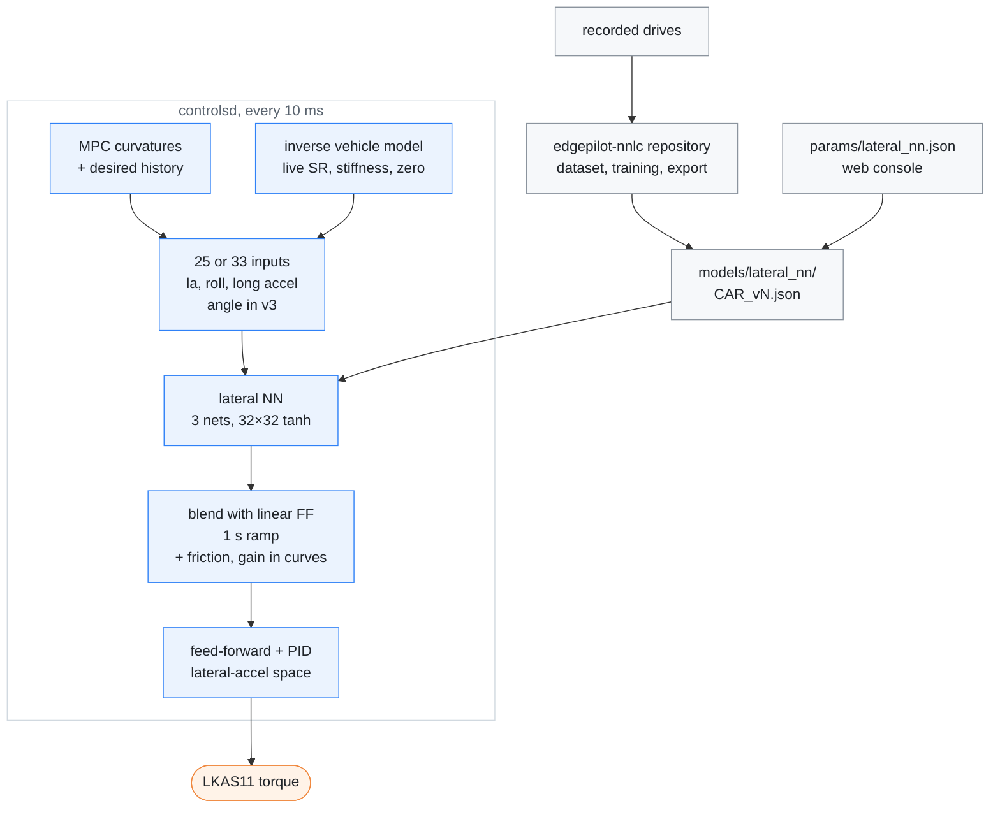

# Lateral NN

[← Documentation](README.md)

The lateral NN is an optional feed-forward for the torque controller. It is a
small neural network, trained on the K7's own recorded drives, that gives the
steering torque a target trajectory needs. With `nn_feedforward` on and a
model chosen from `models/lateral_nn/`, it replaces the linear feed-forward's
lateral-acceleration, offset and bank terms. In curves the friction
compensation stays on top of a model trained without it, the model's output is
raised by the gain its file carries (`curve_gain`) while the curve tightens,
and the PID stays as it is.

This diagram shows where the model comes from and where it enters the
controller:

## Why

The torque controller ported from openpilot turns lateral acceleration into
torque with one learned factor, an offset and a friction term. sunnypilot's
Neural Network Lateral Control (NNLC) replaces that with a per-car model
trained on driving logs, but it has no model for the K7 or its relatives.
Training one from edgepilot's own recordings gives a model of this car's EPS,
tyres and tuning.

## How

### The model

The model is trained in the separate [edgepilot-nnlc][nnlc] repository,
which also holds the K7 drives it was trained on, the CSV format and a guide
for training another car (its README has the details). It is an inverse
steering model: given the lateral-acceleration trajectory around the moment
the car responds, it gives the torque command that produced it.

- **Target:** the torque sent at time t, as a fraction of `steer_max`, with
  right positive (the control sign).
- **Inputs:** 33 in `k7_hev_v3`, 25 in `k7_hev_v4`.
  - Speed at t.
  - Lateral acceleration, its jerk and road roll at the response time
    t + 0.3 s.
  - Lateral acceleration at −0.5…+1.5 s around the response time (13 points)
    and roll at −0.3…+1.5 s (7 points).
  - Longitudinal acceleration.
  - `v3` only: steering angle at the response time and at −0.3…+1.5 s around
    it (7 points).
- **Training inputs:** `v3` learns from the trajectory that happened. `v4`
  learns from the inputs the controller would have built at that tick from the
  recorded plan and history (runtime inputs, below).
- **Network:** three nets of 32×32 tanh, averaged, output clipped to ±1.
  Training mirrors every sample left to right, so the response is symmetric.
- **File:** format `edgepilot-lateral-nn` version 1. It holds the input names,
  the window definition, the normalisation, the weights, test vectors and the
  curve gain (`curve_gain`, 0 when absent).
  `LateralNnModel::load_text` refuses a file when:
  - the names it rebuilds from the window definition differ from the file's;
  - an input would read outside the 1 s history or the plan;
  - a value is not finite as a float;
  - the output clip is outside ±1;
  - `curve_gain` is not a number from 0 to 1;
  - an activation is not `tanh` or `linear`;
  - or its own evaluation of the file's test vectors differs by more than
    2·10⁻⁴.

  The file also carries `input_tests`: a synthetic trajectory and the inputs
  the training code built from it. `gtest_lateral_nn` feeds the same
  trajectory to `LateralNnInputs` and expects the same inputs, for every model
  in the library, so a training change that keeps the names but changes what an
  input means fails there.

### Inputs at run time

The controller feeds the target trajectory in the places of the training
inputs (`LateralController::lateral_nn_feedforward`): `v3` was trained on the
trajectory that happened, `v4` on these run-time inputs. The roll input is the
road-bank estimate over g, as in the training data, which has the opposite
sign of paramsd's roll; `gtest_lateral_nn` pins it. The model is not used
during lane changes, turns or while a blinker is on, which the training
leaves out: the feed-forward ramps to the linear one over 1 s.

- **Lateral acceleration at δ s ahead:** the MPC curvature trajectory at
  δ + plan age, times v².
  - Each point is held to the same limits as the PID's request: the 80° hold
    curvature while the driver's hands are off (`hold_angle_bounds`), and
    ±3 m/s² (plus the learned roll) and the curvature limit
    (`limit_curvature`, shared with `clip_curvature`).
  - Without the hold, a hands-off turn tighter than 80° would feed the model
    angles far beyond its training and push the wheel toward the 85° fault
    angle.
  - Points in the past come from a 1 s history of the target at 100 Hz.
  - A non-finite plan point makes the model's output NaN, and that tick uses
    the linear feed-forward.
- **Jerk:** the central difference of that trajectory over ±0.05 s.
- **Steering angle at δ:** that curvature through the inverse vehicle model,
  with the live steer ratio, stiffness, angle zero and roll. At one speed it
  is linear in curvature, so `TorqueController::angle_map` gives its gain and
  offset once per tick. Training lateral acceleration was computed from the
  measured angle the same way.
- **Roll:** the road-bank estimate divided by g, the same estimator the
  dataset used; future roll is taken as now.
- **Speed and longitudinal acceleration:** the current values. Training took
  the speed at t as well, but the longitudinal acceleration at the response
  time.

These inputs differ from the trajectory that happened, most in curves. On the
25 training drives, replayed open loop with the controller building its inputs
from the recorded plans, at curve entries the plan's window is flatter than
what the car did: 12 % larger in its near part and 5–7 % smaller in its far
part. The jerk input correlates with the trajectory's jerk only at r = 0.17,
and the angle inputs run 8 % high. A model trained on what happened therefore
meets inputs at run time that it did not see in training.

`k7_hev_v4` trains on the runtime inputs instead. `replay_controls
--nn-inputs` writes, for each tick at which the model ran, the inputs the
controller built (open loop on a recording: the plan comes from the recorded
model output, the vehicle state from the recorded CAN). nnlc pairs them with the
torque sent at that tick. Its clock check compares the ESP12 longitudinal
acceleration in both files: the 25 K7 drives with runtime inputs are aligned to
0 ms (the 26th has no usable rows and an empty file). `v4` has no
steering-angle inputs: at run time they are the plan's curvature through the
current vehicle model, so they do not pair with the lateral acceleration the
way the measured angle did in training.

### In the controller

`TorqueController::update` computes the linear feed-forward as before. Then it
blends in the model, converted to lateral-acceleration units by
`latAccelFactor`, by a weight from 0 to 1. The PID, its limits and the torque
limits are unchanged. The model's output already contains the
straight-driving bias, bank and dynamics, so at weight 1 those linear terms
are gone.

The friction compensation is the exception. The linear feed-forward adds up to
`torque_friction` in the direction of the tracking error plus the request's
jerk, which pushes the wheel when the car falls behind. The model sees only
the target trajectory, not the error, so it cannot do that. The controller
therefore adds the same friction term to the model in curves: from 0.2 m/s²
of desired lateral acceleration, in full from 0.6 m/s². On straights the model
runs alone, because the term would shake the torque on the noise in the error
and undo the model's smoothness. sunnypilot's NNLC has the same term as a
model option (`friction_override`) for models with a weak friction response,
and blends in its error response only at high lateral acceleration.

Only a model trained without that share gets it: the file's
`spec.friction_free` (nnlc `Spec.friction_free`; false when absent). Both
models in `models/lateral_nn/`, `k7_hev_v3` and `k7_hev_v4`, are. A model that
learned the torque that was sent, friction included, as the removed
`k7_hev_v1` and `v2` did, runs alone: adding the term would count the friction
twice.

The model file's `curve_gain` raises the model's output while a curve
tightens: ×(1 + `curve_gain`), ramped in over the same 0.2→0.6 m/s² of desired
lateral acceleration as the friction, from 30 to 50 km/h, and with how fast
the desired lateral acceleration grows in the plan (none at 0, all from
0.3 m/s³). That rate is the difference between the plan's desired lateral
acceleration 0.25 s after and 0.25 s before the time the controller requests
(the lagd delay). Until 2026-10-22 the gain stayed on through the hold and the
exit too. For a while after that, the rate was the request's own rate of
change, filtered over 0.1 s. Each new plan moves the request by
0.03–0.05 m/s², so that rate reached 0.7–1.1 m/s³ in steady curves and the gain
came on in holds as well (+0.09–0.10 on average). Reading the plan's shape cut
the 0.5–3 Hz lateral acceleration in curves by 13–16 % on entries and 12–23 %
in holds, with the same lane-centre error (closed-loop replay of the ten NN
drives). On the two 2026-10-18 drives with `v4`, the steering angle then gave
1.07–1.09 times what the controller asked for in steady curves above 80 km/h
and 1 m/s², and the car sat on the inside of right curves (11 cm in the
closed-loop replay of those drives, 13–27 cm against the stock camera's lane
lines on the road). With the gain on the entry only, the replay gives 7 cm
with no more wobble. Taking the gain out altogether put left curves 4–10 cm
to the outside. The models fit the torque
that was sent, at curve entries too: over the entry samples of its training
data, `v3`'s mean prediction is 1.01 of the sent torque. In the closed loop
they still deliver less in curves than the linear feed-forward, which reads the
plan at the lagd delay and gives 10–20 % more than the car needs while the PID
trims the excess. A model that gives exactly what the plan asks follows it
late, and training cannot ask for torque that was never sent. In the replay,
training changes left the curve entry at 0.88–0.89 (`v3` 0.886):

- sample weights on entries (×4, ×10) or on entries and exits;
- a loss that counts too little torque at entries two to four times;
- smoothed inputs (σ 50 and 100 ms) and lateral acceleration from the yaw rate;
- a 64×64 network, 80 epochs, windows ending at +0.9 or +0.6 s;
- the runtime inputs.

The gain is calibrated per model in the [closed-loop
replay](closed-loop-replay.md) after training; 0.3 brings `v3` and `v4` to the
linear feed-forward's curve entry. Below 40 km/h the entries were already as
good as linear, hence the speed ramp.

On the 2026-10-16 drive, the first with the model, the car reached 92–93 % of
the desired lateral acceleration at curve entries, against 100–109 % with
the linear feed-forward on earlier drives, and the PID added torque in every
curve phase. Replayed on the same inputs (four drives), the friction raises
the feed-forward at curve entries from 0.63–0.83 to 0.72–0.94 of the desired
lateral acceleration, and in held curves from 0.57–0.66 to 0.63–0.71. The
straight-line torque steps stay at half of the linear feed-forward's.

On that drive (`k7_hev_v2`) the steering angle also followed the request
0.11–0.12 s later than with the linear feed-forward (0.56 s against
0.42–0.46 s), and the car's yaw 0.10–0.11 s after the angle in both cases.
The model reads the plan from its own response time (0.3 s), while the linear
feed-forward reads it at the lagd delay (0.55 s); but that is not the cause.
On the same recorded plans, the model's feed-forward is in phase with the
linear one. Reading the plan 0.11–0.4 s further ahead moves the model's output
little, because each new plan starts from the car's current state, and it makes
the closed loop worse. The model's torque is smaller: in held curves `v2`
gives 0.87–0.97 of the torque the car was sent and the linear feed-forward
1.0–1.2, while `v3` with the friction gives 0.94–1.04.

The [closed-loop replay](closed-loop-replay.md) with the angle-to-path lag and
the 2026-10-17 plant, which reproduces both controllers' timing, gives, over
58 free-running minutes of six drives (2026-10-12 to 10-18; curve phases as the
simulated path's lateral acceleration over the desired one at the lagd delay,
lane-centre offset by the model's lane lines):

| Feed-forward | Request to angle | Entry | Held | Exit | Lane RMS, straight | In curves | Torque step RMS |
| --- | ---: | ---: | ---: | ---: | ---: | ---: | ---: |
| Linear | 0.48 s | 0.93 | 0.94 | 0.97 | 11.7 cm | 25.8 cm | 2.66 |
| `v3` | 0.55 s | 0.89 | 0.92 | 0.95 | 12.8 cm | 27.9 cm | 2.28 |
| **`v3` + curve gain 0.3** | 0.54 s | 0.93 | 0.95 | 0.97 | 12.7 cm | 28.4 cm | 2.31 |
| `v4` without the gain | 0.55 s | 0.89 | 0.92 | 0.93 | 11.7 cm | 25.0 cm | 2.23 |
| **`v4` + curve gain 0.3** | 0.54 s | 0.94 | 0.95 | 0.96 | 11.7 cm | 25.5 cm | 2.25 |

All rows use the curve friction. The three drives of 10-16 and 10-18 are in
neither model's training. On them alone (21 minutes) `v3` + gain gives
0.93/0.94/0.97 and 29.0 cm in curves, `v4` + gain 0.93/0.95/0.96 and 31.1 cm,
the linear feed-forward 0.90/0.92/0.97 and 34.6 cm. `v4`'s better lane
position comes from the three drives it was trained on. The models steer
13–15 % more smoothly than the linear feed-forward. Earlier runs of the same
replay rejected `k7_hev_v2` (entry 0.85), reading the plan 0.11–0.4 s further
ahead (worse in every phase) and an output gain of 1.2 everywhere (lane
worse). The road decides.

The weight ramps over 1 s toward 1 while all of these hold, and toward 0
otherwise:

- `nn_feedforward` is on and a model is loaded;
- the car is steering;
- the speed is above 3 m/s, the lowest speed in the training data.

Turning the switch on or off while driving, and every engagement, therefore
blends rather than steps. The PID integrator is not moved. On the board it
holds 0.01–0.05 m/s² on average, so a switch while steering leaves an offset
of about 0.01–0.03 m/s² that decays in 12–20 s.

While the model contributes, `ControlState.hud_flags` bit 12
(`kHudFlagNnFeedforward`) is set. In routes before 2026-10-09, bit 11 was the
brake lights. `LearnerState.flags` bit 16 (`kLearnerLateralNnLoaded`) says
whether controlsd loaded a model.

### Models, choice and switch

A model fits only the car it was trained on. The board keeps a library of
models and one choice, and the web console picks from the library.

| Item | Value |
| --- | --- |
| Library | `models/lateral_nn/<car>_v<version>.json`; the repository ships `k7_hev_v3` (curve gain 0.3 since 2026-10-18) and `k7_hev_v4` (runtime inputs, no steering angle, curve gain 0.3). `v1` and `v2` were removed on 2026-10-17, also from nnlc. `upload_to_board.sh` sends the folder and leaves files that exist only on the board |
| Choice | `params/lateral_nn.json`, `{"model": "k7_hev_v3"}`; the default sits in `params.defaults/` |
| Web console | Steering tab, learned torque model card: the files in `models/lateral_nn/`, the choice and the model controlsd uses |
| Override | `EDGEPILOT_LATERAL_NN_MODEL`, a file path, replaces the choice |
| Switch | `nn_feedforward` in `steering.json`, off by default |
| Status | `/dev/shm/edgepilot_lateral_nn_status.json` (`EDGEPILOT_LATERAL_NN_STATUS`): `selected`, `loaded`, `path`, `error`, `inputs` |
| Start-up log | `controlsd: lateral nn <name> (<model name>, <n> inputs) nn_feedforward=<0/1>`, or `lateral nn off: <reason>` |
| Switch log | `controlsd: lateral nn switched to <name> (<path>, <n> inputs)`, or `lateral nn <name> refused: <reason>; keeping <name>` |
| Recording | recordd copies the chosen model into each route as `models/lateral_nn.json` when the route starts; the route's `params/lateral_nn.json` names it |
| Replay | `replay_controls` and `replay_closed_loop` take `--lateral-nn <route>/models/lateral_nn.json`; with the switch on and no model, they warn and run the linear feed-forward |

A model name has letters, digits, `_`, `-` and `.`, up to 64 characters, and
does not start with `.`. The web console lists the files by name and does not
read them; controlsd checks a file when it loads it.

controlsd checks the choice and the chosen file once a second. When either
changes, a background thread loads the file: parsing and the test vectors take
tens of milliseconds on the board, too long for a control tick. The control
loop swaps the model in on the tick the load is done, without a restart.

- **No jump:** the swap keeps the 1 s blend and the input history. The history
  is the target trajectory and does not depend on the model, so the
  feed-forward moves only by the difference between the two models' outputs.
- **Refused file:** a file the loader refuses leaves the current model in use.
  controlsd retries it only after the file changes.
- **Recordings:** a route keeps the model of its start. After a switch in the
  middle of a route, its `models/lateral_nn.json` is the old model.

Without a chosen model, or with a file the loader refuses at start, the switch
does nothing and the linear feed-forward is used.

The web console greys out the linear terms the model replaces (offset, bank)
while the switch is on and controlsd reports a loaded model. `torque_friction`
and `steering_angle_deadzone_deg` get a note that they act in curves on top of
the model. The console greys out the switch itself when controlsd could not
load one.

## Evidence

Offline, by route-level 5-fold cross-validation, the torque RMSE as a
fraction of `steer_max`:

- The data is 25 drives with usable samples (2026-09-25 to 10-15, 7.8 h
  usable).
- The routes are split by date into five folds of similar size, and every
  route is held out once.

| Model | RMSE | \|la\| ≥ 1 m/s² |
| --- | ---: | ---: |
| torqued-style linear (`a·la + b·roll + c·friction + d`) | 0.060 | 0.119 |
| sunnypilot's network shape (18 inputs) | 0.051 | 0.095 |
| this model, one net | 0.0423 | 0.081 |
| this model, the shipped three nets | **0.0414** | **0.078** |

The shipped model is 31 % better than the linear model, and 35 % better above
1 m/s².

Since 2026-10-17 the shipped model is `k7_hev_v3`. It is the same
configuration trained on the same drives, but the friction share the
controller adds in curves is taken out of the target (nnlc `friction_free`),
so the model and that term do not overlap. The share is recomputed from the
recorded desired and actual curvature with the controller's formula; on the
10-16 route it matches the controller's own value
(`replay_controls --dump`, field `fr`) within 0.7 raw on average. Held out
by the same folds, against the torque that was sent (RMSE, and the bias in the
curve's direction, raw):

| Phase | v2 + curve friction | v3 + curve friction |
| --- | ---: | ---: |
| entry | 34.3 (+11.3) | 32.3 (−0.5) |
| hold | 25.4 | 24.2 |
| exit | 31.0 (−14.9) | 25.7 (−2.7) |
| straight | 14.0 | 14.3 |

With v2 the friction counted twice: too much torque at curve entries and too
little at exits. The model alone (v2 without the friction) scores 28.0 at
entries, but it cannot react to the tracking error, which is what the
2026-10-16 drive showed.

`k7_hev_v4` (2026-10-18) learns from the runtime inputs, without the steering
angle. By the same folds its RMSE is 0.0537, 7.5 % better than the linear
model on the same inputs. The number is not comparable with `v3`'s: the plan
does not determine the PID's share of the torque that was sent, and that share
is in the target.

Open-loop replays with `replay_controls --force-engaged` give the same
recorded inputs to both feed-forwards, without the car responding:

| Route | Model in use, of steering ticks | Tick-to-tick torque change, linear → NN | Mean distance from the recorded torque, linear → NN |
| --- | ---: | ---: | ---: |
| 2026-10-15--03-14-59-306 | 94.5 % | 2.09 → 1.87 | 22.4 → 13.0 |
| 2026-10-14--19-09-44-760 | 93.3 % | 2.10 → 1.96 | 20.1 → 13.0 |
| 2026-10-12--22-37-07-989 | 88.4 % | 2.14 → 1.97 | 16.1 → 12.0 |

- The steering ticks without the model are below 3 m/s and in the
  large-angle holds at intersections, where no torque is sent.
- The replay runs torqued without the board's saved state, so its offset
  stays 0 and the replay's linear feed-forward sits about 0.2 m/s² off the
  board's. On the board the model and the linear feed-forward differ by about
  0.05 m/s². The distance from the recorded torque is therefore mostly this
  artefact.

With the switch off, `replay_controls` gives the previous build's output.
Without a model the digests match bit for bit (10-15 and 10-12). With a model
loaded the control dumps match byte for byte. The digest then differs only
through the new `kLearnerLateralNnLoaded` flag in `LearnerState`.

On the board (Cortex-A53 at 1.2 GHz, beside the running runtime at a load of
about 6), a minute of the 10-15 drive was replayed with `--force-engaged`:

- A tick takes 130 µs of CPU time without a model, 135 µs with the switch
  off and 190 µs with it on, counting the reading of the recording.
- So the model costs about 55 µs a steering tick: about 40 µs for the three
  nets, the rest for building the inputs from the plan.
- A loaded model with the switch off costs about 5 µs a tick, for the input
  history and the hold limit.

Two choices keep the nets' share down:

- The weights are stored input-major, so the inner loop over the outputs is
  vectorised.
- tanh is computed as 1 − 2/(e²ˣ + 1), because glibc's `tanhf` takes about
  200 cycles a call on the A53.

Before these, the nets alone took 82 µs a tick.

## Limits

- **Offline only:**
  - The numbers measure how well the model explains the torque that was sent.
    The drives were closed-loop, so it can have learned some of the feedback.
  - Only a road comparison shows whether driving gets better.
- **Thin data at high lateral acceleration:** about 3 minutes above
  1.5 m/s². The mirror keeps the curves monotonic and symmetric there, but
  their accuracy is unchecked.
- **Lag:** the model's response time is 0.3 s, while lagd puts the controller's
  path delay near 0.55 s. The two are separate here: the PID compares against
  the delayed request as before, and the model reads the plan at its own
  offsets.
- **Future speed:** training's future lateral acceleration used the speed at
  each future point; the runtime uses the current speed. This matters only
  when braking hard into a curve (0.1 % of samples, output change up to 0.11).
- **Mirror zero:** the mirror flips angles about one zero fitted over all
  drives (−1.4°), while each drive's own zero is −1.0 to −1.9°. Fitting it per
  drive changed nothing measurable.
- **This car only:** the model encodes the K7's EPS and tyres and the
  controller of the drives. A change of steering hardware, tyres or the
  vehicle-model parameters calls for retraining.
- **Runtime inputs:** `v4`'s target is the torque the drives' controller sent,
  PID included, for the plan it followed. The model learns that controller's
  closed-loop torque, so a replay of its own training drives flatters it. On
  the held-out drives it is not better than `v3` with the gain.
- **Curve gain:** calibrated in the replay, whose plant is linear in torque.
  Driven on 2026-10-18 while it applied through whole curves (see above); the
  entry-only gain of 2026-10-22 is not yet driven.

## Next

- **Road comparison:** drive the same roads with the linear feed-forward,
  `v3` and `v4` (both with the curve gain), curves included. The recording's
  `hud_flags` bit 12 tells the NN from the linear feed-forward, and the route's
  `models/lateral_nn.json` the model. Compare curvature tracking by curve phase
  (entry, hold, exit), lane position at curve exits, torque smoothness and
  driver overrides.
- **More data:** engaged drives on ramps and winding roads, then retrain and
  add the model to `models/lateral_nn/` as the next version.

## Related

- [Parameters](../params/README.md): `nn_feedforward` and the torque
  controller values
- [Diagnostics](diagnostics.md): `extract_lateral_dataset`, the CSV the
  training reads
- [Diagnostic tools](../diagnostics/README.md): `replay_controls` and its
  options
- [Model package](../models/README.md): the model files in the repository
- [Web console](runtime-options.md): the steering tab and its API
- [edgepilot-nnlc][nnlc]: the training code, the K7 dataset, the
  [data format][nnlc-format] and [training for another car][nnlc-cars]
- [Closed-loop replay](closed-loop-replay.md): replaying a drive with the
  car's response simulated

[nnlc]: https://github.com/cwal1220/edgepilot-nnlc
[nnlc-format]: https://github.com/cwal1220/edgepilot-nnlc/blob/main/docs/data-format.md
[nnlc-cars]: https://github.com/cwal1220/edgepilot-nnlc/blob/main/docs/other-cars.md
