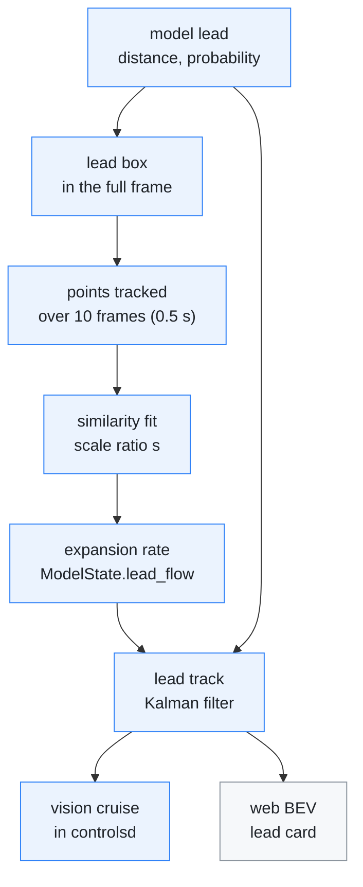
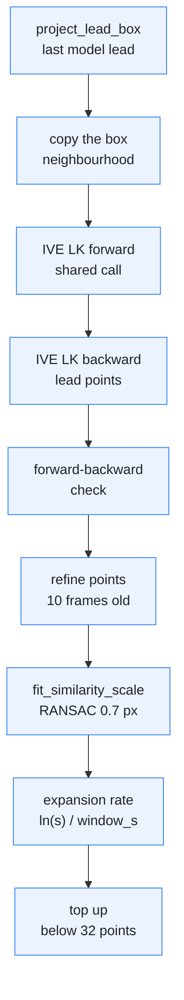
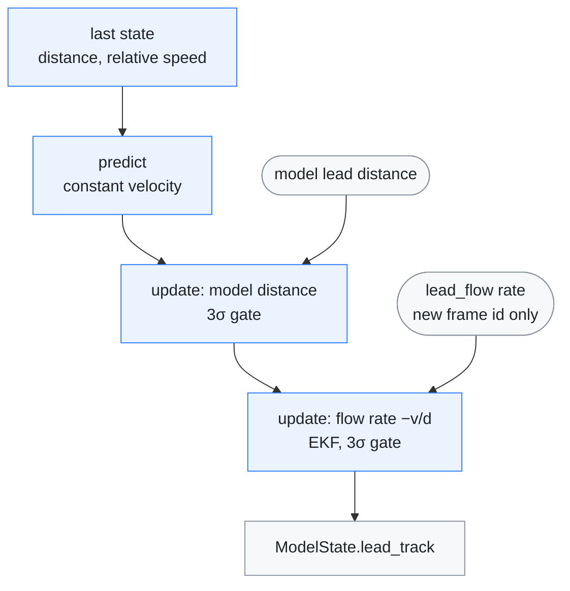
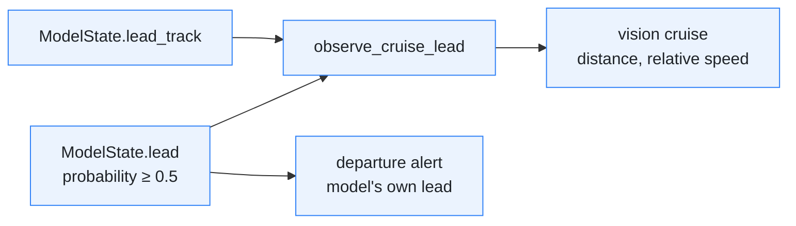
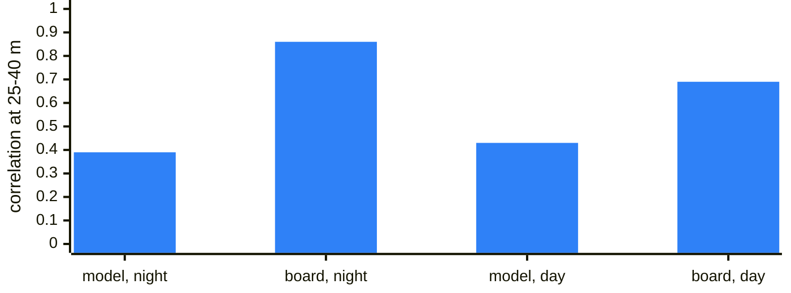
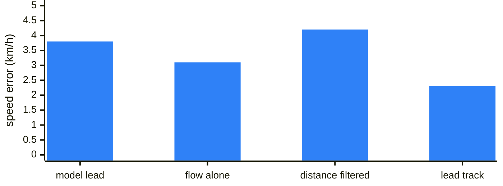

# Lead flow

[← Documentation](README.md)

The flow worker in `modeld` also measures how fast the lead car's image grows,
its expansion rate (`ModelState.lead_flow`). The lead track fuses that rate with
the model's lead distance into a distance and a relative speed
(`ModelState.lead_track`), and the vision cruise follows the track.

From the model's lead to the vision cruise:

The lead flow runs only where the [flow calibration](flow-calibration.md)
runs: on the GDC zero-copy path, unless `EDGEPILOT_FLOW_CALIB=0` or an IVE that
cannot be set up turns it off. Without it the lead track runs on the model
distance alone.

## Why

supercombo's lead velocity barely follows the closing speed beyond 25 m. The
reference here is a linear fit of the model's own lead distance over ±2 s:

- At 25-40 m the lead velocity correlates 0.43 with it in the day and 0.39 at
  night.
- Its slope is 0.3-0.5, so it reports about half the closing speed.
- The vision cruise therefore slows down late for a slower lead.

The image expansion of the lead's rear is a direct measurement:

- a scale ratio s over a window of T seconds gives the expansion rate
  r = ln(s) / T;
- the relative speed (range rate) is -x·r, with x the model distance, negative
  while closing;
- the time to collision is 1/r.

## How

### Expansion rate

The flow worker follows points on the lead's rear one frame at a time, in the
same IVE LK call as the [flow calibration](flow-calibration.md) points. Each
frame with a lead:

| Step | Where | Notes |
| --- | --- | --- |
| Box | `project_lead_box` | the previous model frame's lead (x, y) with the warp calibration, camera height and mount offset. The rear is 1.8 m wide and 0.3-1.4 m above the road; the box is shrunk 12% at each side and 8% at top and bottom. Leads at 8-80 m with probability ≥ 0.5 |
| Corners | `pick_lead_corners` | full-resolution Shi-Tomasi (3x3 Sobel, 3x3 window) in the box, ≥ 1% of the strongest, 3 px apart, up to 64. The calibrator's 640x360 response leaves only a few points in a 25 px box |
| Tracking | IVE pyramidal LK | one frame at a time, in the same call as the calibration points (300 + 64 ≤ 500); then the lead points once more, backward |
| Forward-backward | `LeadFlowTracker::advance` | a point dies when tracking it back lands 0.3 px or more from where it started, when the LK loses it, or when it leaves the box by more than 40% |
| Top-up | `LeadFlowTracker::top_up` | below 32 live points, new corners fill the free slots, 3 px away from live points. The window keeps going |
| Refinement | `LeadFlowTracker::refine` | every point keeps a 9x9 template per frame. A point alive for 10 frames is matched against its template from 10 frames ago: translation-only inverse-compositional LK, starting from the chained position, within 2 px |
| Fit | `fit_similarity_scale` | similarity transform from the positions 10 frames ago to the refined ones; RANSAC at 0.7 px, then a least-squares refit. At least 8 pairs and 6 inliers |

The CPU copies the box's neighbourhood once per frame and picks the corners,
cuts the templates and refines on that copy. It reads the ring slot through a
cached mapping and invalidates the copied rows first: an uncached mapping made
the copy three to five times slower (a 38 KB neighbourhood took 0.68 ms instead
of 0.21 ms, a 312 KB one 5.2 ms instead of 0.94 ms; board, 2026-10-21).

All points are dropped when a frame is skipped, and when in one frame the lead's
distance jumps by more than 4 m and more than 15% of the distance (the larger of
the two), or its lateral position by more than 1.5 m (a cut-in or a lane change
brings another car).

Each step was checked by emulating the board algorithm with OpenCV on the same
frames. Correlation at 25-40 m, night / day:

- **Chained tracking alone:** 0.29 / 0.49. This was the first board version. It
  reseeded only below 8 points, so most windows ran on about 10.
- **Forward-backward check:** removes points that slide on taillight blooms and
  edges. Night: about 0.3 → 0.8.
- **Top-up:** keeps the point count up.
- **Refinement:** removes the error that piles up over 10 chained steps (√10
  times one step). Day, 40-60 m: 0.27 → 0.56.
- **CPU-only alternatives** to the backward IVE call stayed near 0.7 at night: a
  correlation gate, or matching the refined window back.

### Lead track

On its own, the flow rate is right in size but noisy from frame to frame. The
model distance jumps 0.6-1.6 m from frame to frame. `model/lead_tracker` fuses
the two into the lead's distance and relative speed, `ModelState.lead_track`.
`modeld` runs it once per model frame:

- **State and measurements.** The state is [distance from the camera, relative
  speed], at constant velocity:
  - The process noise is 4 (m/s²)²·s of relative acceleration.
  - The model distance has a noise of 0.5 + 0.025·d m. Around the ±2 s trend it
    scatters 0.7-1.9 m, or 3-7%.
  - The flow rate enters as a measurement of -v/d (an extended Kalman filter
    update). Its noise is 0.03/s, taken three times larger because one frame's
    0.5 s window overlaps the next nine.
  - A flow value is used once, by its frame id: the flow worker can lag a model
    frame.
- **Gates.** Both measurements pass a 3σ gate, so single spikes are dropped. The
  filter starts again only when the lead drops out, when frames stop for over
  0.5 s, or when 5 model distances in a row fall outside the gate (another car).
  - An offline version that started again at every 4 m jump of the model
    distance spiked: most such jumps are the model's noise, not a new lead.
- **Start.** It starts from the model's distance and its relative speed (0 when
  `controlsd` has no fresh vehicle speed).

### Output

- `ModelState.lead_flow` (`LeadFlowState`, recording v12, 32 B):
  - `frame_id`, `valid`;
  - `points` (pairs in the fit) and `inliers`;
  - `expansion_rate` (1/s, positive while closing in), `window_s` (about
    0.5 s);
  - `lead_x`, the model distance the box came from.
- `ModelState.lead_track` (`LeadTrackState`, recording v13, 24 B):
  - `valid` and `flags`: the flow was used, the flow or the model distance was
    gated out, the track started.
  - `distance_m` (from the camera, like `lead.x`) and `relative_speed_mps`
    (negative while closing).
  - `distance_std_m` and `relative_speed_std_mps`: the filter's standard
    deviations.
- The `modeld` log gets a `leadflow:` line per 1200 lead frames (about a
  minute).
- `tools/model/recording_reader.py` reads them with
  `lead_flow(payload, version)` and `lead_track(payload, version)`.
- The web BEV draws the lead where the track puts it, with the model's own
  distance as a grey bar across the lane, and a card of both over time
  ([BEV tab](runtime-options.md#bev-tab)).

### The vision cruise takes the track

`controlsd` gives the vision cruise the track's distance and relative speed
whenever the track has a value (`observe_cruise_lead`). Whether there is a lead
at all is still the model's call, through its 0.5 probability threshold. The
departure alert keeps the model's lead: it has to be quick, and at a standstill
the model's lead is already steady (about 3 cm per frame).

## Evidence

### Expansion rate

A board replay tool (removed on 2026-10-22) fed the recorded leads through the
same `FlowTracker` on the board. Against the reference above, correlation /
slope / residual (m/s):

| Range | Model lead velocity | Board, first version | Board, now | OpenCV prototype |
| --- | --- | --- | --- | --- |
| Night 8-25 m | 0.34 / 0.26 / 1.2 | 0.26 / 0.66 / 2.8 | 0.80 / 0.80 / 0.7 | 0.67 / 0.59 / 0.9 |
| Night 25-40 m | 0.39 / 0.29 / 1.5 | 0.29 / 0.44 / 2.3 | 0.86 / 0.83 / 0.8 | 0.69 / 0.59 / 1.1 |
| Night 40-60 m | -0.25 / -0.15 / 1.9 | 0.21 / 0.28 / 2.2 | 0.42 / 0.43 / 1.6 | 0.38 / 0.32 / 1.5 |
| Day 8-25 m | 0.65 / 0.77 / 0.6 | 0.26 / 0.63 / 1.6 | 0.64 / 0.75 / 0.7 | 0.73 / 0.76 / 0.5 |
| Day 25-40 m | 0.43 / 0.48 / 1.0 | 0.49 / 0.88 / 1.4 | 0.69 / 1.05 / 1.0 | 0.81 / 1.06 / 0.7 |
| Day 40-60 m | 0.06 / 0.06 / 1.0 | 0.36 / 0.93 / 1.7 | 0.38 / 0.80 / 1.4 | 0.48 / 0.95 / 1.3 |

Night is 2026-10-10 19:32 (4 segments, 1633 frames every column covers). Day is
2026-10-04 12:32 (5 segments, 4425 frames); its first-version column is the
OpenCV emulation of that version.

The correlation at 25-40 m from the table, the model's lead velocity against
the board's rate now:

- **The prototype** picks fresh corners at every window start and tracks them
  straight to the window end, with a forward-backward check. The board cannot
  do that: the IVE LK clips at ±8 px, and the old frames are gone.
- **Day:** the board is a little under the emulation (25-40 m: 0.69 against
  0.75), because the IVE LK keeps slightly different points.
- **Timing:** the value covers the last 0.5 s. Stamped when it is available, at
  the window end, it trails the reference by 0.15 s (night) and 0.30 s (day).
  The model's velocity trails by 0.10 and 0.15 s. The gain is accuracy, not
  latency.
- **Coverage:** a rate on 84-92% of lead frames at night and 92-99% in the day.
- **Cost:** the replay runs on the IVE pyramid with the runtime up. It took
  1.4-2.0 ms of CPU and 8.4-10.3 ms of wall time per lead frame, against 0.7 ms
  and 6.6 ms for the first version. The backward call adds 1-2 ms of IVE time.

### Lead track

Against the same reference, on the 11 segments above (night 034/039/040/041 and
138/139 of 2026-10-10 19:32, day 2026-10-04 12:32), 8-40 m pooled, settings as
in the runtime:

| | Speed error | Corr / slope | Speed jitter per frame | Distance jitter per frame | Lag |
| --- | --- | --- | --- | --- | --- |
| Model lead (raw) | 3.8 km/h | 0.47 / 0.41 | 2.2 km/h | 0.91 m | 0.25 s |
| Flow rate alone | 3.1 km/h | 0.71 / 0.76 | 2.6 km/h | (model's) | 0.40 s |
| Model distance filtered alone | 4.2 km/h | 0.71 / 1.06 | 1.4 km/h | 0.24 m | 0.55 s |
| Lead track (model distance and flow) | 2.3 km/h | 0.82 / 0.81 | 0.7 km/h | 0.26 m | 0.60 s |

The speed error of each, in km/h:

- At about the same lag, the flow halves the speed error of a filter on the
  model distance alone, and halves its jitter. So the gain is more than
  smoothing.
- The flow for 138/139 came from the OpenCV emulation of the board algorithm,
  which matched the board. The scripts are in `eval/lead_flow_20261011/fusion`
  (outside the repository).

### Vision cruise replay

Before the switch, the real `controlsd` code was replayed on 9 segments where
the vision cruise had pressed buttons behind a lead (2026-10-10 18:34: 042, 066,
069, 075; 19:32: 034, 039-042, 082):

- `diagnostics/replay_controls` fed in the track, computed offline with the
  emulated flow (an option removed on 2026-10-22).
- Each replay starts before its cruise session, because `controlsd` estimates
  the cruise state from the driver's SET/RES presses.
- The replay is open loop: the recorded car does not answer the replayed
  buttons.

| | Model lead | Lead track |
| --- | --- | --- |
| Cruise target vs the target from the reference lead (3545 frames): RMS / median error | 6.9 / 4.3 km/h | 4.2 / 2.0 km/h |
| Target bias / jitter per frame | -2.2 / 3.2 km/h | +0.0 / 1.3 km/h |
| Button presses (SET- / RES+) | 85 (68 / 17) | 72 (55 / 17) |
| Presses against the reference (SET- while the lead pulls away, RES+ while it closes) | 35 | 23 |
| First SET- after a closing episode starts (3 of 14 answered) / first RES+ after an opening (2-3 of 10) | 0.8 s / 4.3 s | 0.4 s / 2.5 s |

- The target is the formula of `AdaptiveCruiseController::target_speed`, fed
  each lead with the same ego speed and parameters.
- The reference target jitters 0.83 km/h per frame.

### Road test

On the drive 2026-10-12--22-37-07-989, the first with the vision cruise on the
track, the cruise was on for only 54 s. The lead sat 80-100 m away and its
probability flickered. `modeld` starts the track again whenever the lead's
probability dips below 0.5, so the track restarted on every dropout, more often
the farther the lead:

| Lead distance | 8-40 m | 40-60 m | 60-80 m | beyond 80 m |
| --- | ---: | ---: | ---: | ---: |
| Track restarts per minute | 22 | 50 | 116 | 287 |

Beyond 80 m there is no flow either, since the flow covers leads up to 80 m.
Two fixes were tried in replay of this drive and of the vision cruise cases
above: the track coasting through short dropouts, and a slower drop of the
cruise target. Neither gave a clear gain, so neither was adopted.

## Limits

- **Lag.** The lead track's price is lag: 0.6 s against the reference, 0.35 s
  more than the raw model lead.
  - Measuring the flow as a change of log distance over its window (a cloned
    state) could take some of that back.
  - A constant-acceleration variant that placed the flow at its window's centre
    overshot.
- **Far leads.** At 40-60 m the board's rate still correlates only 0.42 at night
  and 0.38 in the day.
- **Near leads.** The lead track does not use the flow rate while its distance
  is under 5 m.
- **Dropouts.** A single frame with the lead probability under 0.5 ends the
  track, and the next lead starts it again. A far lead whose probability
  flickers restarts it many times a minute ([Road test](#road-test)).

## Next

The 2026-10-12 drive gave less than a minute of vision cruise, all behind far
leads. Drive more with the cruise on and recording on, behind leads within
60 m, and check `lead_flow` and `lead_track` live and how the vision cruise
follows slower leads. Far, flickering leads need more such data before the
track or the cruise is tuned for them. A time-to-collision warning could
follow.

## Related

- [Flow calibration](flow-calibration.md): the flow worker, the pyramid and the
  IVE behaviour this shares
- [Departure alerts](departure-alerts.md): the alerts that keep the model's lead
- [Runtime options](runtime-options.md#bev-tab): the web console's BEV and its
  lead card
- [Recording](recording.md): `lead_flow` and `lead_track` in the event log
- [Runtime](runtime.md): `controlsd` and the vision cruise
