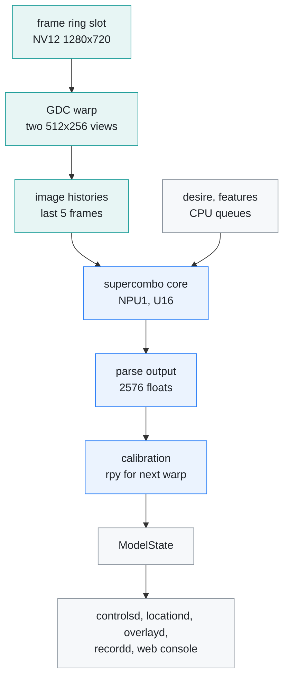
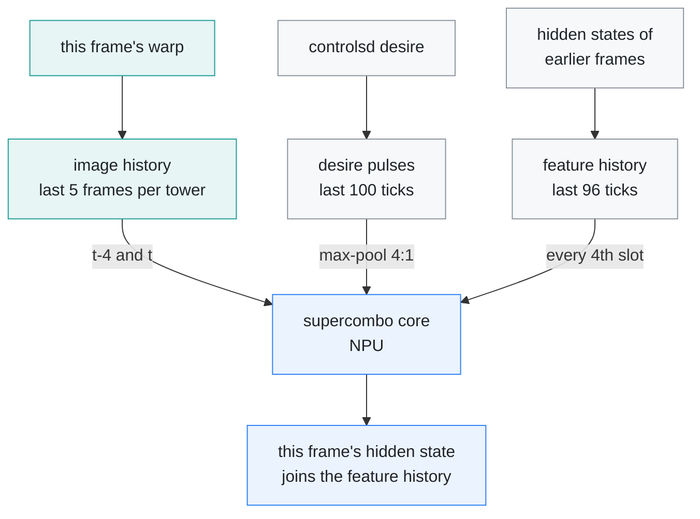
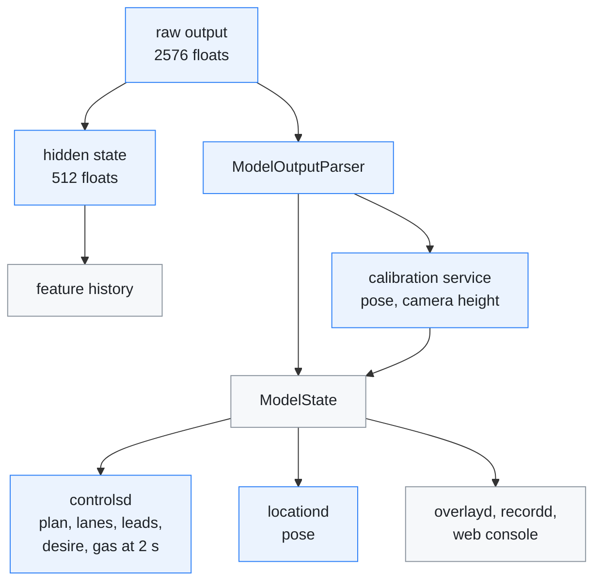

# Model pipeline

[← Documentation](README.md)

`modeld` turns every camera frame into `ModelState`. It warps the frame into the
two views the openpilot master supercombo model expects, keeps the model's
history queues, runs the model on the AX630C NPU and parses its output. Read
this before changing the model, the warp or anything that reads the output.

One frame through `modeld`, 20 times a second:



On the board one frame takes:

| Stage | Time on the board |
| --- | --- |
| warp step, both views (wall time, GDC calls and the YUV6 unpack) | ~3 ms |
| NPU inference (one core, NPU1) | ~15.5 ms |
| whole `modeld` frame | ~19.5 ms |

`EDGEPILOT_PROFILE=1` prints the average wall time of the warp, input, NPU and
output stages every 30 frames. The warp step waits for both views'
`AX_IVPS_Dewarp` calls and then unpacks the views into YUV6 planes on the CPU.
The GDC engine itself is busy for only 2 × 0.3 ms of it
([Hardware engines](runtime.md#hardware-engines)).

The AI-ISP denoiser always runs on the other NPU core, so the NPU boots split
(`/boot/configs` `maix_npu_ai_isp=1`, set by `install_autostart.sh`) and the
model is compiled for one core.

## Frame input

`camerad` captures `NV12 1280x720` into the CMM frame ring and publishes each
slot's metadata (`roadAiFrame`). `modeld` reads the newest slot on every frame
(20 Hz) and counts the frames it missed.

The frame's timestamp is the sensor's hardware PTS, about 24 ms before the
frame reaches the ring, so the plan's age counts from the capture. When the
PTS is missing or more than 200 ms old, `camerad` stamps the ring time instead.

The GDC warp reads the slot straight from its physical address (no copy). A
seqlock on the slot tells whether `camerad` overwrote it during the read.
Such a frame is dropped before it enters any queue
([Temporal inputs](#temporal-inputs)).

Before the model runs, `modeld` also:

- reads `controlsd`'s `ControlState` for the desire and the ego speed;
- hands the slot's Y plane to the flow worker, which
  measures the camera mount and the lead's expansion rate
  ([Flow calibration](flow-calibration.md), [Lead flow](lead-flow.md));
- publishes the slot's metadata on `recordFrame`, so `recordd` records the frame
  the model saw.

## Input warp

The warp is a calibrated pinhole homography per view (medmodel focal 910,
sbigmodel focal 455, both from one camera, like openpilot's single-camera
path). It is openpilot's `get_warp_matrix`, a pure rotation about the camera
centre: `K · view_from_device · R(rpy) · inv(K_model · view_from_device)`. (The
first port used the ground-plane homography of openpilot 0.8 and earlier, which
rotated about the road point 1.22 m below the camera and misplaced the near
road by ~1.3 px per degree of pitch and ~3.6 px per degree of roll.)

What goes into the homography, and what comes out:

```mermaid
flowchart TB
    measured["measured camera matrix<br>1920x1080, kCamera*"] --> k["K at the capture size<br>scaled by width and height"]
    override["EDGEPILOT_CAMERA_INTRINSICS"] -.-> k
    k --> h["homography per view<br>medmodel f 910, sbigmodel f 455"]
    rpy["calibration rpy<br>pose or flow calibrator"] --> h
    mount["camera mount<br>offset and height"] --> h
    h --> gdc["GDC warp<br>two 512x256 NV12 views"]
    gdc --> yuv6["YUV6 planes<br>6 x 128x256 per view"
    classDef pixel fill:#e7f5f4,stroke:#1f9e9a,color:#1f2328
    classDef compute fill:#ebf3fe,stroke:#2f81f7,color:#1f2328
    classDef proc fill:#f6f8fa,stroke:#8b949e,color:#1f2328
    class h,gdc,yuv6 pixel
    class rpy compute
    class measured,override,k,mount proc
```

Between the rotation and the model frame sits the camera mount. The device
setting `camera_offset_m` adds a road-plane shift for a camera
`camera_height_m` above the road, so the model sees the road from a virtual
camera that far to the right. A changed offset moves at 0.1 m/s, because a jump
would look to the model like the car moving sideways.

The warp is followed by packing into the YUV6 plane order
(`Y00, Y10, Y01, Y11, U, V`) at 128x256.

`platform/maixcam2/maix_gdc_warp.*` runs `AX_IVPS_Dewarp` in perspective mode,
reading the ring slot straight from its physical address and producing two
512x256 NV12 views in one cached output block, which it invalidates once per
frame. It then unpacks them into the newest history slot with NEON
(`src/model/yuv6_pack.h`, 16 columns at a time; a byte loop took about 6 times
as long). Storing each vector a second time, straight into the newest half of
the model input, saved 0.27 ms of copying but made the unpack 0.46 ms slower on
the board (2026-10-21), so the history is copied in before each run.
`src/model/model_input_transform.*` builds the two homographies. The
GDC must come up: without it `modeld` exits and the manager restarts it.
Against the CPU warp that earlier builds carried (openpilot's OpenCL
interpolation in fixed point), Y differed by at most 1 LSB and U/V by 0.4 LSB on
average; on a replay the plan lateral offset at 2 s against the fp32 host
reference differed by 0.0005 m.

The calibration service updates the warp's rpy after every frame, matching
openpilot's `cameraOdometry -> liveCalibration -> modeld` loop, so each frame
is warped with the calibration of the frame before. The rpy comes from the
pose calibrator (upstream `calibrationd`). When the web console's calibration
source is flow, pitch and yaw come from the optical-flow calibrator instead
([Flow calibration](flow-calibration.md)).

## Intrinsics

The source intrinsics are scaled from the measured `1920x1080` MaixCAM2
(`ov_os04d10`) camera matrix in `src/common/app_config.h` `kCamera*`:
`fx=1131.24`, `fy=1130.85`, `cx=940.13`, `cy=552.60`.

- **At 1280x720** (the capture size) that is `fx=754.2`, `fy=753.9`,
  `cx=626.8`, `cy=368.4`.
- **Measurement (2026-09-26):** 42 photos of an 11x6 inner-corner chessboard
  on a 65" TV, taken through the runtime's camera path. Views over 0.8 px
  reprojection error were dropped (58 shots, 54 detected), leaving 0.52 px RMS.
  The bootstrap 1σ is ±2.1 / ±2.0 / ±2.6 / ±1.7 px for `fx`, `fy`, `cx`, `cy`.
- **Earlier values:** the stock camera app measured `fx=1132.33`, `fy=1131.47`,
  `cx=932.80`, `cy=556.06`. That agrees on focal length, but `cx` differs by
  7 px (about 2.8σ, 0.37° of yaw, which the online calibration had absorbed).
- **Distortion:** `k1 -0.0090 k2 +0.0135 p1 -0.0010 p2 +0.0002 k3 -0.0210`.
  Inside the model input windows the pinhole warp is off by 0.09 px mean and
  0.5 px max for the road model, and 0.18 / 1.0 px for the wide model.

Captures at 1280x720, 1920x1080, and 2560x1440 register to each other by pure
scaling, so the values scale to any capture size. Distortion stays around 1% at
the corners, so the warp stays pinhole. The camera's horizontal field of view
is 80.6°, so 720p gives 13.2 px/° against the 17.9 px/° of the camera
supercombo was trained on.

`EDGEPILOT_CAMERA_INTRINSICS` overrides the matrix, for another camera module.

## Temporal inputs

The released ONNX keeps the history queues inside the graph; the NPU core does
not, so `src/model/model_temporal.h` keeps them on the CPU with the same
convention:



Every queue has the newest entry last and shifts one slot per frame:

- desire: rising-edge pulses at 20 Hz over 100 ticks, max-pooled 4:1 into the
  25x8 input
- features: the last 96 ticks of the 512-float hidden state; the model sees
  every 4th slot, 0 to 92. This frame's output is pushed after the run into
  the last slot, 95, so the model first sees it four frames later, when it
  reaches slot 92
- images: the last 5 frames per tower; the model sees the oldest (t-4) and the
  newest (t)

A frame the camera overwrote while the GDC was reading it is dropped before it
enters any queue, and a failed NPU run pushes an empty feature row, so the
three queues stay aligned.

## Model

The model is the openpilot master `driving_supercombo` with its history queues
cut off, compiled with Pulsar2 6.0 as a U16 axmodel (S8 weights, SmoothQuant)
whose image inputs are uint8. How it is built is in
[axmodel pipeline](../tools/model/axmodel/README.md); the result is committed
as `models/supercombo.axmodel` and deployed by `scripts/upload_to_board.sh`.

`src/model/ax_engine_session.*` wraps `libax_engine`. The axmodel file stays
mapped read-only for the session, and its pages are dropped once the engine
handle exists (they reload from the file if read again). All inputs share one
cached CMM block and all outputs another, each tensor at a 4096-byte aligned
offset, so a run is one cache flush of the inputs, the model, and one
invalidate of the outputs (an invalidate costs about 40 µs whenever its range
changes). Neither the board image nor the MSP SDK ships engine headers, so
`src/model/ax_engine_api.h` declares the API, copied from pyaxengine's cffi
definitions.

```text
input_imgs          [1, 12, 128, 256]  uint8   road tower: frames t-4 and t, 6 YUV planes each
big_input_imgs      [1, 12, 128, 256]  uint8   wide tower, same layout
desire              [1, 25, 8]         float   100-tick 20 Hz pulse history, max-pooled by 4
features_buffer     [1, 24, 512]       float   hidden states from slots 0, 4, ..., 92 of 96 ticks
traffic_convention  [1, 2]             float   constant (right-hand traffic)
-> 15 outputs                          float   out_meta ... out_desire_state,
                                               reassembled into 2576 floats
```

The heads are separate outputs, with the plan split into motion, orientation,
and std parts (`tools/model/axmodel/split_outputs.py`), so each gets its own
quantisation range; `src/model/model_output_assembly.h` puts them back into the
2576-float layout below. (The earlier single `[1, 2576]` output shared one
quantisation scale across every head and made the steering wobble; it is no
longer accepted.)

At load `modeld` checks each input's name, element count, dtype and buffer
size, and each output's element count and dtype by name. It refuses any other
model, so a mismatched axmodel fails loudly instead of being misparsed.

## Model output

The master supercombo emits 2576 floats. `src/common/model_output.*` owns the
layout, taken from the ONNX metadata `output_slices`. Where each part goes:



| Block | Offset | Floats | Contents |
| --- | ---: | ---: | --- |
| meta | 0 | 55 | gas and brake press probabilities 0, 2, …, 10 s ahead (the departure alert reads gas at 2 s); the rest unused |
| desire prediction | 55 | 32 | unused by this runtime |
| pose | 87 | 12 | translation, rotation, log stds |
| wide_from_device_euler | 99 | 6 | unused by this runtime |
| road_transform | 105 | 12 | 6 values (the first 3 are the camera position over the road), mean then log std; online calibration reads the camera height |
| lane lines | 117 | 528 | 4 lines x 33 points x (y, z), mean then log std |
| lane probabilities | 645 | 8 | 2 logits per line, the second is existence |
| road edges | 653 | 264 | 2 edges x 33 points x (y, z), mean then log std |
| leads | 917 | 144 | 3 time offsets (0/2/4 s) x 6 steps x (x, y, v, a), mean then log std |
| lead probabilities | 1061 | 3 | one per time offset |
| hidden state | 1064 | 512 | fed back through `features_buffer` |
| plan | 1576 | 990 | 33 points x 15 values, mean then log std |
| desire state | 2566 | 8 | desire softmax |

Unlike v0.9.4, the plan is a single hypothesis and each lead time offset has
its own trajectory. Of the 15 values per plan point, the parser consumes the
position (0–2) and the yaw (11) and yaw rate (14) that laneless mode steers
from. The last two floats are not used.

## Related

- [Runtime](runtime.md): the processes around `modeld` and what they cost
- [Runtime options](runtime-options.md): `EDGEPILOT_PROFILE`, the camera mount
  and the other switches
- [Flow calibration](flow-calibration.md): the optical-flow source of the
  warp's pitch and yaw
- [Lead flow](lead-flow.md): the lead's expansion rate and the lead track in
  `ModelState`
- [Departure alerts](departure-alerts.md): the alert that reads the gas-press
  probability
- [Recording](recording.md): how `ModelState` and the frames are recorded
- [Model package](../models/README.md): the axmodel in the repository and its
  board checks
- [axmodel pipeline](../tools/model/axmodel/README.md): building the axmodel
  from openpilot's release
- [Model tools](../tools/model/README.md): the recording reader and the numpy
  copy of the warp
