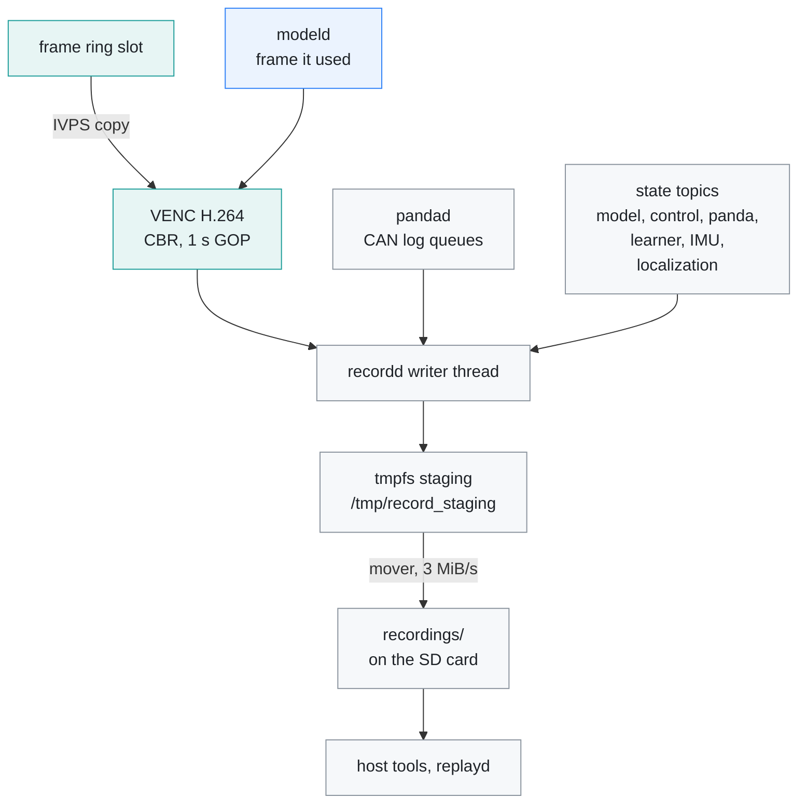
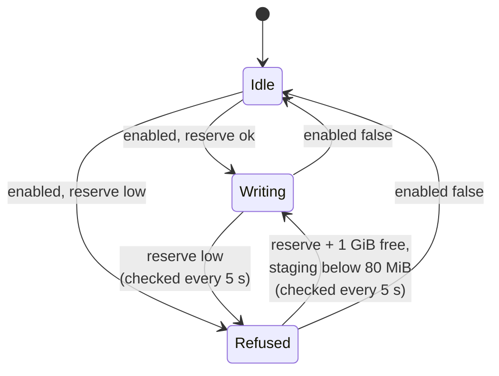
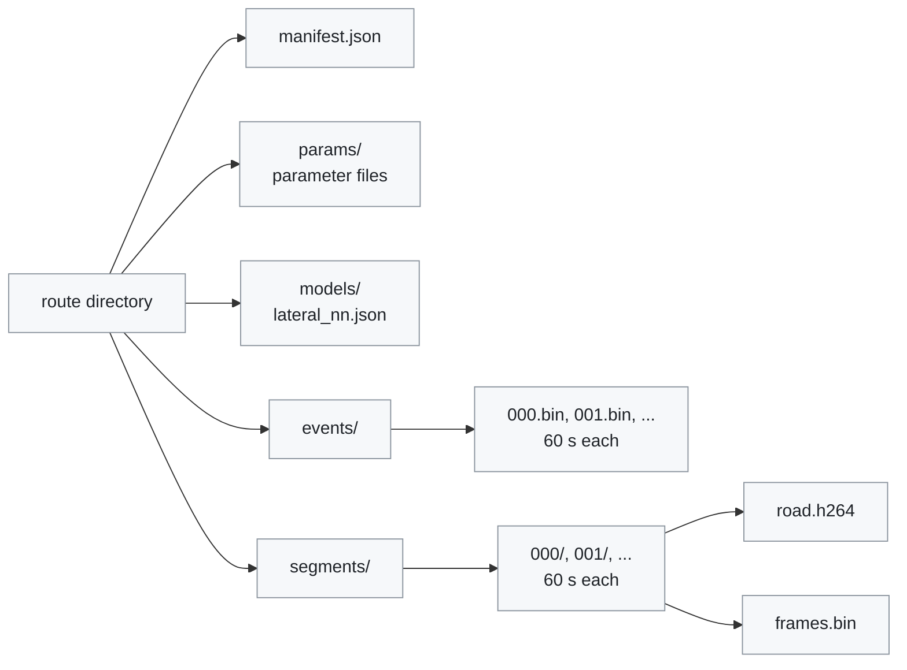

# Recording

[← Documentation](README.md)

`recordd` writes each drive as a route: the camera video as H.264 in one-minute
segments, an event log with every CAN batch and state snapshot and the
processes' log lines, and a copy of the parameter files. This document
describes the route layout, the binary format and its versions, for anyone who
reads a route or changes what is recorded.

`recordd` encodes the frame `modeld` used and logs the shared-memory states
beside it; the route is written to tmpfs first and moved to the SD card:

`recordd` writes the routes the host tools read (`recording_reader.py`, the
replay tools, `lane_benchmark.py`). `gtest_recording` covers
`src/recording/recording_writer.*`.

## Video

- `recordd` follows the frame `modeld` used (`/dev/shm/edgepilot_record_frame`),
  copies the ring slot into its own pool block with IVPS, checks the slot was
  not overwritten meanwhile, and encodes it with the hardware H.264 encoder
  (VENC, CBR, 1 s GOP). The CPU never touches pixels (~5% of a core while
  recording).
- H.264 because the board's decoder only decodes H.264, so a route can be
  replayed as recorded ([Rehearsal](rehearsal.md)).
- The video is 1280x720 at 20 fps. `bitrate_bps` in `params/recording.json`
  sets the bitrate (1-10 Mbit/s, 8 Mbit/s when it is missing); it is read
  once, when `recordd` starts. The top is what the tmpfs staging cap holds:
  a closed segment still being moved plus the one being written.

## Starting and stopping a route

`params/recording.json` `enabled` starts and stops a route. `recordd` looks at
the file every 250 ms and acts when it changes. A route needs a storage
reserve: at least 5 GiB and 10% of the SD card free, and at most 160 MiB
waiting in the tmpfs staging area. More than that means the card is not
keeping up (at 8 Mbit/s the staging peaks near 106 MiB while a closed segment
moves), and the board's `/tmp` (224 MB, no swap) would run out of memory.
After a staging stop, recording starts again only once the staging is below
80 MiB, as the SD reserve needs 1 GiB more than the stop level.

While `enabled` stays on, a refused or stopped route is not the end:
`recordd` checks the free space every 5 s and starts a new route once 1 GiB
more than the reserve is free. The margin keeps it from starting and stopping
in a loop, because the stopped route's files still move from tmpfs to the SD
card. Turning `enabled` off clears the storage warning.

`recordd` publishes `recordState` twice a second: whether a route is being
written, and what stopped it, if anything. `overlayd` shows a red `REC`, a
`STORAGE FULL` chip when the SD reserve is exhausted, or an `SD CARD SLOW` chip
when the staging cap stopped it while the card still has room
([HUD](hud.md)). A route stopped for space is closed as complete.

## Route layout

A route is a directory named after its start time in Korea Standard Time
(the board has no time-zone data), such as `2026-10-12--22-37-07-989`:

| Path | Holds |
| --- | --- |
| `manifest.json` | `version`, `complete`, `video_codec` (`"h264"`), `width`, `height`, `fps`, `bitrate`, `segment_seconds` (60), `video_frames`, `event_records` |
| `params/` | a copy of every `*.json` in the parameter directory when the route started, and of the torqued cache `live_torque_parameters.bin` |
| `models/lateral_nn.json` | a copy of the learned torque model chosen when the route started ([Lateral NN](lateral-nn.md)), so a replay can use the model that drove; `params/lateral_nn.json` names it |
| `events/NNN.bin` | the event log, one 60 s chunk per file |
| `segments/NNN/road.h264` | the H.264 stream of one segment, starting with its SPS and PPS so it decodes alone |
| `segments/NNN/frames.bin` | the frame index of that segment |

- The manifest is written with `"complete": false` when the route starts and
  rewritten when it closes.
- A new segment starts at the first keyframe at or after 60 s. With the 1 s
  GOP a segment is 60-61 s long, and usually 1220 frames (about 61 s), because
  1200 frames take just under 60 s.
- An event chunk ends at the first record 60 s after it began. Chunks and
  segments are cut independently.

### Staging and the mover

The active route is written to tmpfs (`/tmp/record_staging`,
`EDGEPILOT_RECORD_STAGING`), so SD card latency spikes cannot block the writer.
Each closed file is moved to `recordings/` in the install directory on the SD
card (`EDGEPILOT_RECORD_ROOT`); the rest of the route follows when it closes.
The parameter snapshot, the model copy and a first `manifest.json` reach the
card as soon as the route starts, so a drive that ends with the power cut still
keeps them; the closing manifest replaces the first one. The first manifest is
copied, not moved: a move deletes its source when it finishes, and on a route
closed within moments of starting it deleted the closing manifest written to
the same path in the meantime, leaving `"complete": false` on the card.

- The mover copies 1 MiB at a time, syncs each chunk, keeps to 3 MiB/s, and
  runs at idle IO priority. A plain copy piled up dirty pages and held the SD
  card for seconds when they were written: the board's load reached 10 and one
  SSH login took 36 s. A recording averages about 1.6 MB/s (8 Mbit/s video plus
  the CAN and state logs).
- On `SIGTERM` (`systemctl stop edgepilot`, a reboot) `recordd` closes the
  route and moves what is left without the rate limit; the manager waits up to
  8 s for it, inside the service's 10 s stop timeout. Before removing the power,
  stop recording or the service and wait until `/tmp/record_staging` is empty:
  what is still there when the power goes is lost.
- A route left in staging by a session that died is moved to the SD card when
  `recordd` starts. The open segment's video and frame index are written out
  to staging at every keyframe (each second), so such a segment reads up to
  its last keyframe; the index used to stay in its write buffer and was left
  empty.
- Writes wait in a queue of up to 1024 entries; when it is full, a write is
  dropped and counted in `recordd`'s log line (`write_queue_drops`).

### Sizes and deleting routes

The web console's Recording tab has a recording files card
([Web console](runtime-options.md#web-console)). It lists the routes in
`recordings/`, newest first, with the start time, the video length
(`video_frames / fps` of a closed route; a route that was never closed shows
its segment count instead) and the size in allocated blocks, which is what
deleting it frees. It also shows the free space, the reserve below which
`recordd` stops, and whether a route is being written. Deleting the selected
routes asks first and cannot be undone.

- Only directories named like a route are listed or deleted; other files,
  directories and links in `recordings/` are left alone.
- A route with a directory in the staging area is being written or still
  moving to the SD card. It is shown as such and cannot be deleted, since the
  mover would write into it. The staging directory goes away once its last
  file has moved.
- If one of the selected routes cannot be deleted, none is.

## Event log

The event log is written as 60 s chunks in `events/NNN.bin`. Each chunk starts
with a file header and holds records one after another, each a 16-byte header
and its payload. Timestamps are `CLOCK_BOOTTIME` nanoseconds, the runtime's
common clock.

File header (32 B):

| Field | Size | Value |
| --- | ---: | --- |
| `magic` | 8 B | `EDGELOG1` |
| `version` | 4 B | the recording version, now 14 |
| `header_size` | 4 B | 32 |
| `route_start_ns` | 8 B | when the route started |
| `reserved` | 8 B | 0 |

Record header (16 B):

| Field | Size | Value |
| --- | ---: | --- |
| `timestamp_ns` | 8 B | the snapshot's or CAN batch's own timestamp |
| `type` | 2 B | the record type below |
| `flags` | 2 B | 0 |
| `payload_size` | 4 B | bytes that follow |

### Record types

| Type | Record | Payload |
| ---: | --- | ---: |
| 1, 2 | `CanRx` / `CanTx` | variable CAN batch |
| 3 | `ModelState` | 2648 B |
| 4 | `ControlState` | 240 B |
| 5 | `PandaState` | 96 B |
| 6 | `LearnerState` | 128 B |
| 7 | `Imu` | 16 B + 40 B per sample (about 10 samples every 100 ms) |
| 8 | `Localization` | 128 B |

- State payloads are the structs of `src/common/ipc_messages.h` as they are.
- A CAN batch is an 8-byte header (`count`, `dropped`) and `count` frames of
  84 B (`src/recording/recorded_can.h`). `CanRx` comes from `pandad`'s receive
  log: every frame the car sent, on all three buses, with its full data field.
  The Panda's echoes of the frames it put on a bus (forwarding copies and
  edgepilot's own frames, about two thirds of what it hands back) are left
  out, so `events/` is about half the size it was. `CanTx` holds the batches
  `controlsd` generated, as `pandad` took them, whether or not TX was enabled;
  in rehearsal `replayd` logs them instead.
- An `Imu` record holds only the samples of that batch, not the whole buffer.
- The IMU axes are the chip's and the gyro bias is not removed
  (`recording_reader.iter_states`).
- `ModelState` leaves out what can be derived: the model's time grid
  (`model_t_idx`), the distance of every lane-line and road-edge point (the
  openpilot `X_IDXS` grid, `model_x_idx`, so a point is only its `y` and `z`)
  and the lane times (`compute_lane_t` derives them from the plan).

## Frame index

Each segment's `frames.bin` maps the encoded frames to camera frames. Header
(48 B):

| Field | Size | Value |
| --- | ---: | --- |
| `magic` | 8 B | `EDGEIDX1` |
| `version` | 4 B | the recording version |
| `header_size` | 4 B | 48 |
| `record_size` | 4 B | 40 |
| `width`, `height`, `fps` | 3 × 4 B | 1280, 720, 20 |
| `segment_start_ns` | 8 B | capture time of the segment's first frame |
| `reserved` | 8 B | 0 |

Then one 40 B record per frame: `frame_id`, `capture_timestamp_ns`,
`encode_index`, `file_offset` and `packet_size` in `road.h264`, and `flags`
(1 for a keyframe).

## Versions

The version is `kRecordingVersion` in `src/recording/recording_format.h`. It
changes with any recorded layout. The readers read only the current version:
on 2026-10-19 every kept recording was rewritten to version 14 (below), so no
reader carries the older layouts any more.

| Version | Change |
| ---: | --- |
| 1–4 | the earlier board's layouts; no such recording is kept |
| 5 | `LearnerState` added; `ModelState` 3256 B |
| 6 | the plan yaw and yaw rate that laneless mode steers from |
| 7 | the camera mount the warp used for that frame |
| 8 | the model's pedal predictions |
| 9 | the two file magics became `EDGELOG1` and `EDGEIDX1` |
| 10–11 | the flow calibrator's state and the warp calibration's source ([Flow calibration](flow-calibration.md)) |
| 12–13 | the lead's expansion rate and the fused lead track ([Lead flow](lead-flow.md)) |
| 14 | `ModelState` drops what can be derived and the unread brake predictions (2648 B) |

### Rewritten recordings

The 33 routes kept on 2026-10-19 (versions 5 to 13) were rewritten to version
14 by a one-off tool kept outside the repository
(`~/Documents/ax630/tools/recording_v14_migration`), checked record by record
against the old files and by replaying both, and the old files kept aside. The
tool:

- rewrote `ModelState` into the version 14 layout. Fields a version did not
  have are zero, except the camera mount before version 7 (0 m, 1.22 m) and
  the calibration source before version 11 (the pose calibrator, its estimate
  the recorded calibration);
- dropped the Panda's echoes from `CanRx` (159 million frames, half the event
  log) and the type 9 records of 2026-10-15 to 10-18, the removed lane-line
  plugin's results;
- gave `ControlState.hud_flags` today's meaning: before 2026-10-09 bit 11 was
  the brake lights and bits 9 and 10 a turn desire, and bit 10 was the removed
  Lanebow path mode on 2026-10-16 to 10-18. It also zeroed the bytes after the
  end of the two block-name strings and the tail field;
- removed `params/driving.json` (retired on 2026-10-09) and turned the
  `path_mode` of the 2026-10-15 to 10-18 `steering.json` copies into
  `laneless_mode`.

`replay_controls`, `replay_planner --exact`, `replay_localization` and
`replay_lateral_learners` give the same output on every rewritten route as the
old build on the old files. `replay_closed_loop` differs slightly, because it
now fits the turned lane lines back onto the fixed distance grid.

## Readers

- `tools/model/recording_reader.py` reads version 14 only. It checks each
  state payload's size against the struct, so a layout changed without a
  version bump fails instead of decoding garbage. `iter_states` reads the
  record types a tool asks for, one 60 s chunk at a time, into NumPy record
  arrays read by field name: a row per state record, or per CAN frame or IMU
  sample of a batch, with the record's log time.
- `lane_benchmark.py`, `hud_tools.py`, `make_m2_data.py` and
  `compare_rehearsal.py` read the event log through `iter_states`, which
  indexes each chunk with `record_index`.
- In C++, `src/recording/event_log_reader.h` reads the event log for the
  diagnostic tools and `replayd`, and `read_record` copies a fixed-size state
  record into its struct.
- Both readers stop at a cut-off tail (a chunk that tmpfs filled with zeros,
  or the last chunk after a power loss) instead of trying to resynchronise:
  where a record's type is out of range, its length is over 1 MiB, or it runs
  past the end of the file. `replayd` and the diagnostic tools report the tail
  and any unreadable chunk on stderr.
- `check_recording_reader.py` holds the Python reader's layouts, record types,
  version and cut-off rules to the C++ headers and reader.

## Related

- [Runtime](runtime.md): `recordd` among the other processes, and the topics it
  reads
- [Rehearsal](rehearsal.md): replaying a route through the whole runtime with
  `replayd`
- [Diagnostics](diagnostics.md): the replay and HUD tools that read routes
- [Model tools](../tools/model/README.md): `recording_reader.py` and the other
  route readers
- [HUD](hud.md): the `REC` and `STORAGE FULL` indicators
- [Flow calibration](flow-calibration.md): the flow calibrator state in
  `ModelState`
- [Lead flow](lead-flow.md): the lead's expansion rate and lead track in
  `ModelState`
