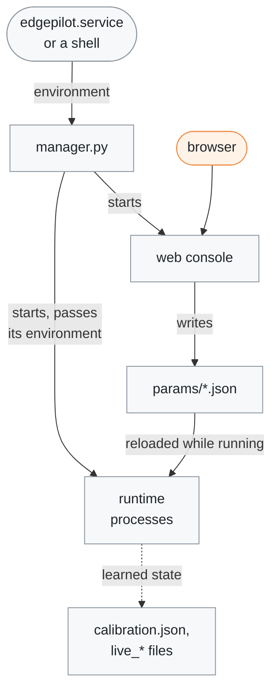
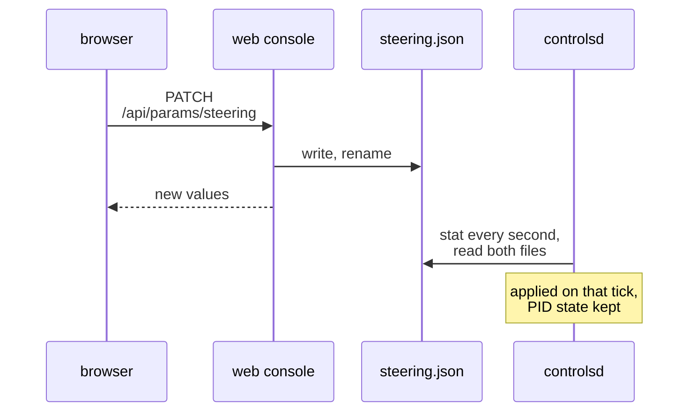
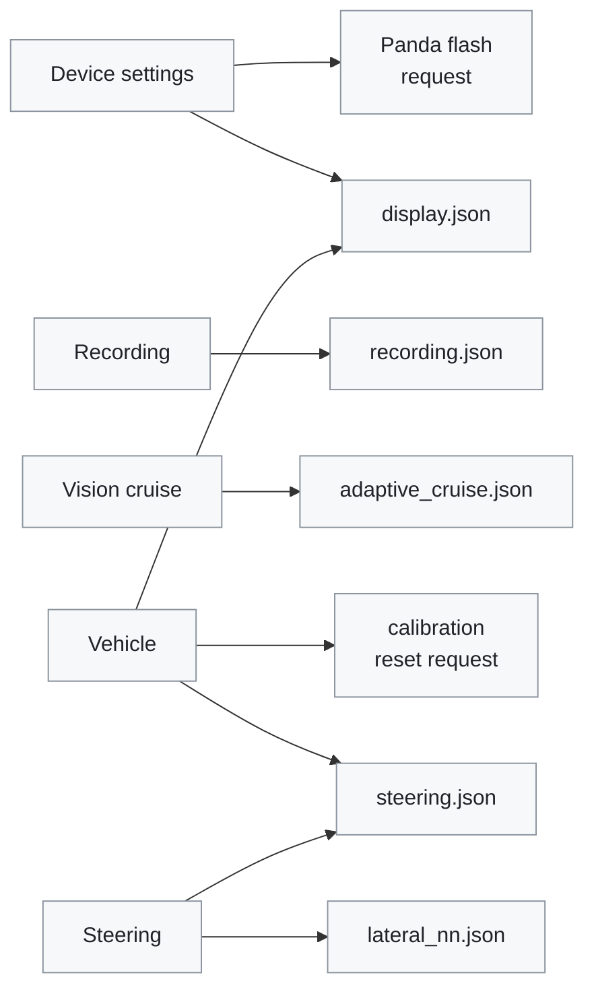

# Runtime options

[← Documentation](README.md)

The switches that set how the runtime runs on the board: environment variables
read when a process starts, the parameter files in `params/` that the processes
reload while they run, and the web console that edits those files. Look here
before you change how a process starts or what it reads.

Where the settings come from and who reads them:



## Environment variables

Boolean environment variables follow one convention: unset or empty uses the
default, `0`/`false`/`no`/`off`/`n` (case-insensitive) is false, anything else
is true.

The manager reads its own variables and passes its whole environment to the
processes it starts, so a variable set for the manager reaches every process.
`edgepilot.service` sets `EDGEPILOT_LOG_DIR=/run/edgepilot`,
`EDGEPILOT_USB_ROLE=host` and `EDGEPILOT_ENABLE_PANDA=1`.

### Manager

| Variable | Default | Effect |
| --- | --- | --- |
| `EDGEPILOT_MODEL=/path/to/supercombo.axmodel` | `models/supercombo.axmodel` in the install directory | Overrides the model selected by `manager.py`. A command-line argument wins over it. |
| `EDGEPILOT_STOP_LAUNCHER=0` | on | Leaves the stock `launcher.service` and `/maixapp/apps/` running. The default stops them, since they hold the camera and NPU. |
| `EDGEPILOT_LOG_DIR=dir` | unset: output goes to the terminal | Writes each process's output to `<name>.log` in that directory; a log above 1 MiB is copied to `<name>.log.1` and emptied. `edgepilot.service` sets `/run/edgepilot`, on tmpfs, so logs never reach the SD card. |
| `EDGEPILOT_REPLAY_ROUTE=route` | unset | Rehearsal: `replayd` plays the recorded route in place of `camerad`, from `EDGEPILOT_REPLAY_START` for `EDGEPILOT_REPLAY_DURATION` seconds; `imud`, `locationd` and `pandad` are not started ([Rehearsal](rehearsal.md)). |

The variables that choose which processes start (`EDGEPILOT_ENABLE_CONTROL`,
`EDGEPILOT_ENABLE_PANDA`, `EDGEPILOT_ENABLE_WEB_CONSOLE`) are listed with their
parts below.

### Model and calibration

`modeld <supercombo.axmodel>` takes one argument, the model. The runtime
targets the openpilot master supercombo core: 5 inputs (`input_imgs` and
`big_input_imgs` uint8 `[1,12,128,256]`, `desire` `[1,25,8]`,
`features_buffer` `[1,24,512]`, `traffic_convention` `[1,2]`) and 2576 output
floats (15 head outputs reassembled). `modeld` checks
names, shapes, dtypes, and buffer sizes at startup and refuses any other
axmodel rather than misreading it.

| Variable | Default | Effect |
| --- | --- | --- |
| `EDGEPILOT_PROFILE=1` | off | `modeld` prints warp/inputs/NPU/outputs averages every 30 frames; `overlayd` adds HUD draw and video push timing and the model-to-draw lag to its status line. |
| `EDGEPILOT_CAMERA_INTRINSICS=fx,fy,cx,cy` | `1131.24,1130.85,940.13,552.60`, the calibrated MaixCAM2 camera | Camera intrinsics at 1920x1080, scaled to the capture size, for another camera module. |
| `EDGEPILOT_CALIB_AUTO=0` | on | Disables pose-based online calibration and keeps the restored projection (`params/calibration.json`, or zero without one). On, the saved calibration is restored and pose-based online calibration feeds the next frame's input warp, matching openpilot's `cameraOdometry -> liveCalibration -> modeld` loop. |
| `EDGEPILOT_FLOW_CALIB=0` | on | Turns off the optical-flow calibrator (VPP/IVE). On, it is recorded in `ModelState.flow_calibration` and logged as `flowcal:` lines; the warp uses it only when the device setting `calibration_use_flow` is on ([Flow calibration](flow-calibration.md#using-the-estimate)). Off, nothing new is measured; a stored estimate (`params/flow_calibration.json`) is still recorded and can still be applied, and with none the recorded status stays 0. |

### Camera and input warp

| Variable | Default | Effect |
| --- | --- | --- |
| `EDGEPILOT_MAX_SHUTTER_US=N` | `33333`, the 30 fps frame time | Caps the auto-exposure shutter in `camerad`, so the 20 fps sensor does not add motion blur. `0` leaves the sensor default. |

### Storage

| Variable | Default | Effect |
| --- | --- | --- |
| `EDGEPILOT_PARAMS_DIR=/path/to/params` | `params/` relative to the runtime working directory | Overrides the shared runtime parameter directory, and is the only way to relocate parameter files; there are no per-file overrides. The web console reads the factory defaults from the directory beside it with `.defaults` added (`params.defaults/`, filled by the upload script). |
| `EDGEPILOT_RECORD_ROOT=dir` | `recordings` under the install directory | Where `recordd` writes its routes. `params/recording.json` `enabled` toggles recording. |
| `EDGEPILOT_RECORD_STAGING=dir` | `/tmp/record_staging` | The staging directory in RAM that `recordd` writes through. A route left there by a session that died is moved to the record root at start. |

### IMU

| Variable | Default | Effect |
| --- | --- | --- |
| `EDGEPILOT_IMU_DEV` | `/dev/i2c-1` | The I²C bus where `imud` finds the LSM6DSOW. |
| `EDGEPILOT_IMU_ADDR` | `0x6B` | Its address. Both defaults are the MaixCAM2's. |

### Panda

Several Panda variables have two defaults: one when `pandad` runs on its own,
and the one the manager sets before it starts `pandad`.

| Variable | `pandad` alone | Manager | Effect |
| --- | --- | --- | --- |
| `EDGEPILOT_ENABLE_PANDA=1` | | off; `edgepilot.service` sets it | The manager also starts `pandad` and switches the USB-C port to host mode (restored on exit). The binary must have been built with `-DEDGEPILOT_BUILD_PANDA=ON`. |
| `EDGEPILOT_USB_ROLE=host\|device` | | unset; `edgepilot.service` sets `host` | Fixes the USB-C role at manager start and leaves it on exit. `host` is for the Panda, which plugs into the USB-C port; set `device` to reach the board from a computer over USB. Unset, the role only changes with `EDGEPILOT_ENABLE_PANDA=1` as above. |
| `EDGEPILOT_PANDA_SAFETY=nooutput\|hyundaiCommunity` | `nooutput` | `hyundaiCommunity` | Panda safety mode for `pandad`. `controlsd` engages only under `hyundaiCommunity` with parameter 0; any other name means `nooutput`. |
| `EDGEPILOT_PANDA_SAFETY_PARAM=N` | `0` | `0` | Numeric safety parameter passed with the safety mode. |
| `EDGEPILOT_PANDA_TX=1` | `0` | `1` | Allows `pandad` to relay ordered `/dev/shm/edgepilot_sendcan` batches to the Panda. |
| `EDGEPILOT_PANDA_ENGAGED=1` | disengaged | engaged | Sends the Panda heartbeat as engaged; only meaningful with `EDGEPILOT_PANDA_TX=1`. The bundled firmware (`firmware/panda`) ignores the value and only resets its heartbeat timer; newer firmware reads it. |
| `EDGEPILOT_PANDA_LOG_CAN=1` | off | off | Prints every received CAN frame from `pandad`. This is a bus-bringup aid only; at full bus load it is far too noisy to leave on. |
| `EDGEPILOT_PANDA_FIRMWARE=path` | `firmware/panda.bin.signed` | same | The Panda application image the web console flashes, relative to the install directory (built by `make -C firmware/panda`). `pandad` and the web console read the same variable. |

Collected KIA K7 YG HEV logs from the current openpilot fork report
`safety=hyundaiCommunity:0`, `sccBus=-1`, `mdpsBus=1`, and `sasBus=1`. A
shadow run uses `EDGEPILOT_PANDA_SAFETY=nooutput` with `EDGEPILOT_PANDA_TX=0`;
`hyundaiCommunity` is only for TX, once the connected car's fingerprint and the
Panda's health confirm that configuration
([Shadow run](k7-panda-port.md#shadow-run)).

### K7 control

| Variable | Default | Effect |
| --- | --- | --- |
| `EDGEPILOT_ENABLE_CONTROL=1` | on | The manager starts `controlsd`. It does not start `pandad` on its own; that needs `EDGEPILOT_ENABLE_PANDA=1`. No openpilot checkout or Python native extension is required. |
| `EDGEPILOT_FORCE_ENGAGED=0\|1` | `0` | Bypasses the SET/CANCEL engage latch, for offline replay only. |
| `EDGEPILOT_LATERAL_NN_MODEL=path` | unset: the model chosen in `params/lateral_nn.json` | A learned torque model file that replaces the choice ([Lateral NN](lateral-nn.md)), relative to the install directory. `controlsd` still reloads it when the file changes, and `recordd` copies it into each route. |
| `EDGEPILOT_LATERAL_NN_STATUS=path` | `/dev/shm/edgepilot_lateral_nn_status.json` | Where `controlsd` reports the chosen and the loaded model for the web console. |

> [!WARNING]
> `EDGEPILOT_FORCE_ENGAGED` must remain `0` in a vehicle.

### Web console and display

| Variable | Default | Effect |
| --- | --- | --- |
| `EDGEPILOT_ENABLE_WEB_CONSOLE=0\|1` | the value of `EDGEPILOT_ENABLE_CONTROL` | Starts the web console (FastAPI, `web_console/`) with the manager. |
| `EDGEPILOT_CALIBRATION_RESET_PATH` | `/dev/shm/edgepilot_calibration_reset` | The request file behind the web console's calibration reset. `modeld` checks it every second; when it exists, `modeld` deletes it and restarts calibration from the beginning. Both sides read the same variable. |

`overlayd` turns the backlight on at start (`pwmchip0/pwm3`, level from
`maix_backlight_value` in `/boot/configs` and `disp_max_backlight` in
`/boot/board`) and then applies `params/display.json` on the same PWM: duty =
100 µs period x brightness % x `disp_max_backlight` %, and `enabled: false`
sets the duty to 0 ([HUD](hud.md#backlight)). The web console only writes the
file, and shows the level it reads back from the PWM.

### Alerts

`overlayd` plays the alert sounds on the board speaker. How it picks and plays
them, and how to check the speaker at the desk, is in
[Alert sounds](hud.md#alert-sounds); which events alert is in
[Departure alerts](departure-alerts.md).

| Variable | Default | Effect |
| --- | --- | --- |
| `EDGEPILOT_ALERT_SOUND=0` | on | Turns the sounds off. |
| `EDGEPILOT_ALERT_VOLUME` | `70` | Volume, 0–100. `alert_volume_percent` in `params/display.json` (the web Device settings tab) overrides it at runtime. |
| `EDGEPILOT_ALERT_PCM` | `/dev/snd/pcmC0D1p` | ALSA playback device node. |

## Parameter files

The tracked JSON files in `params/` are the source of truth for K7 steering,
vision-cruise, recording, and display configuration;
[Parameters](../params/README.md) lists every value. Changes are written
atomically: to a temporary file, synced, then renamed over the old one.

| File | Written by | Read by | A change applies |
| --- | --- | --- | --- |
| `steering.json` | web console: Steering and Vehicle tabs | `controlsd`; `locationd` reads `steer_actuator_delay` once at start | within 1 s: `controlsd` checks both files every second |
| `adaptive_cruise.json` | web console: Vision cruise tab | `controlsd` | as `steering.json` |
| `recording.json` | web console: Recording tab | `recordd` | `enabled` within 250 ms; `bitrate_bps` when `recordd` next starts |
| `display.json` | web console: Device settings tab; `calibration_use_flow` from the Vehicle tab's calibration card | `overlayd` (backlight, alert volume), `modeld` (camera mount, calibration source) | within 1 s |
| `lateral_nn.json` | web console: Steering tab's learned torque model card | `controlsd`, `recordd` | `controlsd` checks it every second and loads the new model in the background ([Lateral NN](lateral-nn.md#models-choice-and-switch)) |
| `calibration.json` | `modeld` | `modeld`, at start | the runtime's own state, see below |

`controlsd` reads its two files together. If either is rejected, it keeps the
previous values of both and logs why. How a changed steering value reaches the
controller:



The web console only writes the file. `controlsd` checks both files every
second (a rename gives the file a new inode, so every write is seen), reads
them when one changed and applies them on that tick, keeping the control and
PID state. A change therefore applies within a second. If `controlsd` is not
running, the editor says the value is saved and `controlsd` is not running; it
reads the file when it starts.

`params/calibration.json` is also tracked as the initial calibration seed. The
tracked copy is all zero (uncalibrated), the same as having no file. The
runtime replaces it atomically when a stable calibration is learned, and
restores it before the first model frame; manual `EDGEPILOT_CALIB_*` values
take precedence and seed it. `scripts/upload_to_board.sh` preserves an existing
runtime copy and installs the repository copy under `params.defaults/` as a
fallback. After a mount change, let online calibration relearn it.

When it starts, the web console brings the keys of each runtime file in line
with `params.defaults/`: a missing key gets its default, and a key gone from
the defaults is removed, so a parameter the code no longer reads does not stay
in the editor. The values of the other keys stay as they are.

### Learned state

The runtime saves what it learns next to the parameter files, and reads it back
at the next start:

| File | Written by | When | Read back |
| --- | --- | --- | --- |
| `calibration.json` | `modeld` | when a stable calibration is learned | at `modeld` start |
| `flow_calibration.json` | `modeld` | the first estimate and a mount change at once, otherwise every minute and on exit | at `modeld` start |
| `live_parameters.json` | `controlsd` (paramsd) | every minute, if it changed | at `controlsd` start |
| `live_torque_parameters.bin` | `controlsd` (torqued) | every 12 s, if it gathered new points | at `controlsd` start |
| `live_delay.json` | `locationd` (lagd) | every 60 s and on exit | at `locationd` start, unless it is from another cache version, invalid, or out of range (then it is deleted); a changed `steer_actuator_delay` does not discard it |

A saved learner state that fails to restore is deleted (for torqued, only a
corrupt cache). paramsd's state also fails when the wheelbase or centre of
gravity changed, or when its steering ratio is outside 0.5-2x the manual one.
A changed tyre stiffness keeps it, as openpilot does: the learned stiffness
factor starts at 1.0 at every start anyway. torqued starts over when its prior
(torque factor, friction) changed, and keeps only the factor and friction when
the learner input source changed. The web console's calibration reset deletes
`calibration.json` and `flow_calibration.json`.

## Web console

Open the web console at `http://<board-ip>:8080`. It can also be started
directly, from the install directory:

```sh
cd /root/edgepilot && python3 -m web_console --host 0.0.0.0 --port 8080
```

The page is in Korean or English. It follows the browser's language at first;
the language button in the header (`EN` / `KO`) switches it, and that browser
remembers the choice (`?lang=en` or `?lang=ko` in the address also picks one).
The documents name the tabs and buttons by their English labels.

Every text on screen, in both languages, is in
`web_console/static/i18n/ko.json` and `en.json`. The server sends only
structure and codes: the parameters' sections, units and ranges, the Panda's
reasons and steps, and a catalogue key when it refuses a request (for example
a calibration reset while engaged). `check_web_console.py` checks that the two
files have the same keys and placeholders, that every key the page or the
server uses exists and none goes unused, and that no screen text is left in
the code or the stylesheet.

The server checks every value before it writes a parameter file, because the
runtime loaders reject a whole file over one bad value and `controlsd` then
fails to start: a switch takes only `true` or `false`, a number only a finite
number within the item's range, and an item whose step is whole only a whole
number.

> [!WARNING]
> The web console has no authentication and writes steering parameters that
> `controlsd` hot-reloads while driving. Expose it only on a trusted vehicle
> or development network.

The header shows the processes the manager runs (its `ManagerState`, a red or
amber pill when one is down or the manager stopped publishing) and the
backlight. The process panel also names the build most processes run, read
from the running binaries ([Build version](build-and-deploy.md#build-version)),
and marks a process that runs a different build, or whose installed binary has
changed since it started (a copied binary that needs a restart).

There is one tab per parameter file, with Vehicle after Steering, and BEV. The
address keeps the tab (`#steering`, `#vehicle`, `#bev`), so a reload stays on
it, and only the tab on screen polls the board. Parameter tabs search, show
only the changed items, mark each item's default and put it back with one
press. A value is written as soon as it is changed.

| Tab | Address | Holds |
| --- | --- | --- |
| Steering | `#steering` | the controller tuning, the learned torque model card, the path mode (Laneless) and the lane-change minimum speed; searching it for a moved value links to Vehicle |
| Vehicle | `#vehicle` | the steering values that belong to the car rather than to the controller, the learner input source, the learners' trend, the camera calibration and the fixed specs |
| Vision cruise | `#adaptive_cruise` | `adaptive_cruise.json` |
| Recording | `#recording` | `recording.json`, and the recording files card: the routes on the SD card with their length and size, the free space, and deleting the selected routes |
| Device settings | `#display` | backlight, sound and camera mount from `display.json`, and the Panda firmware card |
| BEV | `#bev` | the model's view from above, drawn in the browser |

What each tab writes:



The BEV tab writes nothing. The two request files sit in `/dev/shm`: `modeld`
acts on the calibration reset, and `pandad` on the flash request.

### Vehicle tab

Vehicle holds the steering values that belong to the car rather than to the
controller. The values a learner replaces come in one group per learner, as
the learners publish them: paramsd's steering ratio, tyre stiffness,
steering-angle zero and road-roll compensation; torqued's torque factor,
friction and offset; lagd's steering delay. Each group has one Auto-learn /
Manual choice (the `use_live_*` switches). Each value's card shows the value
control uses now and where it comes from (controlsd's LearnerState says
whether the learned values are in use), the learned value, the manual value
with what it does while learning is on, and a button that copies the learned
value into the manual one (tyre stiffness and road roll have none: their
learned value is a factor and a roll). Below are the learner input source
(locationd or ESP12), the learners' last ten minutes, the camera calibration
and the fixed specs (wheelbase, centre of gravity). There is no vehicle mass:
tyre stiffness scales with it, so it cancels out of the vehicle model, and
openpilot dropped it in 2026-10.

The manual values reach the learners as priors when `controlsd` starts
(`locationd` for the steering delay), so a prior changed while auto-learning
reaches the learner at the next start. The cards of the values that reset a
learner say so: the torque factor and friction make torqued relearn from the
new prior. A change of the fixed specs (a code change) makes the next start
delete paramsd's saved state.

The camera calibration card resets the calibration and chooses its source,
pose or flow (`calibration_use_flow`); it refuses both while engaged.

### Device settings tab

The tab edits the backlight, the alert volume and the camera mount in
`display.json`. Its Panda firmware card shows the Panda's link and firmware,
and asks `pandad` to flash the installed image (`EDGEPILOT_PANDA_FIRMWARE`)
only while the car is parked, or at any time for a Panda stuck in its
bootstub ([Panda firmware](../firmware/panda/README.md)).

### BEV tab

The BEV tab shows what the model sees from above: lane lines, road edges, the
planned path and the lead, round the ego car, with the HUD's colours and limits
(`hud_renderer.cc`). The browser does all the work. The board copies the
`ModelState` and `ControlState` payloads, unparsed, into one streamed response
(`/api/bev/stream`, a frame per new model frame, 4.0 kB at up to 20 Hz). It
sleeps until the next model frame is due, so a viewer costs about 3% of one
core at nice 10, and nothing once the tab is closed or hidden. `/api/bev` says
where the fields sit. `ipc_messages.h` pins those offsets, and
`check_web_console.py` checks the two match. The page refuses to draw, and says
so, when the server does not list a field it reads. The page loads `bev.js` and
three.js from `web_console/static/`. The server gzips each file once in memory
(about 250 kB in all) and then answers with 304 while it is unchanged.

The ego car is the car's own model (`web_console/static/bev_ego.js`); the BEV
knows only its size and the function that builds it, so another car brings its
own. Today it is a black 2017 Kia K7, built in code from the published
dimensions and from measurements of Kia's studio photographs (side, front,
back): its proportions, grille, lamps, chrome, plates and wheels. Its tail
lamps are lit. It costs the browser 26k triangles in 22 meshes, and is made
once when the tab opens. The lead is the generic car
(`web_console/static/bev_car.js`).

Beyond the HUD, the BEV shows the following. Its cards (lead, departure) sit in
a column beside the view, or under it below 900 px wide, so they never cover
the road. Over the view are only the view and layer buttons and the chips along
the bottom.

- **Steadied ego lines.** The two ego lines are drawn as the planner sees them:
  `web_console/static/lane_filter.js` runs the planner's lane-line filter on the
  capture times and on `controlsd`'s speed and measured curvature
  ([Lane-line filter](lane-line-filter.md)). The model's own lines run thin and
  grey beneath them; the raw lines button hides those. On the 2026-10 drives
  the drawn lines tremble about 60% less from frame to frame, but still sway:
  the slower swing over a second drops only 13-26%. The `LANE W` chip measures
  the drawn lines. Without `controlsd` the model's lines are drawn as they are.
- **Planned slowdown.** The inside of the path turns amber, then red, where the
  model plans to slow down. The `PLAN` chip gives the slowest planned speed and
  where it is, or `STOP`, or the speed the plan reaches when moving off. The
  speed comes from the plan's positions over openpilot's T_IDXS. Against the
  model's own velocity output it is 0.04 m/s off at 2 s and 0.07 m/s at 4 s
  (median, 2026-10-04 drives). The vision cruise does not use it.
- **Curvature arcs.** A white arc shows the curvature `controlsd` asks for and a
  cyan arc the curvature it measures. Each runs as far as the car goes in 2.5 s.
  The gap between their end ticks shows where the error would take the car. The
  `LAT` chip gives both as lateral acceleration.
- **Steering strain.** The ego halo turns amber as the steering output nears its
  limit. The HUD shows this on the path instead.
- **Lead brake lights.** They light when the model's lead decelerates at
  1 m/s² or more, and go out above −0.6 m/s².
- **Ego turn signals.** The K7's mirror repeater, the block at its headlamp's
  inner end and its tail lamp's amber lens flash, with a glow on the road, while
  `controlsd` reports a blinker, every 0.7 s like the K7's own lamps. Hazards
  light both sides.
- **Ego brake lights.** The K7's tail lamps brighten, its high brake light comes
  on and a red glow lights the road behind it, while the pedal is pressed or
  AUTO HOLD holds the car (`kHudFlagBrakeLights`; see
  [Brake signals](k7-panda-port.md#brake-signals)).
- **Lead track.** `modeld` fuses the model's lead distance with the optical
  flow's measure of how fast the lead's image grows (`ModelState.lead_track`;
  see [Lead track](lead-flow.md#lead-track)). While it has a value:
  - The lead car stands at the tracked distance, and its arrow and the `LEAD`
    chip give the tracked relative speed.
  - A grey bar across the lane marks the model's own distance, so its jitter
    shows.
  - A label beside the car gives the time to contact under 10 s.
  - A `LEAD` card shows, over the last 20 s (its title folds the charts away,
    remembered in that browser):
    - the distance and the relative speed of the track (green), the model's
      own (grey) and the flow's (cyan, speed only);
    - the trend of the model's distance (amber): a straight line over ±2 s,
      so it ends 2 s back;
    - its badge, the time to contact.

  The vision cruise takes the track. The departure alert keeps the model's lead.
- **Departure card.** While the car stands in D, a card shows the departure
  alert's inputs (`departure_alert.cc`):
  - the 2 s gas press probability against the 0.3 that fires it, with its last
    10 s;
  - how far the plan reaches in 10 s: the alert arms while the plan reaches
    less than 5 m in 10 s, and fires when it reaches more than 10 m;
  - `ARMED`, or `GREEN` / `LEAD GO` while an alert shows.

### API

The page talks to the server over these routes (`console_server.py`). A
refused request answers with its status code (400 a bad value, 404 an unknown
item, 409 not now, for example while engaged, 500 a file error, 503 no
hardware) and `{"detail": {"code": <catalogue key>, ...}}`, which the page
shows in its language. Each live state carries `available` (there is one),
`stale` (missing, or older than that state's limit) and `age_s`.

| Route | What it does |
| --- | --- |
| `GET /api/status` | the manager's process states and the backlight; `?versions=1` adds each binary's build, which the header asks for only while its process list is open |
| `GET /api/params` | parameter groups, current values, defaults and descriptions |
| `PATCH /api/params/{group}` | change values, `{"values": {...}}` |
| `GET /api/learners` | paramsd and torqued learned values, the camera calibration, the locationd steering delay |
| `GET /api/learners/trend` | the learned values over the last 10 minutes |
| `POST /api/calibration/reset` | reset the camera calibration (disengaged only) |
| `POST /api/calibration/source` | choose the calibration source, `{"use_flow": ...}` (disengaged only) |
| `GET /api/lateral_nn` | the learned torque models, the choice, the default and what `controlsd` loaded |
| `POST /api/lateral_nn` | choose a learned torque model, `{"model": ...}`; `controlsd` switches without a restart |
| `GET /api/panda` | the Panda firmware and the installed image |
| `POST /api/panda/flash` | ask for a Panda flash, `{"version": ...}` (parked only) |
| `GET /api/recordings` | the routes on the SD card (size, video length, segments, whether one is being written or closed), the free space and the reserve, and `recordd`'s state |
| `POST /api/recordings/delete` | delete routes, `{"names": [...]}`; nothing is deleted if one name is not a route (400), unknown (404) or still being written or moved (409) |
| `GET /api/bev` | where the fields the BEV reads sit |
| `GET /api/bev/stream` | the BEV stream (`ModelState` and `ControlState` payloads) |
| `GET /static/{path}` | the page's files |

## Production defaults

The start order is in [Start order](runtime.md#start-order) and the nice levels
under [`manager.py`](runtime.md#managerpy).

| Setting | Value |
| --- | --- |
| Capture | `NV12 1280x720`, the full sensor field of view scaled (no crop), sensor at 20 fps |
| Frame ring | 8 CMM slots |
| Front-vehicle marker | always enabled, with probability threshold `0.5` |
| Desired curvature | clamped to openpilot's `0.2 1/m`; intentionally not a runtime tuning option |

## Related

- [Parameters](../params/README.md): every value in the parameter files
- [Runtime](runtime.md): the processes the manager starts and how it supervises
  them
- [Build and deploy](build-and-deploy.md): the upload that fills
  `params.defaults/`, and the build version
- [Flow calibration](flow-calibration.md): the optical-flow calibrator and
  `calibration_use_flow`
- [Lead flow](lead-flow.md): the lead track drawn in the BEV and used by the
  vision cruise
- [Lane-line filter](lane-line-filter.md): the steadied ego lines
- [Departure alerts](departure-alerts.md): which events alert
- [HUD](hud.md): what `overlayd` draws on the LCD
- [Rehearsal](rehearsal.md): replaying a recorded route through the runtime
- [Diagnostics](diagnostics.md): checking a model swap with raw output dumps
- [K7 Panda port](k7-panda-port.md): the CAN signals, safety modes and brake
  signals
- [Scripts](../scripts/README.md): `manager.py` and the web console sources
