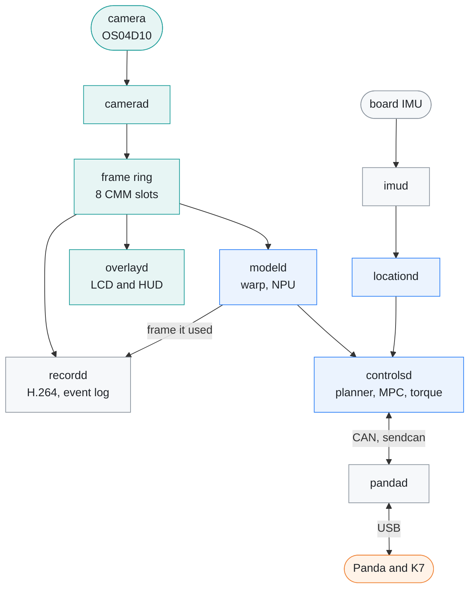
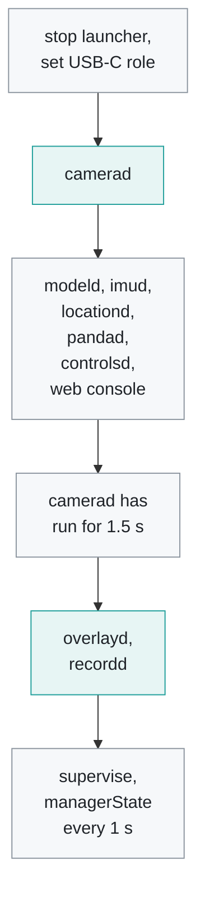
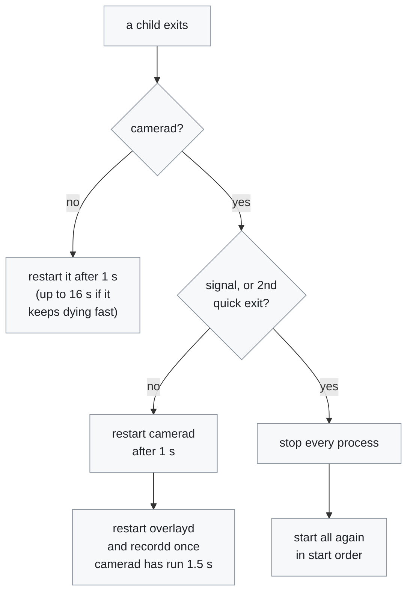
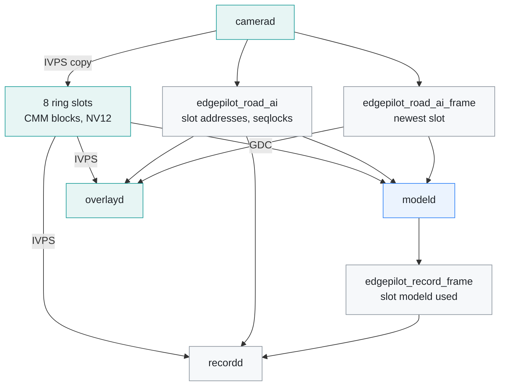

# Runtime

[← Documentation](README.md)

The board runtime is a set of single-purpose processes that `manager.py`
starts and supervises; they talk to each other through `/dev/shm`. This
document covers how the runtime starts, what each process does, what it costs,
and where the process boundaries are.

The camera's pixels go from `camerad` into the frame ring, which `modeld`,
`overlayd` and `recordd` read with hardware engines; everything else is small
state snapshots and CAN batches:



What `overlayd` draws is in [HUD](hud.md), and what `recordd` writes is in
[Recording](recording.md).

## Managed startup

### Start the runtime

```sh
python3 /root/edgepilot/manager.py [supercombo.axmodel]
```

The manager changes to its own directory, so it can be started from anywhere.
With no argument it runs `models/supercombo.axmodel` (or `EDGEPILOT_MODEL`)
with K7 control and the FastAPI web console on. `pandad` starts only with
`EDGEPILOT_ENABLE_PANDA=1`, which the boot service sets, and then transmits by
default (`EDGEPILOT_PANDA_TX=1`). Every setting can be overridden with its
environment variable; see [Runtime options](runtime-options.md).

Stop it with Ctrl-C or `SIGTERM`: children get `SIGTERM`, then `SIGKILL` after
3 s; `recordd` gets 8 s to move the rest of the recording to the SD card.

### Boot autostart

`scripts/install_autostart.sh [root@board]` installs
`scripts/edgepilot.service` and disables the stock launcher at boot. The unit:

- starts after `edgepilot-drivers.service`, which loads the AX drivers early in
  boot and is installed by `scripts/install_boot_tuning.sh`, and after
  `usb-gadget.service` ([Boot time](boot-time.md#unit-order))
- has `Conflicts=launcher.service` and `Restart=always`
- reads `/etc/environment` for `LD_LIBRARY_PATH`
- sets `EDGEPILOT_LOG_DIR=/run/edgepilot`, so each child's output goes to
  `/run/edgepilot/<name>.log` (tmpfs, emptied past 1 MiB after keeping the
  old content as `<name>.log.1`)
- sets `EDGEPILOT_USB_ROLE=host` and `EDGEPILOT_ENABLE_PANDA=1`, so the Panda
  on the USB-C port is used and `pandad` runs

`systemctl start launcher.service` switches back to the stock UI, and
`install_autostart.sh --remove` undoes the install.

The script puts `maix_npu_ai_isp=1` in `/boot/configs`, which splits the NPU
at boot. `camerad` refuses to start without it, so reboot the board once after
the script first writes it (the script says so).

The script also installs `wifi-dhcp-renew.service`. The service waits for
wpa_supplicant's control socket, then renews the wlan0 DHCP lease on every
reconnect; otherwise udhcpc keeps the old network's lease. It also sets the
AIC8800 Wi-Fi driver's debug level to errors only. The stock level 1039 logs
more than 5 lines/s, which the journal writes to the SD card.

### No SD writes from a real-time loop

Real-time daemons must not write to the SD card from their loop. With the
recording mover busy, a small open/rename can block for seconds. modeld's
calibration save did this, stalled modeld and dropped steering. Use a
background writer, as calibration and controlsd's learners do.

### Start order

The manager starts the processes in a fixed order, 0.3 s apart. `overlayd` and
`recordd` wait until `camerad` has run for 1.5 s, because opening the VI resets
the AX common pools they hold:



`imud`, `locationd` and `pandad` are never started in rehearsal mode. Otherwise
`pandad` starts only with `EDGEPILOT_ENABLE_PANDA=1`, and `controlsd` and the
web console only when they are enabled. Binaries that are not installed are
skipped.

### Restarts

The manager notices a dead child within 0.25 s and restarts it after 1 s. A
child other than `camerad` that keeps dying within 10 s of starting waits
longer from the 4th time in a row: 2, 4, 8, then 16 s, so a crash loop does not
reload its libraries every second; a run of 10 s resets it. `camerad` has two
extra rules:



- When `camerad` restarts, `overlayd` and `recordd` are restarted after it
  settles (1.5 s), because opening the VI resets the AX common pools they hold.
- If `camerad` crashes on a signal, or exits within 5 s of starting twice in a
  row, the manager restarts every process: a crashed `camerad` leaves its
  VI/IVPS group and pools allocated while `modeld` keeps the AX system open.
  Every child gets `SIGTERM`, then `SIGKILL` after 3 s, and all start again
  1 s later in the start order.

## Processes

The processes are described in the order data passes through them.

### `manager.py`

- stops the stock UI (`systemctl stop launcher.service`) and any app under
  `/maixapp/apps/`, which cost about 30% CPU and hold the camera and NPU, unless
  `EDGEPILOT_STOP_LAUNCHER=0`
- with `EDGEPILOT_ENABLE_PANDA=1`, switches the USB-C port to host mode
  (`/sys/class/usb_role/8000000.dwc3-role-switch/role`) and restores the
  previous role on exit; `EDGEPILOT_USB_ROLE=host|device` instead fixes the
  role at start and leaves it (the boot service sets `host`)
- starts, in this order: `camerad`, `modeld`, `imud` and `locationd` (not in
  rehearsal mode), then `pandad` (not in rehearsal mode), `controlsd`, and the
  web console when enabled; `overlayd` and `recordd` start once `camerad` has
  run for 1.5 s (opening VI resets the AX pools); binaries that are not
  installed are skipped ([Start order](#start-order))
- restarts a process 1 s after it exits ([Restarts](#restarts)); each C++
  daemon's first log line names its build, as in
  `modeld: edgepilot v0.0.4-6-g1a2b3c4`
  ([Build version](build-and-deploy.md#build-version)); `manager.py` and the
  web console do not log one
- publishes `managerState` to `/dev/shm/edgepilot_manager_state` every second
- nice levels: `camerad=0`, `overlayd=10`, `recordd=15`, `modeld=-15`,
  `imud=10`, `locationd=5`, `pandad=-10`, `controlsd=-8`, `web_console=10`

### `camerad`

- opens the `ov_os04d10` through `libmaixcam_lib` (VI) at `NV12 1280x720` with
  AI-ISP on (one NPU core; `modeld` uses the other). It refuses to start unless
  `/boot/configs` has `maix_npu_ai_isp=1`, which splits the NPU at boot
- runs the sensor itself at 20 fps (`AX_ISP_SetSnsAttr`) with auto exposure on
  and the maximum shutter capped at 33,333 µs (`EDGEPILOT_MAX_SHUTTER_US`), so
  frames arrive 50 ms apart as the model expects
- allocates the 8 frame-ring slots as CMM (physically contiguous) blocks and
  copies each camera frame into the next slot with IVPS TDP; the CPU never
  touches the pixels
- the ring header in `/dev/shm/edgepilot_road_ai` (ring version 5) carries each
  slot's physical address and a per-slot seqlock; only frame metadata is
  published as `roadAiFrame`
- lowers the sensor library's log level, which otherwise writes a harmless
  gain-table error on every AE update

### `modeld`

- takes one argument, the axmodel path, and refuses any model that does not
  match the openpilot master core contract
- runs on every frame (20 Hz): the GDC (`AX_IVPS_Dewarp`, perspective) warps
  the ring slot directly from its physical address into the two 512x256 model
  views
- checks after the warp that the slot was not overwritten; a torn frame is
  dropped before it enters the image and feature queues
- runs the NPU, parses the output, updates online calibration, feeds the
  calibration back into the next warp, and publishes compact `modelState`
- publishes the frame it used as `recordFrame`, which `recordd` follows
- see [Model pipeline](model-pipeline.md)

### `imud`

- reads the board IMU (ST LSM6DSOW on `i2c-1`, address `0x6B`) through
  `i2c-dev`: accelerometer and gyroscope at 104 Hz, ±4 g and ±250 dps. It does
  not use libmaixcam_lib, which has no IMU class, or MaixPy, whose import remaps
  the UART4 pins
- publishes batches of raw samples to `/dev/shm/edgepilot_imu` every 100 ms.
  The axes are the chip's and the gyro bias is not removed; `recordd` records
  them as `Imu` records (`recording_reader.iter_states`)
- feeds `locationd`, whose pose filter gives paramsd and torqued their yaw
  rate and roll (`use_locationd_learner_inputs` in `params/steering.json`) and
  whose lagd estimate can set the steering delay (`use_live_delay`). Without
  the IMU, `locationd` publishes nothing and `controlsd` falls back to ESP12
  values
- if the IMU cannot be opened it retries every 10 s instead of exiting, so a
  missing IMU neither loops the manager nor marks the runtime unhealthy
- is not started in rehearsal mode

### `locationd`

- runs the openpilot locationd pose filter on the IMU batches, the model's
  camera odometry (`ModelState` pose) and `controlState`, and the lagd
  steering-delay estimate (`src/localization/localization_pipeline.*`)
- leaves out of lagd the moments the driver holds the wheel or the controller
  is saturated, as `controlsd` decides them (its pressed threshold and
  hysteresis, the 0.4 s saturation timer) and passes them in
  `controlState.hud_flags`, like openpilot's `steeringPressed` and
  `lateralControlState.saturated`; for recordings made before 2026-10-19, which
  lack these flags, it falls back to a 150 driver-torque threshold and the
  instant output limit
- publishes `LocalizationState` to `/dev/shm/edgepilot_localization`; with no
  IMU input it publishes nothing and waits
- saves the lagd estimate to `params/live_delay.json` every 60 s and on exit,
  and resumes it at start, as openpilot's lagd does, unless the file is from
  another cache version, its status is invalid, or its estimate or block count
  is out of range; such a file is deleted. A changed `steer_actuator_delay`
  does not discard it
- is not started in rehearsal mode

### `controlsd` (K7 controller)

- enabled by default (`EDGEPILOT_ENABLE_CONTROL=1`)
- runs the openpilot-compatible lane planner and lateral MPC in the tick that
  receives the model, with the KIA K7 YG HEV torque controller and
  `LKAS11`/`CLU11`/`MDPS12` packer at 100 Hz; the planner smooths the ego lane
  lines over time first
  ([Lane-line filter](lane-line-filter.md))
- consumes model path, lane, road-edge, and vehicle-state IPC
- filters the wheel-speed average into `vEgo` as openpilot does
  (`car/speed_filter`); the controller, the planner, the learners and the
  published `ego_speed_kph` (read by modeld's calibration and locationd) all
  use it
- adjusts the stock fixed-speed cruise setting with rate-limited
  `SET-`/`RES+` CLU11 pulses from the vision lead distance and relative speed
  (`modeld`'s lead track when it has one, see [Lead flow](lead-flow.md)):
  - the first driver SET speed remains the maximum
  - a lower set speed only makes the car coast (about 0.5 km/h/s, no braking),
    so the speed at which it closes in on a lead is capped to what that coast
    can take off before the desired gap
  - the set speed is not pushed more than 6 km/h past the actual speed while
    the car is already moving that way
  - the target the buttons follow drops at once but rises at only 1 km/h/s,
    so lead noise does not alternate `SET-` and `RES+`
- publishes generated raw `sendcan` batches for `pandad`
- publishes compact `controlState` diagnostics for the display HUD, and the
  learners' output as `learnerState`
- does not transmit by itself; actual TX still requires `pandad` with
  `EDGEPILOT_PANDA_TX=1`

### `pandad` (optional)

- started only with `EDGEPILOT_ENABLE_PANDA=1`, when built with
  `-DEDGEPILOT_BUILD_PANDA=ON` (the default)
- connects to the Panda over `libusb`, publishes compact Panda health and
  ordered CAN receive batches, and can relay ordered `sendcan` batches
- runs like upstream `pandad`: the main loop reads every CAN frame the Panda
  has queued once each 10 ms and publishes them as one batch, and a send
  thread wakes on each `sendcan` batch (a futex on the queue) and passes it to
  the Panda at once. One lock serialises the USB transfers of the two
  threads; holding it, the send thread checks that the safety mode is
  confirmed and that the batch is under 100 ms old before it writes.
- standalone default is shadow mode (`EDGEPILOT_PANDA_TX=0`); the manager's
  default enables TX
- copies received and sent CAN batches into the log queues that `recordd`
  records
- reads the Panda's firmware version when it connects and, once a second,
  writes the link, that version and any flashing progress to
  `/dev/shm/edgepilot_panda_status.json` for the web console
- flashes the Panda when the web console asks:
  `/dev/shm/edgepilot_panda_flash` holds the version to write, and `pandad`
  writes the installed image (`EDGEPILOT_PANDA_FIRMWARE`) only if it is that
  version and the car is parked. See
  [Panda firmware](../firmware/panda/README.md)

### `overlayd`

- drives the LCD: the camera on VO video layer 0 and the HUD on the graphic
  layer (`/dev/fb0`), composed by the hardware for the 480x640 panel
- redraws the HUD at up to 20 Hz, reads the touchscreen, sets the backlight
  from `display.json` and plays the alert sounds
- see [HUD](hud.md)

### `recordd`

- encodes the frame `modeld` used with the hardware H.264 encoder and logs the
  CAN batches and state topics beside it, as a route staged in tmpfs and moved
  to `recordings/` on the SD card; `params/recording.json` `enabled` starts
  and stops it
- publishes `recordState` twice a second for the HUD's `REC`, `STORAGE FULL`
  and `SD CARD SLOW`
- see [Recording](recording.md)

### `replayd` (rehearsal)

- with `EDGEPILOT_REPLAY_ROUTE`, takes the place of `camerad` and `pandad`: it
  decodes the route's H.264 into the frame ring with the hardware decoder and
  replays its CAN and panda state in real time, while the other processes run
  as in the car. Generated CAN is logged, never sent
- the manager runs it under `camerad`'s name, so the camera's start and
  restart rules apply to it; `EDGEPILOT_REPLAY_START` and
  `EDGEPILOT_REPLAY_DURATION` (seconds) choose the stretch to replay
- see [Rehearsal](rehearsal.md)

### `web_console`

- started when `EDGEPILOT_ENABLE_WEB_CONSOLE` is on (by default, whenever
  control is enabled) as `python3 -m web_console`
- reads the model, control, learner, localization and manager states, and
  writes the Panda flash and calibration reset requests to `/dev/shm`
- see [Web console](runtime-options.md#web-console)

## Measured load

CPU per process on the board with the full camera/model/HUD/control pipeline
(one core = 100%): `camerad` ~11% (mostly the ISP 3A thread), `overlayd` ~14%,
`modeld` ~8%, `controlsd` ~1%. Camera, model, and HUD all run at 20 Hz with no
missed model frames.

## Hardware engines

Per camera frame (20 Hz), from `/proc/ax_proc/ivps` on the board (2026-10):

| Process | Engine | Work | Per frame |
| --- | --- | --- | ---: |
| `camerad` | VPP, VI pipeline (group 0) | sensor 2560x1440 (compressed) to 1280x720 | 8.1 ms |
| `camerad` | TDP, VI pipeline (group 0) | 1280x720 pass-through, see below | 2.0 ms |
| `camerad` | TDP, sync queue 0 | copy into the next frame ring slot | 2.0 ms |
| `overlayd` | TDP, sync queue 3 | ring slot centre 4:3 to 640x480 | 1.5 ms |
| `overlayd` | TDP + VPP, VO pipeline (group 1) | 90° rotation and mirror for the portrait panel | 2.8 + 0.8 ms |
| `modeld` | GDC | two 512x256 model views; GDC engine time per view | 2 × 0.3 ms |
| `modeld` | VPP, sync queue 1 | flow pyramid, NV12 out (straight and fast, or a model lead) | see [Flow calibration](flow-calibration.md#evidence) |
| `modeld` | IVE | flow calibrator corners and LK (straight and fast only); lead points LK, also backward (with a model lead) | about 5 ms; lead 1-2 ms |
| `recordd` | TDP, sync queue 2 | ring slot into the encoder's pool block (while recording) | 2.0 ms |

The GDC row is the engine's own time per view, as `/proc/ax_proc/ivps`
reports it. The warp step in `modeld` takes about 3 ms of wall time
([Model pipeline](model-pipeline.md)).

At home (not recording, flow calibrator idle) the engines run at TDP 12%, VPP
17% and GDC 1% duty. None of them is a bottleneck.

### Four queue pairs per board

Every process that calls `AX_IVPS_Init` gets one TDP and one VPP sync work
queue, and the board has four of each (`/dev/ivps_tdp0-3`,
`/dev/ivps_vpp0-3`). `camerad`, `modeld`, `recordd` and `overlayd` take all
four, so a fifth process gets `AX_ERR_IVPS_BUSY` (`0x800d0111`) from any TDP or
VPP call, so a tool run while the runtime is up must not need TDP or VPP.

- The GDC (`/dev/ivps_gdc0`) is shared and not limited this way.
- `modeld` holds its pair because the GDC warp calls `AX_IVPS_Init`. The flow
  calibrator builds its pyramid on that VPP queue straight from the ring slot;
  what it costs is in [Flow calibration](flow-calibration.md#evidence).

### Copies that stay

- **The pass-through TDP stage** in `camerad`'s pipeline does no work for us:
  no mirror, flip, rotation or OSD. The MaixCDK middleware (`VI::add_channel`)
  always adds it so mirror and flip can be switched at run time, and its
  implementation is closed. It stays until `camerad` builds its own IVPS group.
- **The frame ring copy** in `camerad` and the encoder copy in `recordd` are
  deliberate. The ring outlives the VI pool blocks, and the encoder needs a pool
  block it can hold until encoding is done.
- **The sensor delivers 2560x1440,** but the ring is 1280x720. The model's
  narrow input (f = 910) is therefore upsampled 1.2x from the ring. comma's
  AR0231/OX03C10 cameras downsample about 2.9x, and its OS04C10 cameras only
  1.25x. A larger ring was tested as a fix for the model's weak response to the
  warp and ruled out: comma footage resampled to our pixel density responds
  exactly as at full resolution ([Flow calibration](flow-calibration.md)).

## IPC boundaries

Camera frames never go through the small-message IPC. The frame ring's pixels
live in camerad's CMM blocks and are read by physical address: the GDC in
`modeld` and IVPS in `overlayd` and `recordd` read the slot directly, and the
flow worker maps it cached, invalidating the rows it reads, to read the lead's
points. Only the ring header and per-frame metadata are in `/dev/shm`. This
keeps the split runtime close to openpilot's process boundaries without paying
the cost of Cap'n Proto/cereal.



`modeld`, `overlayd` and `recordd` check the slot's seqlock after they read it,
and drop a frame that `camerad` overwrote meanwhile.

The lateral plan has a single producer: the lateral MPC inside `controlsd`.
`modelState` carries perception output only.

### Shared-memory topics

Each topic is a file under `/dev/shm/`. A latest-value topic holds one snapshot
behind a seqlock; a queue holds up to 64 CAN batches in order. In rehearsal,
`replayd` publishes what `camerad` and `pandad` publish here.

| Topic | Message | Kind | Publisher | Readers |
| --- | --- | --- | --- | --- |
| `edgepilot_road_ai` | `FrameRingHeader` | ring header | `camerad` | `modeld`, `overlayd`, `recordd` |
| `edgepilot_road_ai_frame` | `RoadAiFrame` | latest | `camerad` | `modeld`, `overlayd` |
| `edgepilot_record_frame` | `RoadAiFrame` | latest | `modeld` | `recordd` |
| `edgepilot_model_state` | `ModelState` | latest | `modeld` | `controlsd`, `locationd`, `overlayd`, `recordd`, web console |
| `edgepilot_control_state` | `ControlState` | latest | `controlsd` | `modeld`, `locationd`, `overlayd`, `recordd`, `pandad` (flashing check), web console |
| `edgepilot_learner_state` | `LearnerState` | latest | `controlsd` | `overlayd`, `recordd`, web console |
| `edgepilot_can` | `CanBatch` | queue | `pandad` | `controlsd` |
| `edgepilot_sendcan` | `CanBatch` | queue | `controlsd` | `pandad` |
| `edgepilot_can_log` | `CanBatch` | queue | `pandad` | `recordd` |
| `edgepilot_sendcan_log` | `CanBatch` | queue | `pandad` | `recordd` |
| `edgepilot_panda_state` | `PandaState` | latest | `pandad` | `controlsd`, `overlayd`, `recordd` |
| `edgepilot_imu` | `ImuBatch` | latest | `imud` | `locationd`, `recordd` |
| `edgepilot_localization` | `LocalizationState` | latest | `locationd` | `controlsd`, `overlayd`, `recordd`, web console |
| `edgepilot_record_state` | `RecordState` | latest | `recordd` | `overlayd`, web console (recording files card) |
| `edgepilot_manager_state` | `ManagerState` | latest | `manager.py` | `overlayd`, web console |

The layouts are in `src/common/ipc_messages.h`, the channels in
`src/common/ipc_channels.h`. Four plain files sit beside them:
`edgepilot_panda_status.json` (`pandad` to the web console),
`edgepilot_lateral_nn_status.json` (`controlsd` to the web console: which
learned torque model it loaded, or why not), and `edgepilot_panda_flash` and
`edgepilot_calibration_reset` (the web console to `pandad` and `modeld`).

## Related

- [HUD](hud.md): what `overlayd` draws, its redraw timing, touch and sounds
- [Recording](recording.md): the route layout and event log that `recordd`
  writes
- [Model pipeline](model-pipeline.md): inside `modeld`, from the ring slot to
  `ModelState`
- [Runtime options](runtime-options.md): the environment variables, parameter
  files and the web console
- [Build and deploy](build-and-deploy.md): building and uploading the
  processes, and the build version in each log
- [Rehearsal](rehearsal.md): running the runtime on a recorded route with
  `replayd`
- [Lead flow](lead-flow.md): the lead track that the vision cruise follows
- [Flow calibration](flow-calibration.md): the flow calibrator in `modeld` and
  why the ring stays 1280x720
- [Lane-line filter](lane-line-filter.md): the planner's lane-line smoothing in
  `controlsd`
- [Panda firmware](../firmware/panda/README.md): the firmware `pandad` flashes
