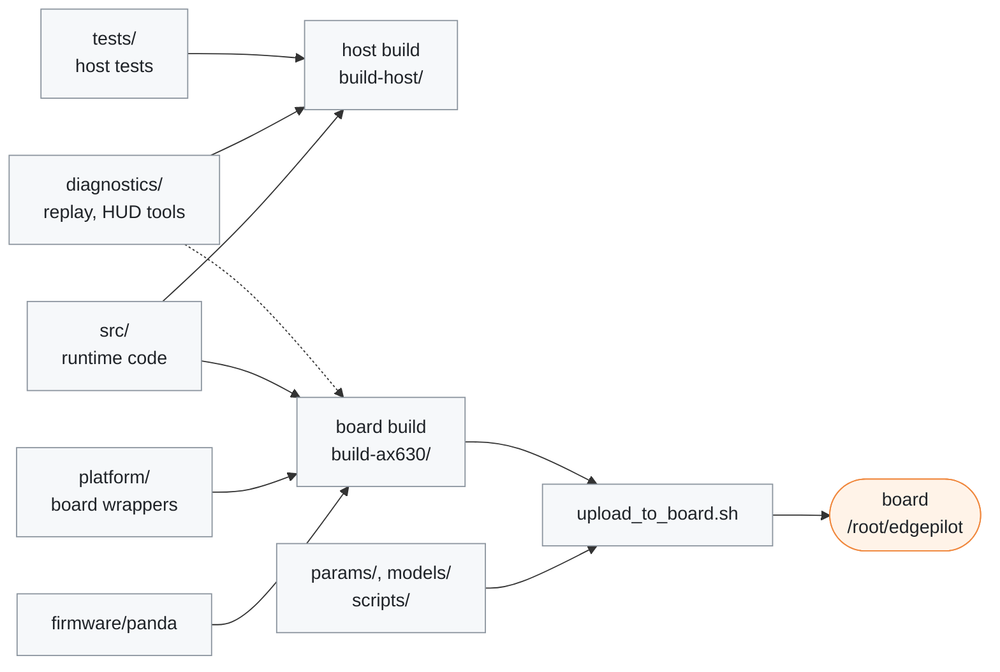
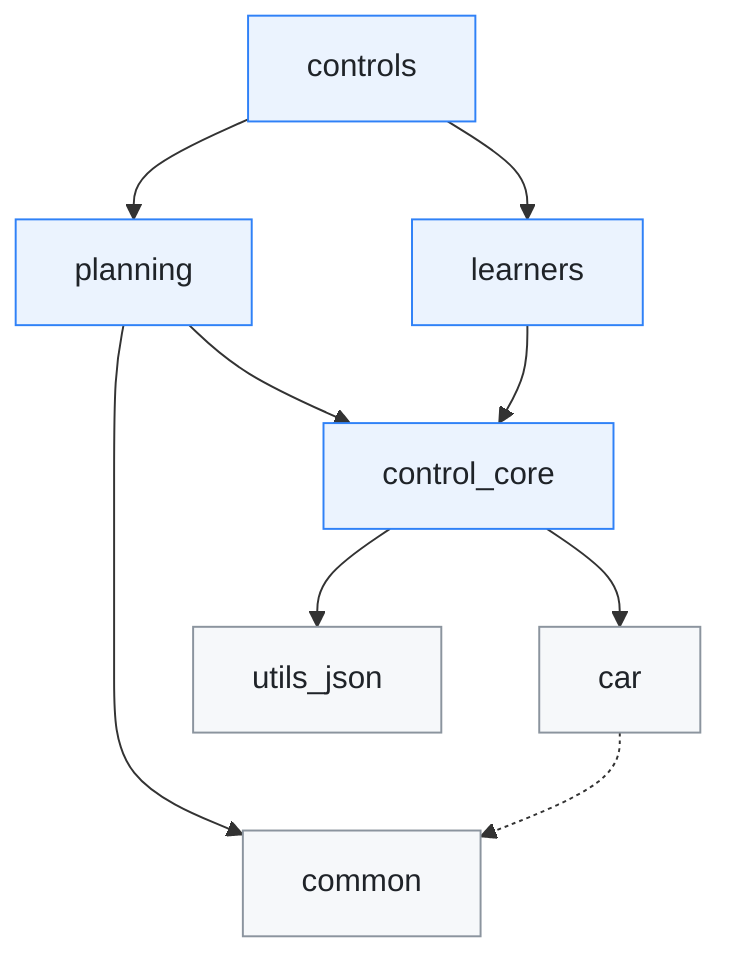
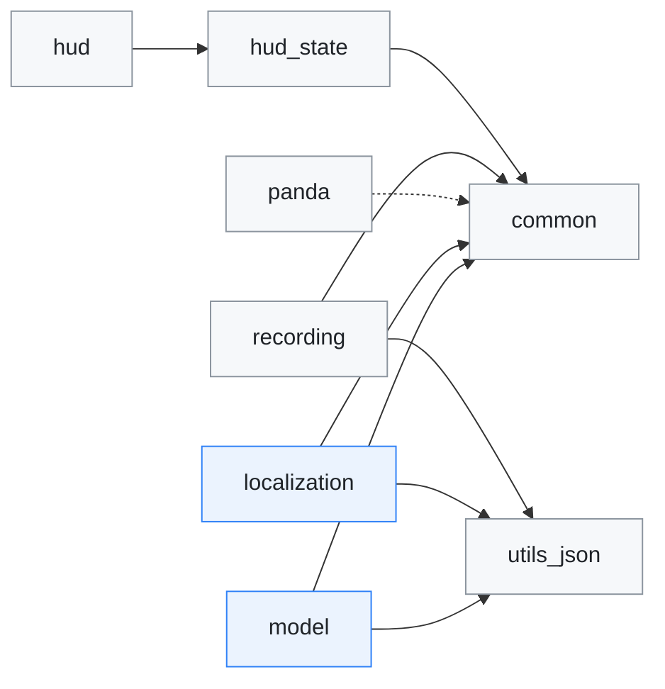
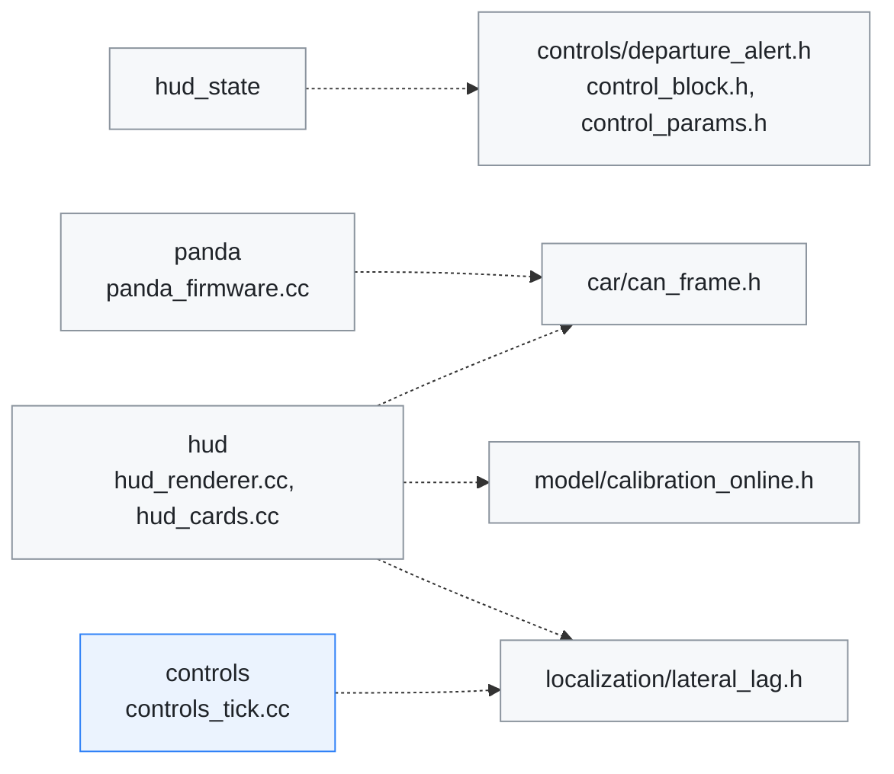
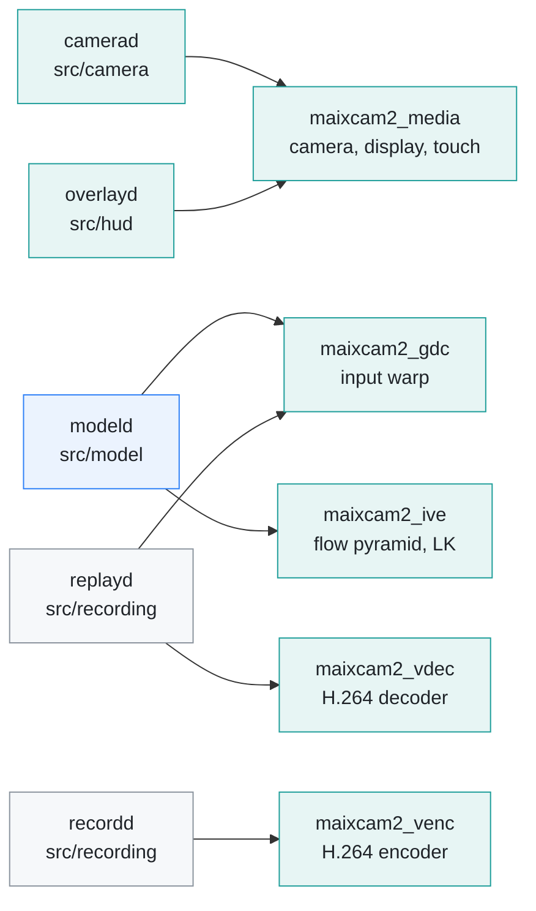
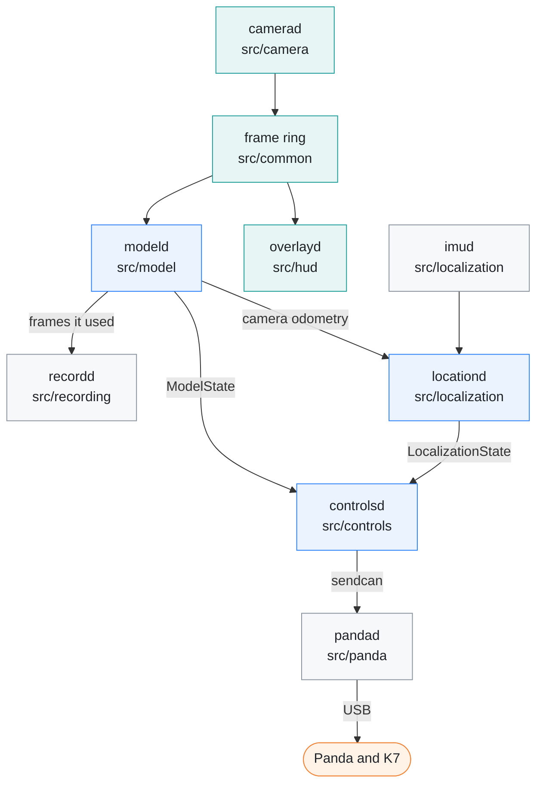
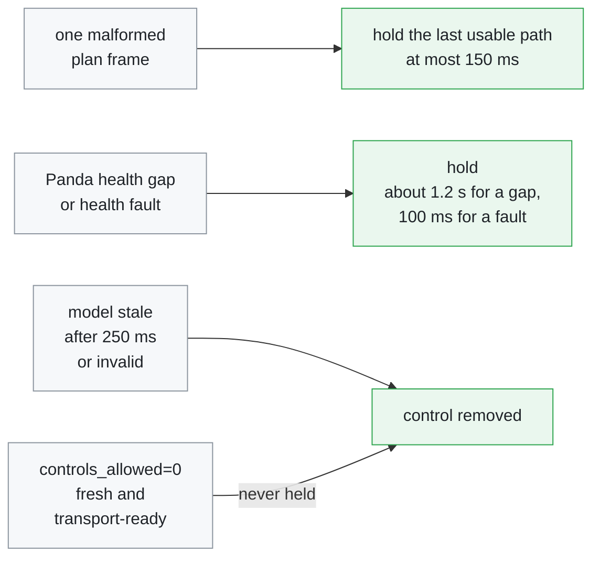

# Source layout

[← Documentation](README.md)

Where the code lives, how its files are named, and which libraries and board
processes each folder builds. Read it before adding a file or moving code
between folders.

The repository's folders and what is built from them:

The board build runs in the arm64 container of `tools/docker_ax630/`. The
diagnostics join it only when it is configured with
`-DEDGEPILOT_BUILD_DIAGNOSTICS=ON`. The rest of `tools/` is Python run on the
host ([Tools and tests](#tools-and-tests)), and `docs/` holds the documents.

## Folders and include roots

Runtime code lives in `src/<subsystem>/`, one folder per subsystem. Each
folder's `CMakeLists.txt` defines its libraries (built on the host too, so the
tests and replay tools use the same code) and, in the board build, the process
it runs.

| Folder | What it holds | Libraries | Board processes |
| --- | --- | --- | --- |
| `src/common/` | configuration, shared memory, message and model-output formats, helpers | `common`, `utils_json`, `build_version` (object) | |
| `src/car/` | K7 CAN: address table, received-frame decoding, sent-frame encoding | `car` | |
| `src/panda/` | the panda USB bridge (`pandad`) | `panda` | `pandad`, `panda_flash` (tool) |
| `src/controls/` | `controlsd`: lateral controller, vision cruise, departure alerts, the tick | `control_core`, `controls` | `controlsd` |
| `src/planning/` | lateral planner, desire helper, lateral MPC | `planning` | |
| `src/learners/` | paramsd and torqued (run inside `controlsd`) | `learners` | |
| `src/localization/` | locationd and lagd, the board IMU reader (`imud`) | `localization` | `imud`, `locationd` |
| `src/model/` | `modeld`: NPU session, input warp, online calibration, `ModelState` packing | `model` | `modeld` |
| `src/camera/` | `camerad` | | `camerad` |
| `src/hud/` | the HUD (`overlayd`): state mapping, drawing, alert policy and sounds | `hud_state`, `hud`, `alert_tones`, `alert_sound` (board) | `overlayd` |
| `src/recording/` | `recordd` and `replayd`, the recording format and its readers | `recording` | `recordd`, `replayd` |
| `platform/maixcam2/` | AX and MaixCDK wrappers (board build only) | `maixcam2_cmm`, `maixcam2_media`, `maixcam2_gdc`, `maixcam2_ive`, `maixcam2_venc`, `maixcam2_vdec` | |

Headers are included by their path from `src/`
(`#include "controls/adaptive_cruise.h"`) and the board wrappers by their path
from `platform/` (`#include "maixcam2/maix_display.h"`); those are the only two
include roots.

## Library dependencies

Libraries link downward only: `common` ← `car` ← `control_core` ←
`planning`, `learners` ← `controls`. `localization`, `model`, `hud_state` /
`hud`, `recording` and `panda` build on `common`. `controls/` holds two
libraries because the planner and the learners sit between the controller
(`control_core`) and the tick that drives them (`controls`).

Each arrow below points from a library to one it links
(`target_link_libraries`). `car` and `panda` link nothing: they use only
header-only parts of `common` (`utils_math.h` and `utils_time.h`,
`ipc_messages.h`), drawn dotted. The control libraries, which `controlsd`
links:

The other libraries build on `common`; `localization`, `model` and
`recording` also link `utils_json`:

`alert_tones` links nothing, and on the board `alert_sound` links it. The
board processes link `build_version`.

A few headers are read across that order for their enums, constants and
default values only:

`panda_firmware.cc` reads `car/can_frame.h`, the HUD reads
`controls/departure_alert.h`, `controls/control_block.h`,
`controls/control_params.h`, `car/can_frame.h`, `model/calibration_online.h`
and `localization/lateral_lag.h`, and `controls_tick.cc` reads
`localization/lateral_lag.h`. Those uses stay header-only; calling a function
defined in one of those libraries means linking it.

## Board processes

Each folder's `CMakeLists.txt` defines its processes in the board build only,
through `configure_board_target`, which also links `build_version`, `pthread`,
`dl` and `rt`. The processes that reach a hardware engine do it through a
`platform/maixcam2` library:

What each process links:

| Process | Folder | Libraries | Other |
| --- | --- | --- | --- |
| `camerad` | `src/camera` | `common` | `maixcam2_media` |
| `controlsd` | `src/controls` | `common`, `control_core`, `planning`, `controls` | |
| `imud` | `src/localization` | `common` | |
| `locationd` | `src/localization` | `common`, `localization` | |
| `modeld` | `src/model` | `common`, `model` | `maixcam2_gdc`, `maixcam2_ive`, `libax_engine`, `libax_sys` |
| `overlayd` | `src/hud` | `common`, `hud`, `alert_sound`, `utils_json` | `maixcam2_media` |
| `pandad` | `src/panda` | `common`, `panda` | libusb |
| `panda_flash` | `src/panda` | `panda` | libusb |
| `recordd` | `src/recording` | `common`, `recording`, `utils_json` | `maixcam2_venc` |
| `replayd` | `src/recording` | `common`, `recording` | `maixcam2_vdec`, `maixcam2_cmm` |

`-DEDGEPILOT_BUILD_PANDA=OFF` leaves out `pandad` and `panda_flash`.

## A frame through the folders

One camera frame's data crosses the folders in this order, from the camera to
the CAN frames that go to the car:

The return paths are left out of the drawing: `pandad` publishes the received
CAN that `controlsd` reads; `ControlState` goes back to `modeld`, `locationd`,
`pandad` and `overlayd`; and `overlayd` and `recordd` also read the state
channels. Every channel is defined in `src/common/ipc_messages.h`. The
processes themselves are described in [Runtime](runtime.md).

## Naming

- Code, folders and scripts are snake_case; documents are kebab-case. C++
  headers are `.h`, sources `.cc`, generated data `.inc`.
- File names read `<subject>_<role>` (`recording_writer`, `lateral_planner`)
  and are unique across the repository, so comments and documents can name a
  file alone. Folders do not strip the prefix. Prefix families (`utils_*`,
  `maix_*`) and one-word programs (`projection`, `manager.py`) are fine.
- A C++ process's main is `<name>d.cc`, named like its executable; the deploy
  scripts and `manager.py` start it by that name.
- Tests are `tests/gtest_<module>.cc`, or `gtest_<folder>.cc` when they cover a
  folder. A module can be a family of files on one subject: `gtest_calibration`
  covers `calibration_online` and `calibration_service`.
- The HUD module is `hud` in files, types and libraries. Only `overlayd`, the
  process, and the display's hardware overlay layer keep "overlay".
- Names something else fixes keep their form:
  - files tools look for (`CMakeLists.txt`, `README.md`, `Dockerfile`);
  - systemd units and the scripts installed under their names
    (`edgepilot-drivers.service`, `wifi-dhcp-renew.sh`);
  - `requirements-web-console.txt`;
  - vendored third-party files (`scripts/web_console/static/three/`, the panda
    tree in `firmware/panda/`).

## Runtime code

One section per folder under `src/`, in the order the libraries link, lowest
first.

### `src/common`

Libraries `common` and `utils_json`, and the object library `build_version`.

- `app_config.*`: parses the small runtime option set once at startup, and
  holds the MaixCAM2 camera intrinsics, the capture size, and the 4:3 preview
  crop shared by `overlayd` and `projection`.
- `ipc_messages.h`: every message that crosses `/dev/shm`. It holds the topic
  names, magics, channel headers, and the state snapshots (`ModelState`,
  `ControlState`, `PandaState`, …) with their `static_assert`s. Recording v13
  stores the state snapshots as-is, so their layouts are pinned here and tied
  to `kRecordingVersion` (that assert sits in `state_recorder.cc`). Code that
  only reads or fills a message includes this and nothing else.
- `ipc_channels.*`: the `/dev/shm` channel implementations: latest-message
  channel, CAN queue, and the camera frame ring, all on one `ShmRegion` (open,
  size, map, close).
  - `Subscription<T>` wraps a latest-message channel with the last snapshot
    and its sequence number, replacing it only after a complete read.
  - The frame ring (version 5) keeps only its header in shm; the slots are
    camerad's CMM blocks, listed by physical address, each with a seqlock that
    hardware and CPU readers check before and after reading.
- `model_output.*`: owns the openpilot master supercombo raw-output layout
  (`model_output_layout`, every block offset with a `static_assert`).
  - It exposes parsed plan, lanes, road edges, leads, pose, and the meta gas
    pedal prediction (the chance the driver presses gas 0, 2, …, 10 s ahead;
    the departure alert uses it at 2 s).
  - It also owns the shared `T_IDXS`/`X_IDXS` trajectory grids and
    `kLeadProbabilityThreshold`, the one lead probability cut (0.5, as
    openpilot's radard) for the vision cruise, the departure alert, the HUD and
    the web BEV.
- `projection.*`: converts model road coordinates through the openpilot-style
  `view_from_calib` matrix onto the display, using the target's real width and
  the same 4:3 preview crop as the video layer.
- `device_settings.h`: the web device settings (`params/display.json`) the
  runtime reads. `modeld` (camera mount, calibration source) and `overlayd`
  (alert volume) poll it from their main loops.
- `build_version.h`: `edgepilot_version()`, the `git describe` that
  `cmake/build_version.cmake` stamps into every board binary on each build, the
  marker the web console finds it by, and `log_build_version`, the first log
  line of each process.
- `utils_process.h`: what a process gets from the OS: environment variables
  (`env_flag` is the one boolean convention), the `params/` directory path, and
  the SIGINT/SIGTERM → stop-flag hookup used by every `*d` main.
- `utils_math.h`: clamping, openpilot `interp`, degree/radian conversion.
- `utils_time.h`: `monotonic_now_ns` (`CLOCK_BOOTTIME`), the clock behind
  every timestamp that crosses a process boundary, and the freshness
  predicates for ns and CAN-seconds timestamps. Per-process scheduling may
  still use `std::chrono::steady_clock`.
- `utils_json.*`: readers for the flat parameter and learner files on top of
  `json_value`: one value by key (a wrong type throws), `load_json_param_file`,
  and the `Json*Field` tables that the parameter loaders fill their structs
  from, one `{key, min, max, member}` row per parameter.
- `json_value.*`: a small JSON document reader (objects, arrays, string
  escapes, a nesting limit), part of `utils_json`. It reads every JSON file the
  runtime loads, including the lateral NN model.
- `lateral_nn_path.*`: which learned torque model is chosen
  (`params/lateral_nn.json`, or `EDGEPILOT_LATERAL_NN_MODEL`) and its path in
  `models/lateral_nn/`; controlsd and recordd share it.
- `utils_file.h`, `background_writer.h`:
  - `file_stamp` is the stat fingerprint the processes poll parameter files
    with; `read_text_file`; and `write_file_atomic` (temporary file + rename,
    so a reader never sees a half-written file).
  - `BackgroundWriter` is the thread `controlsd` (learner files) and
    `locationd` (lag cache) hand those writes to: the newest content per path
    wins, a failed write is retried 12 s later unless newer content for that
    path came in, and the queue drains on shutdown.

### `src/car`

Library `car`.

- `car_specs.h`: the K7 YG HEV's wheelbase and centre of gravity (opendbc
  `CarSpecs`), the Civic reference values of opendbc `VehicleDynamicsParams`,
  and `scale_tire_stiffness_per_mass`, which the torque controller, paramsd and
  the planner share.
- `can_frame.h`, `vehicle_can.*`, `hyundai_can.*`: `can_frame.h` holds the
  transport type and the K7 YG HEV address/bus table; `vehicle_can` decodes
  received frames into vehicle state, and `hyundai_can` encodes
  LKAS11/CLU11/MDPS12 commands. The CAN layer does not see the controller's
  parameters; the controller converts its torque limits.
- `speed_filter.*`: openpilot's `vEgo`, the wheel-speed average through the
  speed Kalman filter of opendbc `CarStateBase.update_speed_kf`, run once per
  control tick.

### `src/controls`

Libraries `control_core` and `controls`, process `controlsd`.

- `controlsd.cc`: the controlsd process. It opens the channels, reads them
  each tick in the order `ControlsTick` documents, publishes, sends, writes the
  learner files on a background thread, and logs the one-second stats line
  (with what the slowest tick did and the control thread's involuntary
  context switches).
- `controls_tick.*`: one 100 Hz controlsd tick without shared memory or files.
  - CAN, model, Panda and locationd inputs go in; the lateral controller,
    departure alerts, vision cruise and learners run in between; the frames to
    send, `ControlState` and `LearnerState` come out.
  - The 20 Hz planner runs in place in the tick that receives the model
    (about 0.1 ms on the board), so a new plan is used in that same tick, on
    the board and in the tools and tests alike.
- `control_params.*`: `SteeringParams`, the control timing constants and
  `ControlParams` (steering plus vision cruise), the JSON loaders, and the
  watcher that reloads both files when one changes (checked every second).
- `lateral_controller.*`, `lateral_torque.*`: apply the planner's
  lag-adjusted curvature through the validated K7 torque/CAN path
  (`car/hyundai_can`). A new plan is blended in over 50 ms (five ticks)
  from what the previous plan gives, for the desired curvature and the
  learned model's inputs alike, but not from a plan whose MPC failed (that
  plan stopped steering). `lateral_torque.h` also holds `VehicleModel`, the
  single-track model (learned or manual steering ratio, stiffness, angle
  offset and roll) as a plain value that the controller and the replay tools
  build where they need it.
- `angle_fault_guard.*`: the 85° rule's state: counts the time above 85°,
  turns the steer request off before the MDPS fault and decides when a
  driver-held turn may be steered again; the upstream two-frame cut when the
  avoidance is off.
- `lateral_nn.*`: the learned torque feed-forward: the model file loader,
  the network and the inputs built from the plan and a 1 s history
  ([Lateral NN](lateral-nn.md)).
- `lateral_nn_select.*`: watches the chosen model, loads a new choice in the
  background, swaps it in and writes the status the web console shows.
- `lateral_target.h`: declares the controller's two per-tick inputs:
  `LateralTarget`, the planner-to-controller interface, and `LateralPath`, the
  steering-usability gate (reach and point count) that `control_holds.*`
  reduces `modelState` to. There is no path geometry; curvature comes from
  the MPC.
- `adaptive_cruise.*`, `departure_alert.*`: vision cruise setpoint control and
  departure alerting ([Lead flow](lead-flow.md),
  [Departure alerts](departure-alerts.md)).
  - The cruise controller dead-reckons the car's set speed per session (this
    car does not report it), re-anchors to the cluster speed once the driver's
    buttons settle and after a long mismatch while the cruise holds speed, and
    paces SET-/RES+ pulses from the vision lead (`modeld`'s lead track when it
    has one) and the learned cluster/wheel speed ratio.
  - The approach to a lead is capped by the fixed cruise's weak coasting
    deceleration, the set speed is kept near the actual speed while the car
    responds, and the button target rises slowly so lead noise does not
    alternate SET-/RES+.
  - The departure detector runs three trackers per stop: close lead, lead
    departure and green light.
- `control_block.h`: the engage/steer block reasons as one table: enum, wire
  name, HUD label, and kind (reject / hard disengage / transient Panda
  handshake / availability / soft disable / interrupt, an input that stopped
  while engaged). The controller decides in `BlockReason`,
  `ControlState` carries the wire name so recordings and the Python readers
  stay text, and `hud_state` labels it from the same rows. `gtest_hud_state`
  proves every reason has a label.
- `control_holds.*`: the two control safety holds, below.

#### Control safety holds

`control_holds.*` implements both holds as `PandaHealthGate` and
`PathHoldGate`; `gtest_control_holds` exercises their boundaries.

`controlsd` tolerates a single malformed plan frame by holding the last usable
path for at most 150 ms; the normal 250 ms model freshness timeout remains a
hard safety gate, so a stale or invalid model still removes control at once,
and if it stays lost for 3 s the controller disengages with a warning. A gap
in the Panda health snapshots keeps the last verdict for up to about 1.2 s:
`pandad` publishes one every 0.5 s, a snapshot counts as fresh for 1.1 s, and
one that is stale or not ready (link down, heartbeat lost) holds the last
verdict for another 100 ms. A fresh, transport-ready `controls_allowed=0` is
never held. Other health faults are released after that short hold if they
persist.

### `src/planning`

Library `planning`.

- `lateral_planner.*`: applies openpilot lane probability/width logic and the
  lateral MPC (Lane mode), or the plan yaw (Laneless mode and Lane mode's
  model-path stretches), to produce curvature targets. This is the only
  producer of `LateralTarget`. The MPC starts from its previous solution's
  curvature with a quarter of the measured curvature mixed in.
- `lane_line_filter.*`: smooths the two ego lane lines over time for the
  planner: the last filtered lines moved by the car's own motion, blended with
  the new frame. See [Lane-line filter](lane-line-filter.md).
- `desire_helper.*`: the openpilot desire_helper port the planner runs each
  model frame: lane change states (`LaneChangeState`), the
  blinker/torque/road-edge gates (upstream's blind-spot gate is left out: the
  K7 sends no LCA11 on the Panda's buses), the lane-line fade,
  one lane change per blinker, the turn detection and turn desire, and the
  `Desire` the model gets.
- `lateral_mpc.*`: the lateral MPC itself: one Gauss-Newton SQP iteration per
  call over the openpilot 0.8.16 OCP, solved by a backward Riccati recursion.
  No external solver. See [Verification](verification.md#lateral-mpc-solver).

### `src/learners`

Library `learners`.

- `vehicle_params_learner.*`, `torque_estimator.*`, `lateral_learners.*`,
  `localizer_inputs.h`: the paramsd/torqued ports that estimate steer ratio
  and torque response while driving (`use_live_vehicle_params`,
  `use_live_torque_params`, both on by default).
  - `vehicle_params_learner` is paramsd with its car_kf EKF and saved-value
    restore.
  - `torque_estimator` is torqued with its cache.
  - `lateral_learners` is the controlsd glue that turns vehicle CAN and
    locationd samples into learner inputs and collects the outputs as
    `LiveLateralParams`.
  - `localizer_inputs.h` converts the IPC `LocalizationState` into a learner
    sample, so the learner library does not depend on the IPC layout.
    "Localizer" is the learners' word for locationd input throughout, as in
    upstream paramsd.

### `src/localization`

Library `localization`, processes `imud` and `locationd`.

- `location_estimator.*`, `lateral_lag.*`, `localization_pipeline.*`: ports of
  openpilot locationd (the 18-state pose EKF over the board IMU and the model's
  camera odometry) and lagd (the steering delay from desired vs actual lateral
  acceleration), and the pipeline that feeds them in time order. `locationd`
  and `replay_localization` share it.
- `imud.cc`, `locationd.cc`: the board IMU reader (LSM6DSOW over `i2c-dev`) and
  the process that runs `localization_pipeline` on its samples and publishes
  `LocalizationState`. It hands the lag cache to `BackgroundWriter`, so an SD
  stall never holds up the IMU loop.

### `src/model`

Library `model`, process `modeld`.
[Model pipeline](model-pipeline.md) follows a frame through these files.

- `modeld.cc`: the model process. It takes the newest ring frame, runs one
  frame, and publishes `ModelState`.
- `supercombo_model.*`: loads the axmodel, enforces the input/output contract,
  runs the GDC (or CPU) warp into the image histories, fills the temporal
  inputs, and runs one frame. `run_frame_phys` reads a ring slot by physical
  address and drops the frame if it was overwritten during the warp.
- `ax_engine_session.*`, `ax_engine_api.h`: a minimal `libax_engine` session
  with one cached CMM block for the inputs and one for the outputs, so a run
  flushes and invalidates once. The board image ships no engine headers, so
  `ax_engine_api.h` declares the API. These are the only files
  under `src/` that touch the NPU.
- `model_output_assembly.h`: reassembles the split-head axmodel outputs into
  the openpilot 2576-float layout (`model_output.h`); each head is quantised
  over its own range.
- `model_temporal.h`: the history queues the NPU core does not carry:
  100-tick desire pulses pooled to 25x8, 96 ticks of hidden state strided to
  24x512, and the 5-frame image history per tower. No engine dependency, so
  `gtest_model_output` pins the convention on the host.
- `yuv6_pack.h`: unpacks an NV12 view into the YUV6 planes, with NEON where
  the CPU has it; the GDC warp uses it.
- `model_input_transform.*`: the CPU input warp: direct
  `NV12 -> calibrated warped YUV6`, fusing homography sampling and YUV6
  packing through a compact fixed-point LUT. Also produces the projection
  matrices the GDC warp uses.
- `calibration_service.*`, `calibration_online.*`: wrap pose-based online
  calibration, manual override, projection policy, and the model-input
  calibration feedback loop.
  - `calibration_online` is a plain port of upstream `calibrationd`. The
    service feeds it only while its own value drives the warp.
  - The service reads the flow calibrator through the `FlowSource` interface
    (`flow_calibration.h`). It also stores and restores the flow blocks
    (`params/flow_calibration.json`) and clears both on a web reset.
  - The calibration source setting comes in from `modeld`'s single
    `display.json` reader with every update.
- `calibration_source.*`: picks the warp calibration's source each frame: the
  pose loop, or the flow estimate's pitch and yaw when the web setting asks for
  it and the estimate is usable; waits for disengage and ramps changes.
  Host-tested by `gtest_calibration_source`
  ([Using the estimate](flow-calibration.md#using-the-estimate)).
- `flow_calibration.*`: the hardware-free part of the optical-flow calibrator:
  the travel-direction solver, the per-cell corner pick, the
  straight-and-fast gate and the block aggregation. Host-tested by
  `gtest_flow_calibration` ([Flow calibration](flow-calibration.md)).
- `flow_tracker.*`, `flow_engine.h`: `FlowTracker` builds the pyramid once per
  frame and tracks the calibration window's points and the lead's points in
  one LK call (the lead points also backward), through a `FlowEngine`: the
  board's IVE (`platform/maixcam2/maix_ive_flow`), or a fake in
  `gtest_flow_calibration`, which checks how it chains frames and drops a step
  on a frame gap, an overwritten slot or an engine failure.
- `flow_worker.*`: board only. `FlowWorker` (a `FlowSource`) runs the tracker
  with the IVE engine on its own thread in `modeld`. The model loop only hands
  over ring slots, gate inputs and the previous frame's lead.
- `lead_flow.*`: the hardware-free part of the lead expansion: the lead box
  projection, the full-resolution corner pick, the similarity fit and
  `LeadFlowTracker` (forward-backward check, top-up, template refinement, the
  0.5 s window). Host-tested by `gtest_lead_flow`
  ([Expansion rate](lead-flow.md#expansion-rate)).
- `lead_tracker.*`: `LeadTracker`, the Kalman filter that fuses the model's
  lead distance with the flow's expansion rate into `ModelState.lead_track`.
  It gates outliers and starts again on another lead. `modeld` runs it once
  per model frame. Host-tested by `gtest_lead_tracker`
  ([Lead track](lead-flow.md#lead-track)).
- `model_state_fill.*`: `fill_model_state`, which modeld calls to pack a
  frame's outputs into `ModelState`. It needs the online calibrator's
  snapshot, so it lives in the `model` library and message consumers do not
  pull in the calibrator. `ModelState` leaves out the fixed grids and the lane
  times; the planner gets those from `common/model_output.h` (`model_t_idx`,
  `model_x_idx`, and `compute_lane_t`, the openpilot plan→lane time
  mapping).

### `src/camera`

Process `camerad` (board build only).

- `camerad.cc`: captures into the frame ring for `modeld`, `overlayd` and
  `recordd`.

### `src/hud`

Libraries `hud_state`, `hud` and `alert_tones`, and on the board
`alert_sound`; process `overlayd`. What the HUD shows is described in
[HUD](hud.md).

- `overlayd.cc`: the two-layer LCD HUD: the camera preview on the video layer,
  the HUD drawn onto the graphic (overlay) layer, alert sounds and the
  touchscreen.
- `hud_renderer.*`, `hud_scene.cc`, `hud_cards.cc`, `hud_draw.h`,
  `hud_canvas.*`, `hud_font.*`: draw the 640x480 HUD into a straight-alpha BGRA
  buffer (landscape coordinates; `HudOrientation` maps them onto the portrait
  panel buffer).
  - **What it draws.** State border, speed with yellow turn-signal/hazard
    chevrons, set speed (with the vision cruise `SET` speed) and gear cards,
    steering mode and the lane change in progress, an `AUTO HOLD` badge under
    the speed, plan/lane/road-edge ribbons faded with distance, the car's
    position in its lane marked on the road, lead chevron, torque bar with the
    driver's torque, alerts (including the lane-change nudge and the
    large-angle pause), TPMS and camera calibration cards with the board state
    card above TPMS and the learned values card above calibration (white while
    control uses them), a recording/Wi-Fi status pill (and the network card a
    tap opens), and chips that appear only when something needs attention
    (panda, storage). The numbers no other card shows sit in a diagnostics card
    that a tap on the left column shows or hides.
  - **Which file draws what.** `hud_renderer` lays out the frame and the top
    and bottom-edge widgets, `hud_scene` draws the road scene (ribbons, lead
    chevron, lane position), `hud_cards` the cards, and `hud_draw.h` holds what
    they share (design tokens, text placement, state colours).
  - **Canvas.** `hud_canvas` fills polygons with 4-subrow anti-aliasing that
    touches only covered spans, fills the straight part of integer rounded
    rectangles directly (cut along the buffer rows, so across the screen in the
    portrait buffer), blends without divisions, and records the tiles (16 px in
    the portrait buffer) each row touched so the next frame clears only those.
    `hud_tiles.h` walks the runs of marked tiles for that clear and for the
    copy to fb0 in `maix_display`.
  - **Font.** `hud_font` holds the glyphs that `tools/ui/make_hud_font.py`
    bakes from Pillow's Aileron (CC0).
  - **Host.** No board library, so `gtest_hud_canvas` and `hud_snapshot` run
    on the host. The renderer keeps only coverage scratch and the per-buffer
    tiles; the turn-signal phase and the card toggles come from `hud_policy`.
- `hud_state.*`: `HudState`, the IPC state (`ControlState`, `ModelState`, …) →
  `HudState` mapping shared by `overlayd` and `hud_snapshot`. It also holds the
  `ModelState` → `ParsedModelOutput`/`ProjectionState` unpacking, the
  engage-block label table, and `hud_select_alert`, the one alert card
  (`HudAlertCard`) a HUD state shows (its priority, text and severity; the
  renderer only colours it). `gtest_hud_state` pins it on the host.
- `hud_policy.*`: what `overlayd` decides besides drawing, without the screen,
  speaker or touch device. `gtest_hud_policy` pins it on the host.
  - `HudAlertEvents` turns the controlsd event counters into one alert a frame
    (baseline on first sight, rebaseline on a controlsd restart, reject >
    engage > disengage > departure).
  - `HudAlertPolicy` picks the one sound a frame plays (a take-control edge
    waits for a quiet frame, an available → unavailable transition is skipped
    in a frame that already sounded) and holds the engage-reject toast for 3 s.
  - `TurnSignalClock` steps the blinker animation from the time the blinkers
    changed.
  - `HudTouch` opens and closes the network and debug cards.
  - `smooth_lane_center_offset` filters the lane-position readout.
- `alert_tones.*`, `alert_sound.*`: the alert sounds.
  - `alert_tones` synthesises them: overlapping bell-like notes with soft
    attacks and decaying overtones. It is portable, so `alert_sound_preview`
    writes them as WAV and `gtest_alert_tones` checks them on the host.
  - `alert_sound` writes them to the board speaker's ALSA device through
    ioctls (`overlayd`), opening it only around an alert.
- `system_monitor.*`: `/proc`, thermal-zone, and network sampling (the Wi-Fi
  SSID through the `SIOCGIWESSID` ioctl) into `HudState`, called at 1 Hz by
  `overlayd`. Only a `wlan` link with an address and an associated SSID counts
  as connected; another link (the USB virtual Ethernet, which always has an
  address) is kept apart for the network card.

### `src/recording`

Library `recording`, processes `recordd` and `replayd`. The route layout and
the event log are described in [Recording](recording.md).

- `recording_format.h`, `recording_writer.*`, `state_recorder.*`: the
  event-log writer and on-disk contract that `recordd` writes.
  - `StateRecorder` copies each new state snapshot (model, control, Panda,
    learner, IMU, locationd) into the log, attaching to a channel once its
    producer has created it.
  - `gtest_recording` pins the layout and the state recording.
  - `recording_format.h` (`kRecordingVersion`, the `EDGELOG1` / `EDGEIDX1`
    headers and the earlier magics that recordings up to v8 carry, record
    types) is mirrored by `tools/model/recording_reader.py`.
- `event_log_reader.h`: the one C++ reader of `events/NNN.bin`, shared by
  `replayd` and the replay and dataset tools. It checks the magic, skips
  `header_size`, and stops without resyncing at a truncated tail (record type
  out of range, a payload over 1 MiB, or a short header or payload), which
  `truncated()` reports.
  `report_event_file_end` prints those problems for `replayd` and the tools.
- `time_ordered_events.h`: reads several event logs in time order. recordd
  writes the queued CAN before the state snapshots, so file order is not time
  order; it reorders within a window (0.5 s by default), so a route is never
  held in memory. `replayd` streams its events through it, and the replay
  tools through `diagnostics/route_events.h`, which also reports unreadable
  files and turns them into exit code 1. The tools read numeric options with
  `diagnostics/cli_args.h`, which refuses anything but a whole finite number
  in range.
- `recorded_can.h`: the recorded CAN payload (written by `recordd`, read back
  by `replayd` and the tools, whole frames only).
- `recordd.cc`: the drive recorder. It encodes the frames `modeld` used and
  writes the CAN and state channels through `recording_writer` and
  `StateRecorder`.
- `replayd.cc`, `replay_route.*`: rehearsal, which plays a recorded route in
  place of `camerad` and `pandad` ([Rehearsal](rehearsal.md)). `ReplayRoute`
  reads the route (frame indexes, the frames with their parameter sets, and the
  CAN/Panda events in time order) without the decoder, so `gtest_recording`
  reads back a route the writer made. `RecordedCameraDelay` reads ahead in the
  recorded `ModelState` for each frame's camera delay.

### `src/panda`

Library `panda`, process `pandad`, tool `panda_flash`. The K7's side of the
link is described in [K7 Panda port](k7-panda-port.md).

- `panda_client.*`, `panda_can_codec.*`, `pandad.cc`: the optional panda USB
  bridge. It handles USB, health, heartbeat, receive CAN, and the final TX
  gate, but does not generate vehicle control messages. `pandad` also flashes
  the Panda when the web console asks.
- `panda_protocol.h`: what `firmware/panda` speaks over USB: ids, request
  codes, packet versions, the health packet and the application flash layout.
  `gtest_panda_firmware` checks it against the firmware sources.
- `panda_firmware.*`: application image checks, the parked-car condition for
  flashing (it reads `car/can_frame.h` for `kGearPark`), and the status JSON.
  No USB, so the host tests build it.
- `panda_flasher.*`, `panda_flash.cc`: the bootstub flasher (board only) and
  the command-line tool that runs it with the runtime stopped.

## Board firmware and platform

### `firmware/panda`

The Panda's firmware for the STM32F413 boards, imported from openpilot_c2 with
upstream's file names (`board/`, `crypto/`, `certs/`). `make -C firmware/panda`
builds and signs it; `panda_version.py` names a build by its sources. See
[Panda firmware](../firmware/panda/README.md).

### `platform/maixcam2`

`platform/maixcam2/` keeps the AX and MaixCDK headers out of `src/`. It builds
only in the board build, against `deps/ax630` from
`scripts/fetch_maixcam2_sdk.sh`, as the `maixcam2_media`, `maixcam2_gdc`,
`maixcam2_ive`, `maixcam2_venc` and `maixcam2_vdec` libraries.

- `maix_camera.*`: opens the camera (VI) through `libmaixcam_lib`'s
  `ax_middleware` classes, AI-ISP always on, sensor at the requested fps with
  auto exposure and a capped shutter, and copies each frame into a CMM block by
  IVPS TDP.
- `maix_display.*`: the LCD.
  - VO video layer 0 takes a CMM frame, IVPS crops the centre 4:3 and scales it
    to 640x480, and VO rotates it for the 480x640 panel with the board's
    flip/mirror.
  - The HUD goes to the graphic layer: it is drawn in the panel's portrait
    orientation into a cached 480x640 BGRA buffer, and only the 16 px tiles
    drawn this frame or last frame are copied into the visible page of
    `/dev/fb0`.
  - MaixCDK's layer-1 push rotates with IVPS TDP, which smears G/R/A into the
    next pixel for 32-bit BGRA (stair-stepped, fringed edges), so the HUD does
    not use it.
  - It also sets the backlight (`set_backlight`), which only `overlayd` does.
- `maix_touch.*`: the touchscreen (`hyn_ts`, multi-touch type B) read without
  blocking; reports short taps in screen coordinates, rotated clockwise 90° as
  MaixCDK's `maix_touchscreen_maixcam2.hpp` does.
- `maix_cmm.*`: physically contiguous CMM blocks shared across processes
  (allocate in one, uncached; map by physical address in another, cached for
  CPU reads, which invalidate the range first).
- `maix_frames.h`: the NV12 frame description, stretch-resize setting and
  uncached block pool that the display, GDC, IVE, encoder and decoder wrappers
  share.
- `maix_gdc_warp.*`: the model input warp on the IVPS GDC (`AX_IVPS_Dewarp`,
  perspective): two 512x256 views from a ring slot's physical address into one
  output block, unpacked to YUV6 at two destinations (the image history and
  the model input). Uses only MSP SDK headers, not the middleware, so the NPU
  process initialises AX SYS once.
- `maix_ive_flow.*`: the flow calibrator's hardware part.
  - Each frame's 1/2 and 1/4 levels come from one VPP call on `modeld`'s own
    IVPS queue. The full level is the ring slot itself.
  - The IVE computes the Shi-Tomasi response and the pyramidal LK, wrapped
    around its undocumented behaviour (start points in top-level pixels, the
    ±8 px clip with the +16 px wrap, re-polled queries).
- `maix_venc.*`, `maix_vdec.*`: the hardware H.264 encoder and decoder.
  `recordd` copies a ring slot into the encoder's own pool block with IVPS
  before encoding; `replayd` decodes a recorded frame into a ring slot. Both
  use only MSP SDK headers.
- `maix_shim.cc`, `stub/`: the few MaixCDK runtime pieces (log, err, board
  config lookup) and Kconfig stubs that the inline code in
  `ax_middleware.hpp` references but `libmaixcam_lib` does not export.

## Board scripts

- `scripts/manager.py`: minimal supervisor and heartbeat publisher
  ([Runtime](runtime.md)). It is intentionally not a full openpilot manager
  clone. It stops the stock launcher, switches USB-C to host for the Panda,
  and one table in start order decides which processes run
  (`EDGEPILOT_ENABLE_CONTROL`, `EDGEPILOT_ENABLE_PANDA`,
  `EDGEPILOT_ENABLE_WEB_CONSOLE`) and with what nice value.
- `scripts/web_console/`: the web console (`EDGEPILOT_ENABLE_WEB_CONSOLE`,
  `python3 -m web_console`; [Web console](runtime-options.md#web-console)).
  `console_server.py` is the FastAPI app and its routes; each card or tab has
  its own module behind it:
  - `param_store.py` and `param_metadata.py`: the parameter files, their
    sections, units and ranges (the labels and descriptions are in the
    page's text catalogues);
  - `process_status.py`: the manager's process table with each binary's build
    version, and signalling a process to reload;
  - `learner_monitor.py`: learner and localization state;
  - `calibration_control.py`: the camera calibration card: its state, reset
    and source switch;
  - `panda_update.py`: the Panda firmware card;
  - `lateral_nn_models.py`: the learned torque model card: the model files,
    the choice and what controlsd loaded;
  - `recordings.py`: the recording files card: the routes on the SD card with
    their sizes, the free space, and deleting routes;
  - `bev_stream.py`, `backlight.py` (reads the MaixCAM2 backlight, PWM3, that
    `overlayd` sets) and `static_assets.py`;
  - `shm_channel.py` reads the shared-memory channels and `state_layout.py`
    holds the ModelState and ControlState offsets they share;
  - `refusal.py`: the reason a request is refused, sent as a text-catalogue
    key and an HTTP status so the page shows it in its language;
  - `files.py`: the paths (relative to the working directory, environment
    variables empty means unset) and the JSON and atomic file helpers the
    modules share.
- `scripts/web_console/static/`: the page, plain ES modules with no build step.
  - `index.html`, `console.css` (every style, the BEV's included),
    `console.js` (header, tabs, routing), `ui.js` (DOM helpers, cards and
    status cards, help texts, small time charts, toasts, requests from
    buttons, API calls, polling) and `storage.js` (choices this browser
    remembers).
  - `i18n.js` and `i18n/ko.json`, `i18n/en.json`: the language choice and
    every text on screen, in Korean and English.
  - `param_state.js`, `param_editor.js` (the controls, saving and the item
    card) and `param_view.js` (the parameter tabs).
  - `vehicle_view.js` (the vehicle characteristics tab: learned and manual
    values side by side), `panda_card.js`, `lateral_nn_card.js` (the
    learned torque model card on the steering tab) and `recordings_card.js`
    (the recording files card on the recording tab).
  - The BEV tab: `bev_view.js`, `bev.js` (three.js view, ported from
    sv_recorder_bev), `bev_gl.js` (its stateless GPU helpers: the colour
    cache, the per-frame triangle and instance batches, the shared fog
    uniforms and the shaders), `bev_geometry.js` (the stateless geometry
    writers: bands, the path corridor, curbs, arrows and polyline reading),
    `bev_ego.js` (the ego car; today a black 2017 K7 made in code),
    `bev_car.js` (the lead's car model), `bev_data.js` (reads the ModelState
    and ControlState bytes the console streams), `bev_math.js` (the small
    maths the BEV files share), and `lane_filter.js` (the planner's lane-line
    filter, for the ego lines the BEV draws).
  - three.js 0.186.1 in `three/`.
- `scripts/*.service`, `install_autostart.sh`, `install_boot_tuning.sh`: the
  systemd units (`edgepilot.service`, `edgepilot-drivers.service`,
  `wifi-dhcp-renew.service`) and the scripts that install them; the boot tuning
  is described in [Boot time](boot-time.md).

## Tools and tests

- `.clang-format`, `cmake/build_version.*`: the C++ format
  ([Style guide](style-guide.md); `firmware/.clang-format` leaves the vendored
  Panda tree alone) and the build version stamp
  ([Build version](build-and-deploy.md#build-version)).
- `scripts/fetch_maixcam2_sdk.sh`, `tools/docker_ax630/`,
  `scripts/upload_to_board.sh`, `scripts/run_host_tests.sh`: pinned SDK and
  board-library fetch, the arm64 build container, deploy, and host tests. See
  [Scripts](../scripts/README.md) and [Build and deploy](build-and-deploy.md).
- `tools/model/axmodel/`: the openpilot master → axmodel pipeline (core
  extraction, output split, calibration and evaluation data, the board
  evaluation runner, Pulsar2 config). See
  [axmodel pipeline](../tools/model/axmodel/README.md).
- `tools/model/`: the recording readers. `recording_reader.py` decodes `recordd`
  routes (frame index, event log, H.264 video) and mirrors `recording_format.h`
  / `ipc_messages.h` for the analysis tools; `lane_benchmark.py` (model lanes
  against the stock camera's `LKA14`) builds on it. `model_warp.py` is a NumPy
  port of the CPU input warp. See [Model tools](../tools/model/README.md).
- `tools/control/make_can_golden.py`: the bytes of the frames edgepilot sends
  and the torque limiter, built with a local opendbc's packer and upstream
  formulas → `tests/hyundai_can_golden.h` for `gtest_car`.
- `tools/rehearsal/compare_rehearsal.py`: compares a board rehearsal's
  recording with the route it replayed ([Rehearsal](rehearsal.md)).
- `tools/ui/hud_tools.py`: extracts `hud_snapshot` inputs from a route and
  composes its frames.
- `tools/docs/render_mermaid.py`: draws the Mermaid diagrams of the documents
  with mermaid-cli in Docker, and reports any that fail or come out wider than
  GitHub's page column ([Style guide](style-guide.md)).
- `tests/`: host unit tests (`gtest_*.cc`, googletest + CTest), one
  self-contained file per target, each registered by one
  `add_host_test(<name> <libraries>)` line in `tests/CMakeLists.txt`, and the
  Python checks `check_web_console.py`, `check_manager.py`,
  `check_recording_reader.py` and `check_docs.py`, registered beside them.
  `check_web_console.py` also runs
  `check_bev_lane_filter.mjs`. `scripts/run_host_tests.sh` runs them all. See
  [Host tests](../tests/README.md).
- `tests/check_docs.py`: the documentation check run by `ctest`. It checks the
  title, the back link, links and anchors, the wrapping, the language and the
  Mermaid colours of every document.
- `diagnostics/`: replay and HUD tools (built by `diagnostics/CMakeLists.txt`
  against the same libraries as the runtime). See
  [Diagnostic tools](../diagnostics/README.md).

## Related

- [Runtime](runtime.md): what each board process does and how the manager runs
  them
- [Model pipeline](model-pipeline.md): a frame through `src/model` from the
  ring to `ModelState`
- [Build and deploy](build-and-deploy.md): building the board and host trees
  and copying them to the board
- [Style guide](style-guide.md): how code, comments, documents and diagrams are
  written
- [Host tests](../tests/README.md): what each `tests/gtest_*.cc` covers
- [Diagnostic tools](../diagnostics/README.md): the replay, dataset and HUD
  tools in `diagnostics/`
- [Scripts](../scripts/README.md): the build, deploy and board-side scripts
