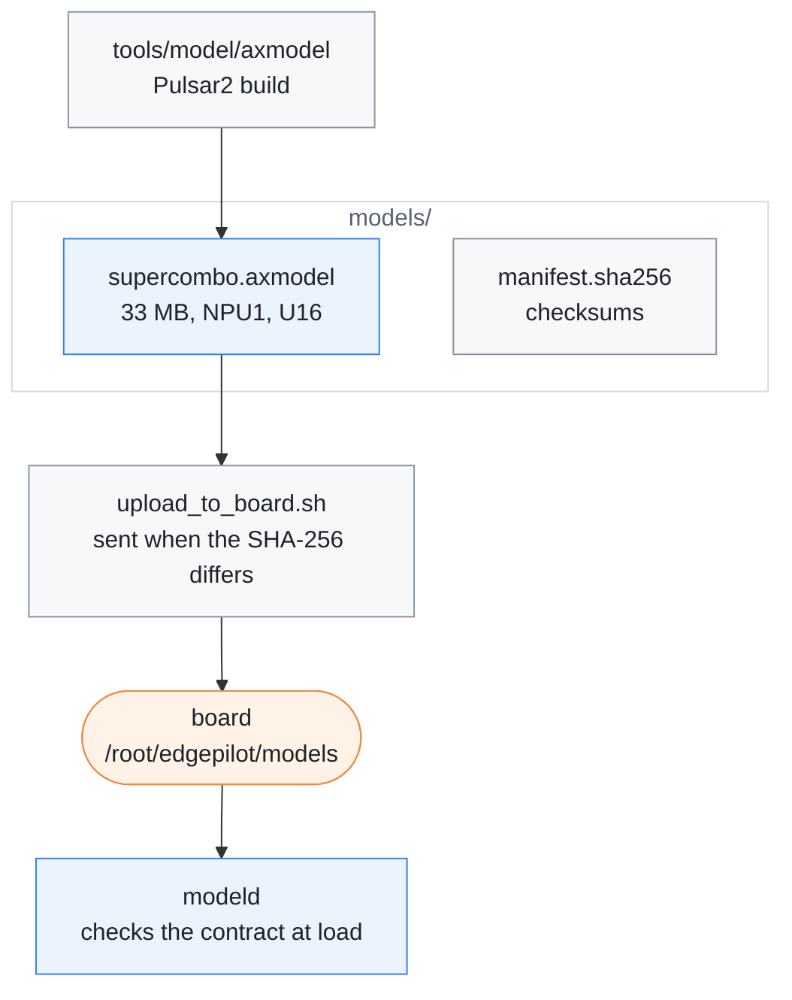

# Model package

[← Documentation](../docs/README.md)

The NPU model the MaixCAM2 runtime runs: the openpilot **master**
`driving_supercombo` core as a Pulsar2 6.0 axmodel for the AX630C, with the
checks that it is right. Read this before replacing the model.

Where the model comes from and where it goes:



## Contents

| File | What it is |
| --- | --- |
| `supercombo.axmodel` | the model `modeld` loads |
| `lateral_nn/<car>_v<version>.json` | the learned steering torque models `controlsd` chooses from |
| `manifest.sha256` | SHA-256 manifest for the tracked files |
| `.gitignore` | keeps a `work/` folder out of git |

The model runs with U16 activations and uint8 image inputs on the AX630C NPU.
It is compiled for one NPU core (NPU1) because the AI-ISP denoiser always uses
the other. It is built with
[axmodel pipeline](../tools/model/axmodel/README.md), and
`scripts/upload_to_board.sh` puts it on the board as
`/root/edgepilot/models/supercombo.axmodel`.

`lateral_nn/` holds the torque feed-forward models of
[Lateral NN](../docs/lateral-nn.md), one file per car and version, copied from
the separate [edgepilot-nnlc][nnlc] repository's `models/`:

| File | Trained |
| --- | --- |
| `k7_hev_v3.json` | the trajectory that happened, 33 inputs, three nets, without the friction share the controller adds in curves; curve gain 0.3 (added 2026-10-18, calibrated in the closed-loop replay); the default |
| `k7_hev_v4.json` | the controller's runtime inputs (`replay_controls --nn-inputs`), 25 inputs without the steering angle, otherwise as `v3`; curve gain 0.3 |

The earlier `k7_hev_v1` and `v2` learned the torque that was sent, friction
included, and were removed on 2026-10-17, here and in nnlc. Git history keeps
them, and every route keeps the model it ran as `models/lateral_nn.json`.

`params/lateral_nn.json` names the one `controlsd` uses, and the web console's
Steering tab changes it. `recordd` copies the chosen file into every route.
`scripts/upload_to_board.sh` sends the folder on every upload and leaves
models that exist only on the board in place.

## Contract

```text
input_imgs          [1, 12, 128, 256]  uint8   road tower, frames t-4 and t
big_input_imgs      [1, 12, 128, 256]  uint8   wide tower, frames t-4 and t
desire              [1, 25, 8]         float   5 Hz max-pooled desire history
features_buffer     [1, 24, 512]       float   5 Hz hidden-state history
traffic_convention  [1, 2]             float
-> 15 outputs (out_meta ... out_desire_state), reassembled into the openpilot
   [2576] layout by src/model/model_output_assembly.h
```

The heads are separate outputs so each gets its own U16 range; the runtime
still accepts a single-output axmodel
([2. Split the outputs](../tools/model/axmodel/README.md#2-split-the-outputs)).
The release graph's `action_t` input is dropped from the core, and the delay it
carries is applied after the model
([1. Extract the core](../tools/model/axmodel/README.md#1-extract-the-core)).

Both image towers are active: the runtime warps one `1280x720` NV12 frame
through two calibrated virtual cameras (`medmodel` fl=910 and `sbigmodel`
fl=455) and keeps a 5-frame history per tower. The queues the released ONNX
keeps in its graph (images, desire, features) are kept on the CPU by
`src/model/model_temporal.h`; the 512-float hidden state at offset 1064 is fed
back through `features_buffer`.

`modeld` verifies this contract at load and refuses any other axmodel, so a
mismatched model fails loudly instead of being misparsed. The output layout is
in [Model output](../docs/model-pipeline.md#model-output).

## Current build

The current build (2026-11-06, sha256 `70fbc5da…`) is the openpilot master
weights quantised again without training: calibration on recorded drives, the
image normalisation folded into the uint8 inputs, AdaRound weight rounding,
and the first vision Gelu and `Gelu_2` in FP32
([Current build](../tools/model/axmodel/README.md#current-build)). On the
board, in closed loop on a held-out drive against the fp32 core, its plan
lateral error at 2 s is 2.35 cm and its lane-line error 3.33 cm; the build
before it (2026-10-04, SmoothQuant, sha256 `4ef2b2ab…`) had 7.72 cm and
13.2 cm.

- It follows fp32 closely, including fp32's lateral response, and has not
  been road-tested yet
  ([Limits](../tools/model/axmodel/README.md#limits)).
- Its calibration set is not in this repository. Compare a new build against
  it on the same inputs before replacing it, as in
  [step 5](../tools/model/axmodel/README.md#5-compare-on-the-board).
- The calibration data must carry desire pulses, or the NPU model ignores
  lane-change desire
  ([Troubleshooting](../tools/model/axmodel/README.md#troubleshooting)).

## Verification

On the board the 2026-10-04 build's NPU inference took about 15.5 ms on one
core and a whole `modeld` frame about 19.5 ms. The current build takes about
6 % less NPU time (`ax_run_model` back to back on 2026-11-06: 9.79 ms against
10.39 ms).

- On the 552-frame evaluation set the 2026-10-04 NPU1 build's output is
  bit-identical to the earlier two-core (NPU2) build.
- On a 200-frame replay that build's board output matched the host axengine
  runner to 0.0008 m in plan lateral offset at 2 s, with a hidden-state cosine
  similarity of 0.9994.

The master model replaced v0.9.4 because Pulsar2 6.0 and 7.0 both miscompile
v0.9.4's Elu at U16
([Troubleshooting](../tools/model/axmodel/README.md#troubleshooting)).

## Related

- [Model pipeline](../docs/model-pipeline.md): how `modeld` feeds the model and
  reads its output
- [axmodel pipeline](../tools/model/axmodel/README.md): building and checking a
  new axmodel
- [Build and deploy](../docs/build-and-deploy.md): the upload that copies the
  model to the board

[nnlc]: https://github.com/cwal1220/edgepilot-nnlc
