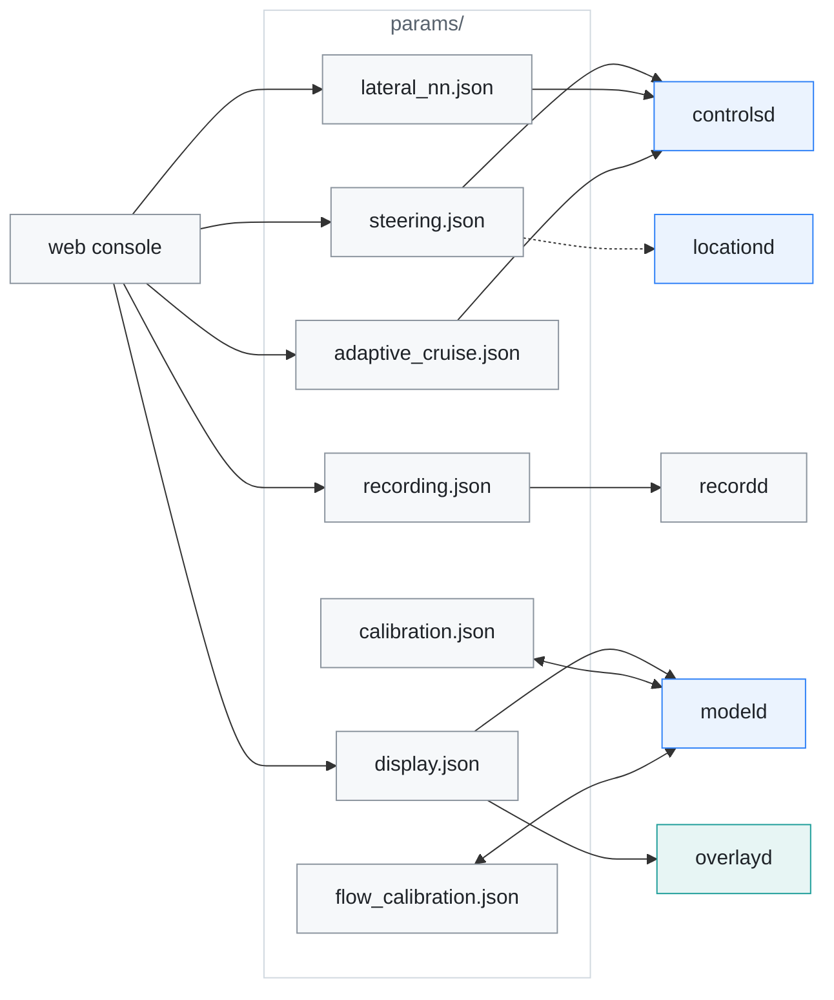
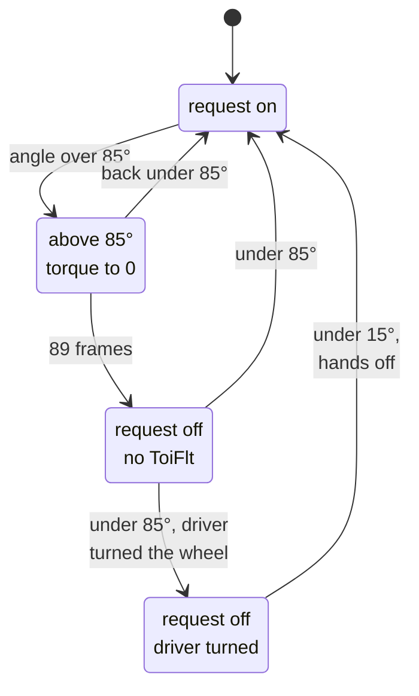
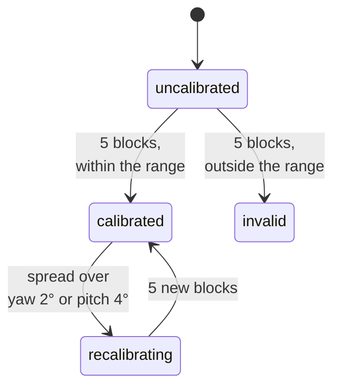

# Parameters

[← Documentation](../docs/README.md)

This folder holds the steering, vision-cruise, recording, display and camera
calibration values for the KIA K7 YG HEV. `controlsd` checks its two runtime
JSON files (`steering.json`, `adaptive_cruise.json`) every second, so a change
from the web console or by hand applies within a second, engaged or not,
keeping the control and PID state.

Who writes each file and which process reads it:

modeld loads the two calibration files at start and saves them as it learns.
locationd reads only `steer_actuator_delay` from `steering.json`, once at start
(the dotted line).

The default directory is `params/` in the runtime's working directory. To use
another directory, set `EDGEPILOT_PARAMS_DIR=/path/to/params`. In the tables
below, the value is the one in the repository's file, and the range is what the
loader clamps a number to.

## Before tuning

- Change steering torque, fixed vehicle values and CAN communication values
  only while stopped.
- Do not let the driver tune the vision cruise while driving. A passenger
  changes one item at a time, by a small step.
- On the Panda, first check the data and the load in `nooutput` or with TX
  disabled.
- Change one value at a time, by a little, and keep logs from before and after
  the change.
- The loader clamps a number outside its allowed range to the range in the
  tables below.
- JSON has no comments, so the descriptions are kept in this document.
- Do not replace the vehicle specs with another car's values.
- The web console (port 8080) runs by default whenever control does. Its
  Vehicle tab chooses Auto-learn or Manual for each learner's values
  (`use_live_*` below); see
  [Runtime options](../docs/runtime-options.md#web-console).
- The web console greys out a value while another value leaves it unused and
  says why, for example the cruise gaps while vision cruise is off, or
  `torque_lat_accel_offset` while `nn_feedforward` is on. It can still be
  edited. A value whose role changes gets a note instead, such as
  `torque_friction`, which with `nn_feedforward` on acts only in curves. The
  conditions are the `unused` and `role` entries in
  `scripts/web_console/param_metadata.py`.

## recording.json

| Key | Value | Unit | Range | Description |
|---|---:|---|---|---|
| `enabled` | false | bool | | Changed from the web Recording tab. On, it saves the 1280x720 20 FPS frames the model actually selected with the AX630C hardware H.264 encoder (VENC), and records CAN RX/TX and the model and control state with them. |
| `bitrate_bps` | 8000000 | bps | 1M to 10M | Target bitrate of the H.264 encoder. The encoder is opened once when recordd starts, so a change applies from the next restart. Above 10M the tmpfs staging would outgrow its cap while a closed segment moves to the SD card. |

A recording is created under `recordings/<time>/`. The video is split into
60 s H.264 segments (`road.h264`). The original capture time of each frame
is saved in each segment's `frames.bin`, CAN and state in 60 s chunks
`events/NNN.bin`, and the parameters of the time in `params/`. When the free
space is below 5 GiB or 10% of the total capacity, a new recording does not
start, or the one in progress ends.

## display.json

| Key | Value | Unit | Range | Description |
|---|---:|---|---|---|
| `enabled` | true | bool | | Turns only the backlight on or off (duty 0); the LCD video pipeline keeps running. |
| `brightness_percent` | 100 | % | 1 to 100 | Duty of backlight PWM3 (pwmchip0/pwm3, 10 kHz, normal polarity). The actual duty is brightness x the board maximum (`disp_max_backlight` in `/boot/board`, default 95%). |
| `alert_volume_percent` | 70 | % | 0 to 100 | Volume of the alert sounds on the board speaker. 0 makes no sound. overlayd checks the file every second, applies a change and plays a confirmation tone once. Without a value, `EDGEPILOT_ALERT_VOLUME` (default 70) is used. |
| `camera_offset_m` | 0.0 | m | -0.35 to 0.35 | When the board is mounted to one side of the car's centre, shifts the input image so the model sees as if from the car's centre (the sunnypilot camera offset method). Positive moves the car left within the lane (with the board on the driver's side, + by that distance). Applies in both Lane and Laneless modes, and the HUD lane lines follow. Beyond ±0.35 m the lead and traffic-light detection get worse, so it is blocked. modeld checks the file every second and moves a changed value at 0.1 m/s. |
| `camera_height_m` | 1.22 | m | 0.8 to 2.0 | Height of the camera above the road. It sizes the effect of `camera_offset_m` and places the lead in the image for the optical-flow lead track. modeld moves a changed value at 0.1 m/s, as it does the offset. |
| `calibration_use_flow` | false | bool | | Takes the warp calibration's pitch and yaw from the optical-flow estimate (the direction of camera motion measured directly in the image, `flow_calibration.json`). It is used only while the flow estimate is usable (3 blocks or more, block-median standard deviation within 0.5°, within upstream's angle limits); otherwise the model pose calibration (`calibration.json`) is used. Roll is the pose calibration's value. modeld checks the file every second and switches to flow only while disengaged (if the setting changes while engaged, or the flow estimate appears while driving, it waits for the disengagement). If flow stops being usable (standard deviation over 0.8° and so on), it goes back to pose even while engaged. It moves the warp towards the new value by 1/5 of the remaining difference per second, at least 0.05°/s. While flow drives the warp (moving included), the pose calibrator pauses and leaves its last value and `calibration.json` as they are. Changed only from the camera calibration card of the web Vehicle tab: the card's `POST /api/calibration/source` is refused while engaged, and the parameter API (`PATCH /api/params/display`) does not accept this key. It does not appear on the Device settings tab ([Flow calibration](../docs/flow-calibration.md)). |

The settings are changed from the web Device settings tab. The web console only
edits the file; overlayd applies the backlight and the alert volume within 1 s,
and the backlight again every time it starts.

## adaptive_cruise.json

This feature uses the vision model's lead distance and relative speed to press
only the `SET-` and `RES+` buttons of the stock fixed-speed cruise.

> [!WARNING]
> It does not control the throttle or the brakes, so it guarantees neither the
> gap nor any deceleration. The driver must always do the braking.

Pressing the brake pedal (AHB1 stroke over 3 mm,
[K7 Panda port](../docs/k7-panda-port.md#brake-signals)) turns it off together
with the stock cruise. Button control starts again only once the driver turns
the stock cruise back on with `SET` or `RES`. Until 2026-10-06 the brake on
this car went unseen, so after the driver braked, the vision cruise pressed
buttons that turned the stock cruise back on.

| Key | Value | Unit | Range | Description |
|---|---:|---|---|---|
| `enabled` | true | bool | | Turns on the vision-based stock cruise button control. Changing it to `false` releases the automatic button pulse in progress and the session at once. |
| `standstill_gap_m` | 5.0 | m | 2 to 20 | Base distance added to the target gap whatever the speed. |
| `following_time_s` | 1.8 | s | 0.8 to 4.0 | Time gap multiplied by the current speed to make the dynamic gap. |
| `gap_correction_gain` | 0.25 | gain | 0.05 to 1.0 | Ratio that turns the error between the actual and the target distance into a target speed correction. |
| `max_slowdown_correction_mps` | 4.0 | m/s | 0.5 to 10 | Largest correction that can lower the target speed when the lead is close or slow. |
| `max_speedup_correction_mps` | 2.5 | m/s | 0 to 5 | Largest correction that can set the target above the lead's speed when the gap is large enough. It never exceeds the first SET limit. |
| `deceleration_rate_kph_per_s` | 0.5 | km/h/s | 0.2 to 5 | How fast the car actually slows when `SET-` lowers the set speed. A fixed-speed cruise only cuts acceleration and does not brake, so it is weak (measured on the K7 HEV: median 0.15 m/s² after repeated `SET-`, about 0.5 km/h/s, and no stronger with a lower set speed). The closing speed on the lead is limited to what this deceleration can remove before the wanted gap (√(2·deceleration·remaining distance)), and the distance closed during the button response is counted in advance. |
| `lead_hold_s` | 0.6 | s | 0.1 to 2.0 | How long the last lead is kept when the vision detection drops out briefly. |
| `lead_restore_delay_s` | 2.0 | s | 1 to 10 | Wait after the lead disappears before going back to the first SET limit. |
| `command_interval_s` | 1.0 | s | 0.5 to 5.0 | Shortest interval at which consecutive button pulses can start. |

The number of CLU11 frames sent for one button press (5) is a code constant, as
in upstream and the community forks
(`AdaptiveCruiseParams::button_pulse_frames`).

The other rules of the button decision are code constants too
(`adaptive_cruise.cc`):

- When the car is already slowing down (or speeding up) that way, the set speed
  is not sent more than 6 km/h from the actual speed. Widening the gap further
  does not change the speed faster and only adds buttons to undo. If the car
  does not respond, it keeps pressing.
- The target speed for the button decision follows downward at once and upward
  at only 1 km/h/s, so noise in the lead measurement does not send `SET-` and
  `RES+` in turn.
- This car does not report the set speed on CAN, so it is estimated by adding
  up the buttons. The estimate is corrected, when it disagrees with the cluster
  speed for long, only while the cruise holds the speed (accelerator released
  for more than 3 s and speed settled for more than 2 s). This keeps the speed
  the driver holds with the pedal from being read as lost button presses, which
  used to make the vision cruise back off for 30 s.

## steering.json

### Base torque limits

`steer_max` (384), `steer_delta_up` (3), `steer_delta_down` (7),
`steer_driver_allowance` (50), `steer_driver_multiplier` (2) and
`steer_driver_factor` (1) were taken out of the runtime keys, because the
panda's hyundai safety enforces the same numbers (`safety_hyundai.h`). Raising
them makes the panda reject frames, and lowering them only makes the steering
weaker than stock. They are code constants, as in upstream opendbc's
`CarControllerParams` (`kHyundaiSteer*` in `src/car/hyundai_can.h`); to change
them, change the panda firmware with them. The steering-angle gate
(`max_steering_angle_deg`) was a dead path that never ran while fault avoidance
is on, so the parameter and the code were removed together. Fault avoidance
itself (`avoid_lkas_fault_enabled`) must stay on: the measurements of
2026-09-18 showed that without it the MDPS faults after about 1 s above 85°.

| Key | Value | Unit | Range | Description |
|---|---:|---|---|---|
| `enabled` | true | bool | | `false` disables the steering controller. |
| `steering_pressed_threshold` | 150 | MDPS raw torque | 0 to 500 | Driver steering threshold that stops the torque PID's integral. It goes through a 5-frame filter, as in RK openpilot, and is separate from `steer_driver_allowance`, the CAN safety limit. |

### openpilot torque controller

The values have the same form as openpilot's `latcontrol_torque`
(lateral-acceleration space). Torque =
(FF + P + I) ÷ `torque_lat_accel_factor` + friction, so changing only the
factor moves all three terms together, and KP and KI compare directly with the
upstream numbers whatever the factor. The
loader rejects the `torque_*_raw` keys of files from before 2026-09-24. To
convert: factor = max_lat_raw ÷ kf_raw, KP = kp_raw ÷ 10, KI = ki_raw ÷ kf_raw,
friction = friction_raw ÷ 1000.

| Key | Value | Unit | Range | Description |
|---|---:|---|---|---|
| `torque_lat_accel_factor` | 2.75 | m/s² | 0.5 to 5.0 | Lateral acceleration that normalised torque 1.0 produces (openpilot `latAccelFactor`). The feed-forward, proportional and integral torques are all divided by this value. 2.75 is the MaixCAM2 torqued learned value (2026-09-27). The earlier 4.44 only worked paired with the excess feedback of SR 16.8; once SR was corrected to 14.9, it showed as understeer in curves (left-curve curvature ratio 0.86, 0.3 m to the outside). With 2.78 on the road on 2026-09-23, the left and right curves came back to the centre (−0.07/−0.03 m). |
| `torque_kp` | 0.8 | gain | 0 to 10 | Proportional gain on the lateral-acceleration error (openpilot `KP`). It is the last point (30 m/s and above) of the gain-by-speed curve `KP_INTERP` [250, 120, 65, 30, 11.5, 5.5, 3.5, 2.0, KP]. The other points are fixed upstream values, so this value does not change the low-speed gain. The earlier 2.0 was an inherited value never tuned since the v0.11 port. Checked on the road on 2026-09-20. |
| `torque_ki` | 0.15 | gain | 0 to 2 | Integral gain on the lateral-acceleration error (openpilot `KI`, the upstream default). The old raw notation hid that the earlier value, 0.33, was 2.2 times upstream's. With 0.15 on the road on 2026-09-24, the left-curve curvature ratio went from 0.90 to 0.96 (n≈17), and the wobble on straights stayed the same. |
| `torque_friction` | 0.083 | normalised torque | 0 to 0.3 | Torque added in the error's direction to overcome the steering friction (openpilot `friction`; upstream adds it in torque space too). |
| `steering_angle_deadzone_deg` | 1.0 | ° | 0 to 3 | No friction compensation while the lateral-acceleration error is within what this steering angle produces (openpilot `steeringAngleDeadzoneDeg`; upstream uses it only on some Toyotas, 0.2°, and openpilot_c2 used 1°). Unlike upstream it fades from 40 km/h to zero at 60 km/h: set as an angle it grows with v², and at 80 km/h and above a 1° dead zone would remove about 90% of the friction compensation. See [Low-speed wheel shake](#low-speed-wheel-shake). |
| `torque_straight_kp_scale` | 0.7 | factor | 0.3 to 1.0 | Factor on the `KP_INTERP` curve on slow straights: in full below 10 m/s (36 km/h) with a desired curvature under 0.003 1/m, back to 1 at 15 m/s (54 km/h) or 0.008 1/m. The desired curvature is the larger of the current request and the delayed one the error compares against, so the whole of a turn keeps the full gain. 1 is upstream. See [Low-speed wheel shake](#low-speed-wheel-shake). |
| `nn_feedforward` | false | bool | | Uses the learned torque model chosen in [`lateral_nn.json`](#lateral_nnjson) for the feed-forward instead of the linear one's lateral-acceleration factor, offset and bank; the PID stays. The friction compensation (`torque_friction`, `steering_angle_deadzone_deg`) is added to a model trained without it (`spec.friction_free`: `k7_hev_v3` and `k7_hev_v4`) in curves, from 0.2 m/s² of desired lateral acceleration and in full from 0.6 m/s², because the model does not see the tracking error. Its inputs keep the same limits as the PID request, including the 80° hold while the hands are off. Switching blends over 1 s, and every engagement ramps in the same way; below 3 m/s, where there is no training data, and during lane changes, turns or while a blinker is on, which the training leaves out, it ramps back to the linear one. Without the model file it does nothing. See [Lateral NN](../docs/lateral-nn.md). |

### Low-speed wheel shake

On straights at 20–50 km/h the wheel shook at 1.7–2.3 Hz by 3–7° (drives of
2026-10-10 to 10-15). The share of engaged straight time shaking was:

| Speed (km/h) | 10–20 | 20–30 | 30–40 | 40–50 | 60–80 | 80+ |
|---|---|---|---|---|---|---|
| Shaking | 15.5% | 11.5% | 5.4% | 2.7% | 0.6% | 0% |

The desired curvature stays flat. The proportional term and the friction
compensation push back on the angle. The torque rate limit (3 up / 7 down per
10 ms) delays that request by another 40–50°. The angle lags the applied torque
by about 130°, so the loop closes at 360° with a gain of about 1. The wheel is
light at low speed, which is where the loop gain peaks.

- `steering_angle_deadzone_deg` stops the friction term from chattering on
  small errors.
- `torque_straight_kp_scale` lowers the gain on straights only.

In slow turns the proportional term makes most of the torque: at 10–30 km/h
its mean is 312–646 against 78–103 for the feed-forward, and the car already
turns 0.68–0.81 of the request. The scale therefore leaves turns alone.

In a model of the loop that reproduces the shake, together they cut the
ringing after a disturbance:

| Speed | Before | After |
|---|---|---|
| 20 km/h | 4.7 s | 0.9 s |
| 30 km/h | 2.3 s | 0.7 s |
| 40 km/h | 2.1 s | 0.5 s |

### Vehicle model and delay

| Key | Value | Unit | Range | Description |
|---|---:|---|---|---|
| `steer_ratio` | 14.72 | ratio | 8 to 25 | Ratio of the steering-wheel angle to the front-wheel angle. It is the paramsd learned value (2026-09-27); RK's KIA K7 HEV value is 16.8. |
| `tire_stiffness_factor` | 0.83 | factor | 0.2 to 2.0 | Car-specific correction applied to the reference tyre lateral stiffness. It is the paramsd learned value (2026-09-27); RK's K7 default factor is 1.0. |
| `steer_actuator_delay` | 0.42 | s | 0.01 to 1.0 | Steering actuator delay. **It is used in two places.** `lag_adjusted_curvature` reads the MPC path this far ahead to lead the curve entry, and the torque controller's request buffer compares the target from this long **ago** with the current measurement. So raising it adds lead but makes the feedback staler. When the curvature tightens quickly and the car is already past the stale target, the error's sign flips and the torque drops out in the middle of the curve — at 0.46, 36% of 69 tightening curves had the requested torque collapse below 30% within 0.4 s, against 14% at 0.34 (paired comparison, McNemar p=0.0015). The upstream Hyundai default is 0.1 (0.2 for some). |
| `angle_offset_deg` | -1.57 | ° | -10 to 10 | Straight-ahead offset of the steering-angle sensor. It is subtracted from the sensor angle before the actual curvature is estimated. Set to the paramsd learned mean (drives of 2026-09-21 to 23, −1.5 to −1.6°). The earlier −0.7° was 0.9° off and got the curvature wrong by about 4e-4, making left curves look under-turned and right curves over-turned. |
| `torque_lat_accel_offset` | -0.06 | m/s² | -1.0 to 1.0 | Subtracts from the feed-forward the constant lateral-acceleration bias that a mount roll error and the like cause (openpilot latAccelOffset). Enter the offset torqued learned (with a recording, the one `diagnostics/replay_lateral_learners` finds) as it is. Positive = the direction to raise when the car pulls right (+y = right convention, the opposite wording to the openpilot docs). |
| `live_bank_compensation` | true | bool | | Corrects the feed-forward in real time for the road bank estimated from the ESP12 measurements (2 s filter). The bank absorbs the bias the sensors see (crown, zero), so `torque_lat_accel_offset` is only a trim for the torque-path or mechanical bias the sensors do not see. This replaced the static roll key, which was removed. |
| `use_live_vehicle_params` | true | bool | | Like openpilot paramsd, uses the steering ratio, tyre stiffness, steering-angle zero (total) and road roll learned while driving. On, the actual curvature uses the learned values instead of `steer_ratio` and `angle_offset_deg`, and the roll goes into the actual curvature, the feed-forward (−roll·g) and the curvature's lateral-acceleration limit, replacing `live_bank_compensation`. When the learned values become invalid (zero or roll beyond its limit and so on, after calibration has completed) it disengages with `paramsd_invalid`. Off, it only computes and records. The learning state is kept in `live_parameters.json` (checked every minute, written when it changed) and carries on at the next start. In the web console, choose Auto-learn or Manual on the Vehicle tab. |
| `use_live_torque_params` | true | bool | | Like openpilot torqued, learns the torque-to-lateral-acceleration factor (latAccelFactor), the offset and the friction, and uses them in the torque controller. The factor stays within ±30% of `torque_lat_accel_factor` (default 2.75), the friction within ±50% of `torque_friction`. On, `torque_lat_accel_offset` is replaced by the learned offset. Until the buckets are full (`cal_perc` < 100) the starting values are used: the saved ones, or else `torque_lat_accel_factor` and `torque_friction` with an offset of 0. The fit uses every collected point (upstream samples 2000 at random to save CPU). The learner pauses while the CAN inputs are stale (the car is off), as upstream runs torqued only while the car is on. The points and the filters are kept in `live_torque_parameters.bin` (every 12 s when new points arrived). In the web console, choose Auto-learn or Manual on the Vehicle tab. |
| `use_live_delay` | false | bool | | Like openpilot lagd, uses the steering delay that locationd estimates (desired curvature → actual yaw rate) for the path delay (when the desired curvature is read), the torque controller's request delay and the torqued delay. It applies only once the estimate is settled (5 blocks); until then `steer_actuator_delay` is used. In the web console, choose Auto-learn or Manual on the Vehicle tab. |
| `use_locationd_learner_inputs` | true | bool | | paramsd and torqued take the yaw rate and the road roll from locationd (IMU and camera fusion), as in openpilot. Off, they use the ESP12 yaw rate (with its own bias estimate) and a roll from the ESP12 lateral acceleration. When locationd is missing or stale, they fall back to ESP12. torqued collects points only from the source it had at start, so for torqued a change applies from the next start. In the web console, choose locationd or ESP12 under the learner input source on the Vehicle tab. |
| `lane_path_weight` | 3.0 | weight | 0.5 to 10 | Path (lateral position) weight of the Lane-mode MPC. openpilot 0.9.4's `PATH_COST` is 1. In closed-loop replay on 2026-10-05, 3 cut the inside bias on right-hand highway curves from 13.4 cm to 10.6 cm (sharp curves 18→14 cm), and the lateral jerk rose 12-19%. Not used in Laneless mode. |
| `min_steer_speed_mps` | 1.0 | m/s | 0 to 5 | No steering torque below this speed (openpilot CP.minSteerSpeed). It covers the 1.1-3.6 km/h creep band where the v0.9.4 plan gives saturated commands. |

### Path mode

| Key | Value | Unit | Range | Description |
|---|---:|---|---|---|
| `laneless_mode` | false | bool | | `false` is Lane mode: with a high lane probability it blends in the lane-centre path, and as the probability drops it uses only the model path. `true` is Laneless mode, the same method as openpilot master (`get_curvature_from_plan`). Without lanes or MPC, it makes the desired curvature `2·ψ(t_d)/(v·t_d) − ψ̇(0)/v` from the model plan's yaw and yaw rate (t_d = steering delay + plan age). Lane mode uses the same calculation when no lanes are visible (intersections and so on, effective probability below 0.3, back to the lanes above 0.4; not while a lane change takes the lanes out, though a blinker alone does not stop it). For this switch the lane-line std counts only once it has stayed high for 0.5 s: the model's std passes 0.4 for a moment even on clear lines, and each time it used to drop to the model path and back (3 times a minute, mostly for under a second; 2026-10-19). The switch also takes a wider std band than the blend (full below 0.25, none above 0.5, against 0.15–0.4): lines that come back after an intersection have a high std (median 0.62 on a 2026-10-22 town drive), and with the blend's band the car stayed on the model path for 0.70 s (p90 1.81 s) after the model saw them, 12–27 cm off the lane centre, while lines at std 0.4–0.6 were within 7 cm. With the wider band it is 0.55 s (p90 1.31 s), with fewer switches back within a second. The lane weight in the blend still falls with that frame's std, since a high-std line is less accurate (median error against the stock camera's line 3.9 cm, 8.5 cm at std 0.4–0.6), and the handover with the lane MPC blends the desired curvature (0.5 s when dropping the lanes, 0.25 s when getting them back). Before 2026-10-06 this stretch followed the plan positions through the lane MPC, which below 25 km/h turned 26-30% less than laneless and 0.3-0.4 s later (recording replay). On real drives, the median driver torque in slow turns was also 152, twice laneless's 80. Changed on the web console's Steering tab; the HUD shows the path in use as `LANE`/`LANELESS`. Lane changes work through the model's desire input in both modes. |

### Lane change

| Key | Value | Unit | Range | Description |
|---|---:|---|---|---|
| `lane_change_min_speed_kph` | 30.0 | km/h | 0 to 80 | No lane-change desire below this speed. |

Lane changes work as in openpilot's desire_helper. Turning on the blinker and
pushing the wheel that way (driver torque over `steering_pressed_threshold`)
starts one: the model gets a lane-change desire pulse, and the lane-line weight
is taken away over 0.5 s. It ends when the model says the lane change is done
(`desire_state` lane-change probability below 0.02), when 10 s have passed, or
when the steering is inactive (openpilot `latActive`: also at a standstill and
in the large-angle pause). At the end the lane lines come back over 0.5 s
(openpilot takes 1 s).

On top of openpilot:

- **One lane change per blinker.** With the blinker still on after a lane
  change, another needs the blinker switched off and on again (switching to the
  other side counts). A blinker left on through a ramp or a turn exit used to
  start a lane change every 4.5 s.
- **Pushing back cancels.** Steering against the lane change for 0.2 s
  (filtered like the controller's steering-pressed) cancels it. The lane
  lines then come back with the 0.5 s fade alone, without a drop to the model
  path: the fade scales the lane probabilities after their 2/s rate limit.
  Before 2026-10-22 it scaled them before the limit, so after a cancel the
  limited probability climbed back from the faded value, and 11 of 13 cancels
  briefly fell back to the model path.
- **A blinker turn is a turn, not a lane change.** Below 55 km/h a lane change
  does not start while the car slows by more than 0.75 m/s² (the driver is
  braking for a turn). Turning the wheel 45° or more with the blinker on ends
  any lane change and blocks another for that blinker. Turned toward the
  blinker, the model gets a turn desire (repeated every 2.5 s, since the model
  input is a pulse it remembers for 5 s) and Lane mode follows the model path,
  until the wheel is back under 15° or 15 s have passed; then modeld drops the
  turn from the model's desire history. On the drives of 2026-10-14 and 15,
  4 of 27 lane changes were really intersection turns; replaying 12 drives, a
  turn desire came on 44 times, all in turns past 53°.

Holding the wheel does not reduce the requested torque (as in openpilot). Only
torque against the driver is reduced, gradually, by the same driver clamp as
the panda's (allowance 50 + driver torque x 2) and the rate limit (3 up / 7
down per frame). While the wheel is held, only the torque controller's
integrator stops. The old `driver_torque_threshold` (driver torque over 170 for
1 s brought the torque down to 0 whatever its direction) also removed the
assist in sharp curves where the driver was helping in the same direction, so
it was deleted on 2026-09-27.

### Path limits

The lateral path limits are not runtime keys but fixed constants in
`src/controls/lateral_controller.h`: the largest lateral jerk `5.0 m/s³`, the
largest lateral acceleration `3.0 m/s²` (shifted by the learned road roll),
and the absolute cap on the final desired curvature, openpilot's `0.2 1/m`
(`kMaxCurvature`). None of them is exposed as a setting.

### Steering angle and LKAS fault protection

| Key | Value | Unit | Range | Description |
|---|---:|---|---|---|
| `avoid_lkas_fault_enabled` | true | bool | | Uses the large-steering-angle fault avoidance. Measured on the K7 YG HEV (2026-09-18): when the steer request stays on above 85° for 0.98-1.12 s, the MDPS sets ToiFlt/FailState whatever the torque, and cuts the assist until the angle comes back below 85°. Above 85° the torque is still output, but only so much is left that it reaches 0 within the allowed frames (`steer_delta_down` × remaining frames), and from that frame the steer request is turned off, without ToiFlt, until the angle comes below 85°. The same holds while waiting at a stop, and above 85° the request is never newly turned on. If the driver turned the wheel during that stay (steering detected), it stays off until the angle comes below 15°, not 85°, and the hands leave the wheel (carrotpilot's release condition): it does not push a driver who is straightening the wheel out of a turn. It also comes back below 80° once the planned curvature has matched the wheel's curvature (same side, within 25%) for 1 s, as when the driver holds a ramp after a brief pass over 85°. Off, upstream hyundai `carcontroller.py`'s `common_fault_avoidance` is used: above 85°, after 89 frames of request it cuts 2 frames (ToiFlt on, torque unchanged) and counts again. On the K7, turning a cut request back on above 85° caused a fault within 3-14 ms (2026-10-03, 4 times out of 4). Do not turn it off. |
| `avoid_lkas_fault_hold_angle_deg` | 80.0 | ° | 0 to 84 | Largest steering-wheel angle the controller goes to on its own while the driver is not holding the wheel (not steering pressed). It binds the desired curvature within the curvature this angle produces (the vehicle model with the learned SR, stiffness, offset and roll). So instead of passing 85°, losing the torque 0.89 s later, and the wheel unwinding and being caught again over and over, the torque holds at this angle without a break. Not bound while the driver is steering (it does not push a driver who winds on). Above about 35 km/h, where the lateral-acceleration limit (3.0 m/s²) is tighter, it never binds. 0 turns it off; the loader keeps it below the 85° avoidance threshold. |

With the avoidance on, the steer request moves between these states (the
request is off from the start when it would begin above 85°):

The MDPS fault limit is a code constant (`SteeringParams`): the request is held
for up to 89 frames above 85°, 9 frames before the measured fault floor of 98
frames. It is the same value as upstream hyundai `carcontroller.py`'s
`MAX_ANGLE` and `MAX_ANGLE_FRAMES`. The length of the request cut with the
avoidance off (2 frames) is also a code constant, the same as upstream
`MAX_ANGLE_CONSECUTIVE_FRAMES`. If a case is found where the fault comes
earlier, lower this constant.

When steering starts again, after this pause or any other, the torque
controller sends only the feed-forward for one steering delay: no P, I or
friction from the error. Its error compares the request from one delay ago
with the wheel now, and while steering rested those requests were the
measured curvature. When the pause releases at 15°, that is the curvature of
the wheel at about 45° a moment before. Before 2026-10-22 the P term then
pushed into the turn the driver was unwinding: in 30 of 34 releases on the
drives of 2026-10-14 to 22 it exceeded 100 (median about 360). In replay
over all 34 routes, the mean into-turn torque over the first 0.42 s after a
release went from 56 to −25 (median over 64 releases).

### State and CAN

These are code constants, as upstream (openpilot, opendbc, the community forks)
has them, and are not read from the file (`kModelTimeoutS`,
`kVehicleStateTimeoutS` and `kInactiveReleaseS` in
`src/controls/control_params.h`; the MDPS speed is `kMdpsSpeedSpoofKph` in
`src/car/hyundai_can.cc`):

- the time after which the model path and the vehicle CAN state count as stale
  (250 ms, 500 ms);
- the time zero-torque frames keep being sent after a disengagement before the
  stock LKAS takes over (3 s, the same as openpilot_c2's default handover
  time);
- the speed written on the MDPS bus so the MDPS takes LKAS even at low speed
  (60 km/h).

## calibration.json

This file is not a normal tuning file but the saved state of the online camera
calibration. It is updated from the model pose and the actual vehicle speed,
unless `EDGEPILOT_CALIB_AUTO=0` turns the online calibration off. If the board
or the camera mounting angle changes, or the camera intrinsics are measured
again, do not keep using the old values; calibrate again.

The values here are the initial seed for a new install.
`scripts/upload_to_board.sh` does not overwrite a runtime file already on the
board, and puts this file in `params.defaults/`.

| Key | Value | Unit | Description |
|---|---:|---|---|
| `version` | 1 | schema version | Version of the storage format. Users do not change it. |
| `rpy_rad` | `[0, 0, 0]` | rad `[roll, pitch, yaw]` | Camera attitude correction. The valid range is upstream's: pitch -0.0907 to 0.17 and yaw ±0.0691 rad. A saved value outside the range is still loaded, and marked invalid. |
| `spread_rad` | `[0, 0, 0]` | rad `[roll, pitch, yaw]` | Spread of the calibration values between the valid blocks. The smaller, the steadier the observation. |
| `valid_blocks` | 0 | block | Number of saved valid calibration blocks. With 5 or more the state can become calibrated. |
| `height_m` | (absent → 1.22) | m | Height of the camera above the road, block-averaged from the model's road_transform z (upstream `extrinsicsCalibration.height`, added 2026-10-05). An old file without it starts at 1.22. After calibration, samples whose height standard deviation is over e^-3.5 (0.030 m) are dropped. Collecting again after a mount change takes it back to 1.22. Not yet used for `display.camera_height_m` (the size of the camera offset). |

The seed is all zero, the same as having no file: the input warp starts from
the camera's own axis and the online calibration learns the mount on the first
drive.

`OnlineCalibrator::restore()` uses the saved `valid_blocks` as it is (as
openpilot's calibrationd does). Below 5 (`kInputsNeeded`), `rpy_rad` is only
the starting point of the model input warp, and the state is `uncalibrated`, so
engagement is blocked. It becomes `calibrated` once 5 new blocks are collected.
A block is 100 accepted samples (`kBlockSize`), and samples are accepted only
when driving straight at about 24 km/h or more, so 5 blocks take a little over
25 s of such driving.

The calibration status moves like this:

Deleting the file outright starts from `rpy=[0,0,0]` with no seed. This car's
pitch is -1.35°, so the model input warp is off by that much until the
calibration converges. To make it learn again, keeping `rpy_rad` and setting
`valid_blocks` to 0 is better than deleting the file.

After moving the camera mount, press **Reset calibration** on the web console's
Vehicle tab. It is accepted only while disengaged (like openpilot's Reset
Calibration). It creates `/dev/shm/edgepilot_calibration_reset`, and within
a second modeld deletes this file and `flow_calibration.json` and restarts the
calibrator from `rpy=[0,0,0]` with 0 blocks, and the flow calibrator with no
blocks. The old mount's values are wrong, so they are not kept as a seed. The
paramsd and torqued learned values are learned from the CAN yaw rate, so they
stay. If modeld is not running, the request file stays and is handled at the
next start.

When the spread between blocks goes over 2° in yaw or 4° in pitch, the
calibrator decides, as openpilot's calibrationd does, that the mount has
changed, and calibrates again by itself. It collects again from the last
block, the state is `recalibrating` (HUD `RECAL`), the output moves to the new
value over 0.5 s (10 samples), and it is calibrated again once 5 new blocks are
full. Nothing is saved in between. A smaller mount change mixes with the old
blocks and moves slowly, so reset it with this button.

To measure the intrinsics again and relearn while keeping the old values as the
seed: while stopped, stop the pipeline, back up the board's
`params/calibration.json`, rewrite it with `valid_blocks` set to 0, and start
the pipeline. On the road, drive fast enough on a nearly straight road, with
the camera fixed so that it cannot move.

## lateral_nn.json

Which learned torque model ([Lateral NN](../docs/lateral-nn.md)) controlsd
uses: `{"model": "k7_hev_v3"}`, a name from `models/lateral_nn/` without
`.json`. A model is trained on one car, so choose the one of this car. The
web console's Steering tab writes it. controlsd checks it every second and
switches models without a restart; `nn_feedforward` still decides whether the
model is used. Without the file, or with a name that does not load when
controlsd starts, the linear feed-forward is used. A name that does not load
while it runs leaves the current model in use.

## flow_calibration.json

A runtime file that is not in the repository. modeld saves the flow
calibrator's block medians (each the median of 20 windows, up to 30, oldest
first), so a restart starts straight from that estimate. The first estimate and
a mount change are written at once, otherwise once a minute and on exit. The
web console's calibration reset deletes it together with `calibration.json`.

| Key | Unit | Description |
|---|---|---|
| `version` | schema version | 1 |
| `yaw_rad`, `pitch_rad` | rad | The block medians. They must have the same length; if any value is not finite or exceeds 10°, the whole file is discarded |
| `windows` | count | Number of measurement windows accepted so far |
| `mount_changes` | count | Number of times old blocks were dropped for a mount change (the last 3 blocks over 1° on the same side) |

## Recommended tuning order

1. Fix the camera mount and complete the online calibration.
2. Set the lane-centre position first, with the device setting
   `camera_offset_m`.
3. Check that `angle_offset_deg` and `steer_ratio` match the real car. The
   wheelbase and the centre of gravity are code constants
   (`src/car/car_specs.h`, as opendbc `CarSpecs`).
4. Adjust `torque_lat_accel_factor`, `torque_kp`, `torque_ki` and
   `torque_friction`, one at a time.
5. Once the torque tracks properly, adjust `steer_actuator_delay`. The lateral
   jerk and acceleration limits are not runtime keys, so they are not changed
   here (see [Path limits](#path-limits) above).
6. Last, check the fault avoidance options (`avoid_lkas_fault_*`).

At each step, first check that you can disengage, that the torque against the
driver eases off when the driver steers against it, and that there are no CAN
errors and no MDPS faults.

## Related

- [Runtime options](../docs/runtime-options.md): the environment variables, how
  a changed file reaches the processes, and the web console
- [Runtime](../docs/runtime.md): the processes that read these files
- [Flow calibration](../docs/flow-calibration.md): the optical-flow calibrator
  behind `calibration_use_flow`
- [Lead flow](../docs/lead-flow.md): the lead track the vision cruise follows
- [K7 Panda port](../docs/k7-panda-port.md): the K7's CAN signals, the brake
  pedal and the transmit gates
- [Closed-loop replay](../docs/closed-loop-replay.md): the simulation behind
  `lane_path_weight`
- [Recording](../docs/recording.md): the route that `recording.json` switches on
