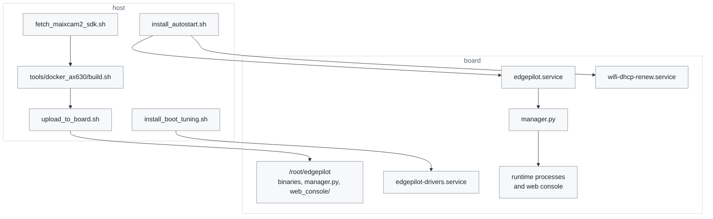

# Scripts

[← Documentation](../docs/README.md)

The scripts used on the host to build, deploy and test, and the Python that is
installed on the board and runs with the runtime. `upload_to_board.sh` puts the
board files at the top level of the board's install directory
(`/root/edgepilot`), next to the executables.

This map shows which scripts run on the host and what each one sets up on the
board:

`run_host_tests.sh` stays on the host: it builds and runs the host tests in
`build-host/` and touches neither the board nor `deps/`.

## Host

| Script | Usage | What it does |
| --- | --- | --- |
| `fetch_maixcam2_sdk.sh` | `[root@board]` | Fetches the MaixCAM2 cross-build dependencies into `deps/ax630/`. The MSP SDK `v3.0.0_20250319114413` (SHA256 pinned) and the MaixCDK headers (commit `30f4b8b`) come from the network; the board's `/opt/lib`, `libmaixcam_lib.so.1.2.5` and `libsamplerate` are copied from the board over SSH as they are |
| `upload_to_board.sh` | `[root@board]` | Uploads to the board the runtime in `build-ax630/bin`, the board-side Python, the whole web console directory (its page, `static/` with the i18n catalogues `static/i18n/*.json`, and three.js), the parameter defaults, the model (`models/supercombo.axmodel`, only when it changed), every learned torque model in `models/lateral_nn/` (models that exist only on the board are kept) and the Panda firmware image (as `firmware/panda.bin.signed`, when it was built). When the board's `/usr/lib/libmaixcam_lib.so` differs from the 1.2.5 the build used, it uploads 1.2.5 and changes the link (the stock file is kept as `.stock`) |
| `install_autostart.sh` | `[--remove] [root@board]` | Installs `edgepilot.service` (runs the manager at boot, instead of the stock launcher) and `wifi-dhcp-renew.service`, and puts `maix_npu_ai_isp=1` in `/boot/configs` (reboot once after it first does, or `camerad` refuses to start) |
| `install_boot_tuning.sh` | `[--remove] [root@board]` | Makes the boot faster: installs `edgepilot-drivers.service`, which loads the AX drivers early in the boot, turns off stock services that are not used, and bounds the journal size. It takes effect from the next boot ([Boot time](../docs/boot-time.md)) |
| `run_host_tests.sh` | `[--linux]` | Builds the host tests and runs them all with `ctest` ([tests/](../tests/README.md)). It needs neither the board nor `deps/`. `--linux` builds and runs them in the board build's Docker image, with the board's compiler |

The build itself is done by `tools/docker_ax630/build.sh` in an arm64 Ubuntu
22.04 container (the output goes to `build-ax630/bin`, the Panda firmware to
`build-ax630/panda/obj`). The scripts that reach the board take its address as
their first argument (`root@<board-ip>`), or from `EDGEPILOT_BOARD`, and log in
with SSH key authentication; with neither they stop and print their usage.

Environment variables that change the defaults:

- `fetch_maixcam2_sdk.sh`, `upload_to_board.sh`, `install_autostart.sh`,
  `install_boot_tuning.sh`: `EDGEPILOT_BOARD`, the board when no argument is
  given.
- `upload_to_board.sh`: `EDGEPILOT_BIN_DIR` (default `build-ax630/bin`),
  `EDGEPILOT_BOARD_DIR` (default `/root/edgepilot`), `EDGEPILOT_PANDA_IMAGE`
  (default `build-ax630/panda/obj/panda.bin.signed`).
- `run_host_tests.sh`: `EDGEPILOT_HOST_BUILD_DIR` (default `build-host`),
  `JOBS`.

How `upload_to_board.sh` installs:

- `models/supercombo.axmodel` is sent only when its checksum differs from the
  board's copy.
- A running binary cannot be overwritten, so files go to `.upload/` first and
  are replaced with `mv`.
- The manager is not restarted.
- The board's `params/` is not overwritten. The defaults go to
  `params.defaults/` and fill in only the files that are missing.

The full build and deploy procedure is in
[Build and deploy](../docs/build-and-deploy.md).

## Board

| File | Usage | What it does |
| --- | --- | --- |
| `manager.py` | `python3 /root/edgepilot/manager.py [supercombo.axmodel]` | The runtime supervisor. It stops the board's UI launcher, starts the processes in order and restarts one after it dies (1 s, backing off to 16 s when it keeps dying within 10 s). At boot, `edgepilot.service` starts it |
| `web_console/` | `python3 -m web_console [--host address] [--port port]` | The web console (FastAPI, default `0.0.0.0:8080`). The manager starts it too. It handles parameter editing, the vehicle characteristics (learned and manual values) and the BEV, and shows the backlight state (`backlight.py`); the page is in `static/`. The Panda firmware card on the device settings tab flashes the Panda (only while parked; `pandad` does the writing). The recording tab's recording files card shows the routes on the SD card with their sizes and deletes them (`recordings.py`) |
| `web_console/static/` | (static files) | The web console page (ES modules, no build step): `index.html`, `console.css`, `console.js` (header line and tabs), `ui.js` (shared helpers), the parameter tab (`param_state.js`, `param_editor.js`, `param_view.js`), the vehicle characteristics tab (`vehicle_view.js`), the Panda card (`panda_card.js`), the learned torque model card (`lateral_nn_card.js`), the recording files card (`recordings_card.js`), the BEV tab (`bev_view.js`, `bev.js` with its GPU helpers `bev_gl.js` and geometry writers `bev_geometry.js`, the ego model `bev_ego.js`, the lead model `bev_car.js`, `bev_data.js`, `bev_math.js`, the planner's lane filter copy `lane_filter.js`), the remembered browser choices (`storage.js`) and three.js 0.186.1 (`three/`) |
| `web_console/backlight.py` | (module) | Reads the LCD backlight state from sysfs for the header line (PWM3 `pwmchip0/pwm3`, 10 kHz, duty = brightness x `disp_max_backlight` from `/boot/board`). Only `overlayd` writes the backlight: it applies `display.json` within 1 s and again each time it starts. The web console only edits `display.json` |
| `edgepilot.service` | installed by `install_autostart.sh` | The systemd unit that starts the manager at boot (`Conflicts=launcher.service`, `Restart=always`). `systemctl start launcher.service` returns to the stock launcher. Child logs go to `/run/edgepilot/<name>.log` |
| `edgepilot-drivers.service` | installed by `install_boot_tuning.sh` | Loads the AX media drivers early in the boot. The stock image loads them from `rc.local`, which waits for the Wi-Fi connection |
| `wifi-dhcp-renew.service`, `wifi-dhcp-renew.sh` | installed by `install_autostart.sh` | Renews the wlan0 DHCP lease each time the Wi-Fi joins another access point |
| `requirements-web-console.txt` | `python3 -m pip install -r ...` | The web console's dependencies (fastapi, uvicorn) |

Which processes to start, and the environment variables, are in
[Runtime](../docs/runtime.md) and [Runtime options](../docs/runtime-options.md).
The order in which these units start at boot is in
[Boot time](../docs/boot-time.md#unit-order).

## Writing a script

- The comment at the top (the module docstring in Python) says in Korean what
  the script is for, and ends with a usage line.
- A shell script starts with `set -euo pipefail` and finds the repository root
  itself, so it runs from anywhere. A script that also runs on the board is
  written in POSIX `sh`.

## Related

- [Build and deploy](../docs/build-and-deploy.md): the build container, upload
  and build version step by step
- [Board setup](../docs/board-setup.md): preparing the stock image before the
  first upload
- [Boot time](../docs/boot-time.md): what the boot tuning changes and what it
  saves
- [Runtime](../docs/runtime.md): the processes the manager starts and how it
  supervises them
- [Runtime options](../docs/runtime-options.md): environment variables,
  parameter files and the web console
- [Host tests](../tests/README.md): what `run_host_tests.sh` runs
