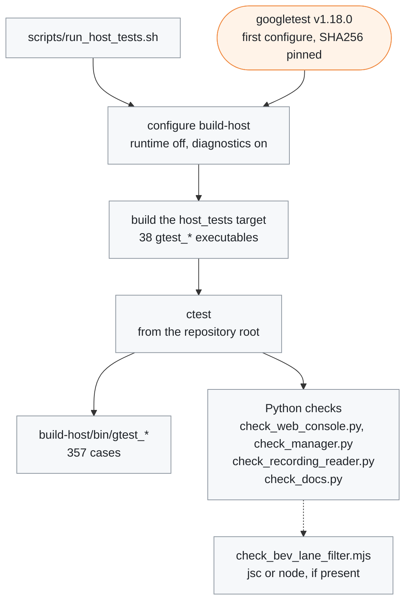

# Host tests

[← Documentation](../docs/README.md)

The googletest tests and Python checks that run on the host, without the board.
Each test file is one executable (`gtest_<name>.cc` →
`build-host/bin/gtest_<name>`), and none of them is part of the board build.

`scripts/run_host_tests.sh` builds the tests and runs them all:



## Run

```sh
./scripts/run_host_tests.sh
```

The script configures `build-host`, builds the `host_tests` target and runs
everything with `ctest`: 357 C++ cases and 4 Python checks. googletest v1.18.0
is downloaded on the first configure (its SHA256 is pinned).

`./scripts/run_host_tests.sh --linux` does the same in `build-linux-test/`
inside the board build's Docker image (GCC 11, as on the board). It covers what
the Mac build cannot: the futex wait in the IPC channels (macOS polls instead)
and the board compiler's floating-point results that the replay digests depend
on.

Two options check more in a build directory of their own:
`-DEDGEPILOT_SANITIZE=ON` builds with AddressSanitizer and
UndefinedBehaviorSanitizer, and `-DEDGEPILOT_WERROR=ON` turns warnings in
edgepilot code into errors (the board build has none either). On 2026-10-19
all tests passed under both:

```sh
cmake -S . -B build-san -DEDGEPILOT_BUILD_RUNTIME=OFF -DEDGEPILOT_BUILD_DIAGNOSTICS=ON \
  -DEDGEPILOT_SANITIZE=ON -DEDGEPILOT_WERROR=ON -DCMAKE_BUILD_TYPE=RelWithDebInfo
cmake --build build-san -j8 && ctest --test-dir build-san -j8
```

To run one test:

```sh
ctest --test-dir build-host -R LateralController.InactiveDesiredTracksActual --output-on-failure
build-host/bin/gtest_lateral_learners --gtest_filter='LateralLearners.Torque*'
```

The tests read `params/` by a relative path, so they must run from the
repository root. Run `ctest` from the root, and call an executable directly from
the root as well.

## Tests

| Executable | Cases | What it checks |
| --- | ---: | --- |
| `gtest_adaptive_cruise` | 18 | Vision cruise button spacing and limits. In closed loop with a vehicle model: set-speed sync, re-setting, a car that does not respond, and up-down hunting. With a slow vehicle model like the measured one (0.5 km/h per second): accelerator use is not read as a lost button press, the approach-speed limit matched to the weak deceleration, the set speed kept near the actual speed while the car slows, and no alternating SET-/RES+ on lead measurement noise |
| `gtest_alert_tones` | 1 | Alert sound synthesis: every sound starts and ends in silence, has the same peak, lasts 0.3-2.5 s, and differs from the others |
| `gtest_background_writer` | 2 | The thread that writes files outside the loop: the latest content wins for the same path, deletion, `flush` waiting for the writes already handed over, the remaining writes finishing on destruction, and a failed write retried later unless newer content for the path came in |
| `gtest_build_version` | 2 | The build version (`cmake/build_version.cmake`): the marker in the executable is followed by `edgepilot_version()`, which is at most 64 characters, all of them ones the web console shows as they are |
| `gtest_calibration` | 13 | The online calibration state machine (against `calibrationd.py`, including the camera height and height standard deviation conditions), recalibration on a mount change or a reset, restoring an out-of-range saved value, save and restore through the background writer, environment variables. The calibration service's flow source (with a fake `FlowSource`): flow from the first frame when a flow block is saved and the setting is on; the pose calibrator pausing while flow drives the warp and running again once it goes back to pose; a reset clearing both calibrations, telling the source and dropping the earlier state; a reset while engaged waiting for the disengage; the source saving its blocks |
| `gtest_calibration_source` | 12 | Choosing the warp calibration source: set to pose, the pose value as it is; set to flow with the flow usable (3 blocks, range and standard deviation), the flow pitch and yaw with the pose roll; a setting change while engaged, and an estimate formed while driving, wait for the disengage; falling back to pose, and following a change in the applied estimate, happen even while engaged; the standard-deviation hysteresis (0.5°/0.8°); the ramp (1/5 of the difference per second, at least 0.05°/s); following the pose directly once back on it; matching at once on a reset |
| `gtest_car` | 18 | The bytes edgepilot sends against golden values made with opendbc's packer and upstream formulas (`tools/control/make_can_golden.py` → `hyundai_can_golden.h`: LKAS11 on both buses with its checksum, the cruise-button CLU11, the MDPS12 fault-avoidance frame) and the torque limiter against opendbc's `apply_driver_steer_torque_limits` and the Panda firmware's `driver_limit_check` (200,000 random ticks, never a violation); the wheel-speed vEgo Kalman filter (against upstream opendbc values, restart after going stale), K7 CAN signal decoding (WHL_SPD11 and wheel standstill, TPMS11, TCS13/15, SCC11, CLU11 cruise buttons and the fixed-cruise set speed, the MDPS12 fault filter and temporary faults (ToiUnavail, ToiFlt)) and the CLU11 speed swap for the MDPS, a CGW1 B-CAN timeout read as safe values (blinkers off, door open, seatbelt unlatched), brake lights lit by the AHB1 pedal stroke (over 3 mm) and TCS13 BrakeLight (AUTO HOLD), the AHB1 pedal turning off the fixed-cruise estimate (a TCS13 zero does not overwrite it, RES ignored while the pedal is pressed) |
| `gtest_control_holds` | 3 | The steering path gate (plan reach and point count), the Panda health gap hold (100 ms), the invalid plan hold (150 ms) |
| `gtest_controls_tick` | 13 | One controlsd tick (`ControlsTick`) every 10 ms, as in `main`, fed K7 CAN built from the signal layout, a 20 Hz model and the Panda state: a SET engage and the LKAS11 transmit (powertrain and MDPS buses), a disengage when a door opens, the refusal after a 1 s grace when the Panda does not allow control, the AHB1 pedal turning off the cruise estimate (lateral control stays), the last lagd delay on ticks that could not read locationd, a model lead below the probability threshold ignored, the vision cruise taking the lead track while the departure alert takes the model lead, learner files written only when they change, reloaded parameters reaching the planner, a new model's plan used in the tick that receives it, the lagd inputs (steering pressed, saturated) in `ControlState`, only changed learner outputs on exit, the CAN batch freshness taken at the pop, a torn locationd read keeping the last lag estimate, and the parameter-file watcher picking up an atomic rewrite at its once-a-second check |
| `gtest_departure_alert` | 14 | Lead-departure and green-light alerts at a stop (arming after 1.5 s of a short plan, timing again when the plan opens before arming, a green light only 2.7 s into the stop, the gas probability, path flicker behind a close standing lead filtered out, the gas probability unused while waiting with a blinker, short lead dropouts tolerated), the green-light check at controlsd's rates (100 Hz ticks, a model frame every 5 ticks), the close-lead rejection judged between model frames, and creeping not ending the stop while the accelerator does |
| `gtest_desire_helper` | 9 | The lane-change desire state machine (`DesireHelper`): it starts only when the wheel is pushed towards the blinker side; lane lines fade out and in over 0.5 s; the 10 s timeout; no lane change towards a road edge, and the start once the edge goes away; one lane change per blinker (a blinker switched off and on, or to the other side, is a new one); pushing back for 0.2 s cancels; a blinker turn (45° of wheel, or braking below 55 km/h) is not a lane change; the turn desire toward the blinker until the wheel is back under 15°, repeated every 2.5 s; following latActive and re-reading the blinker side; the turn desire ending after 15 s |
| `gtest_device_settings` | 3 | Reading the web device settings (`display.json`): range clamping, a bad value keeps the previous one, re-reading only when the file changes |
| `gtest_flow_calibration` | 16 | The hardware-independent part of the flow calibrator: solving the direction of travel and the rotation on a synthetic scene, with the sign conventions; rejection with too few points or a large rotation; a standing scene rejected by its motion (1 px); corners chosen per cell; the straight-road condition; the block median and status; the last 30 blocks; a save-restore round trip; a mount change detected (the last 3 blocks more than 1° to the same side) while a small shift or scattered blocks are not; the count of dropped windows. `FlowTracker` with a fake engine: consecutive frames finishing a window straight ahead, a frame-id gap, an overwritten ring slot or an engine failure dropping the step, and a closed gate leaving the engine idle |
| `gtest_hud_canvas` | 11 | The HUD canvas: straight alpha compositing (against a floating-point reference formula), polygon coverage summing to the geometric area, the far-side fade, the straight rows of a rounded rectangle (no seams), clearing only the drawn cells, glyph widths, the portrait panel buffer equal to the transposed landscape drawing. The renderer: the status border and alert cards, a reused buffer drawing the same as a new one, the cards always shown (TPMS, calibration, board status, learned values), the auto hold badge, the yellow blinker clear of the card even at a three-digit speed, SET inside the set-speed card, and the touch areas of the status pill and the left column; every alert card text within the card's 288 px |
| `gtest_hud_policy` | 12 | overlayd's decisions outside drawing: control event alerts (baseline, counter reset, priority), one alert sound per loop (the disengage warning deferred and an unavailable transition skipped, the engage refusal shown with its reason for 3 s), blinker phases, cards opened and closed by touch, lane position smoothing |
| `gtest_hud_state` | 6 | The mapping from control, recording, learner, locationd and calibration state to the HUD (lane-change and steering-pause flags, STORAGE FULL apart from SD CARD SLOW, the driver torque gauge, the learned values the controls use, FLOW on the CAL card for the flow source), the position in the lane, labels for every `BlockReason`, alert card priority |
| `gtest_ipc_channels` | 9 | The shared-memory CAN queue (order, a full queue, copying only the filled frames), a subscriber that does not attach to a latest-value channel whose header does not match, the futex waits (a latest-value read and a CAN queue pop that wake right after a publish and otherwise time out), and a pop that clears impossible queue indices; reads and frame-ring copies never torn under concurrent writers |
| `gtest_json_value` | 4 | The small JSON reader (`common/json_value.h`) the model file uses: every value kind, string escapes, refused documents with their byte position, and the nesting limit. |
| `gtest_lane_line_filter` | 6 | The lane-line time filter: weight 1 gives the measurement as it is; no bias while following a curve (linear interpolation would pull it towards the inside); no lag when the car turns on a straight road, thanks to the ego-motion compensation; the noise falls with the weight; it starts again from the measurement when a line changes a lot or frames drop; the golden output shared with the BEV's JS copy (`check_bev_lane_filter.mjs`) |
| `gtest_lateral_controller` | 37 | The lateral controller: the engage gate and holds; the torque limit and the MDPS fault avoidance (torque cap and steer request off above 85°, waiting at a stop and engaging above 85°, the 80° cap with hands off and its limit below the fault angle, the request kept off until under 15° after a turn the driver took over, or back below 80° after the wheel follows the planned curve for 1 s, and the upstream 85° cut with the avoidance off); MDPS temporary faults (steering pause and disengage warning, quiet if the driver took over); inactive at a stop; a new plan blended in over 50 ms; the curvature limit (minimum stable delay, saturation warning); the Panda gate and handover; the LKAS HUD; the use of learned values (bit-identical when off, `paramsd_invalid` as a soft disable, the road-bank estimate held through curves and faded when stale, roll-aware curvature limit, lagd delay); every `params/steering.json` key equal to the code default; a lost model or stale car state warning then disengaging, a Panda revoke while engaged, the soft-disable timer counting through other reasons |
| `gtest_lateral_learners` | 21 | paramsd EKF (Jacobian, Joseph positive definiteness, convergence, gate, output limits, save, gyro bias), torqued (TLS against the closed form, buckets, gate, filter and decay, the 4 Hz/12 s schedule, a cache saved only after new points, a pause while the inputs are stale), the controlsd wiring; locationd samples observed at their own time and kept once, the ESP12 fallback per tick |
| `gtest_lateral_mpc` | 1 | Lateral MPC optimality: the dynamics and the cost are implemented separately, and the gradient is checked at the converged point of 8 scenarios ([Verification](../docs/verification.md#lateral-mpc-solver)) |
| `gtest_lateral_nn` | 26 | The learned torque model (`docs/lateral-nn.md`): the repository model and every model in `models/lateral_nn/` load (the loader re-evaluates their test vectors), refused files (format, names, non-finite values, output clip, windows beyond the history, a wrong test vector, a non-boolean `friction_free`, a `curve_gain` outside 0..1), a collapsed net giving NaN instead of a clip bound, the run-time inputs from a plan and the history, the same inputs as the training code on every library model's `input_tests`, the inverse vehicle model, the torque controller's blend, the curve friction kept only for a friction-free model and the curve gain's ramps (lateral acceleration 0.2→0.6 m/s², 30→50 km/h), and in the lateral controller the switch, the model, the 1 s ramp kept through a model swap, the 80° hold limit on the model's inputs, the 3 m/s floor, a NaN plan, the linear feed-forward during lane changes, turns and blinkers (left out of training), and the roll inputs equal to the bank estimate over g. |
| `gtest_lateral_nn_select` | 5 | Choosing the model file (`params/lateral_nn.json`): the name rule, the selection file and the environment override, the selector switching, keeping and reporting a model, and no model when nothing is selected. |
| `gtest_lateral_planner` | 10 | The lateral planner: laneless (openpilot `get_curvature_from_plan`), lane change (upstream desire_helper), no desire from a blinker below the minimum speed, `lane_path_weight`, the MPC starting partly from the measured curvature, lanes taken back while their std is still high, Lane mode's stretch without lanes matching laneless, the handover blend, a blinker alone keeping the model path fallback, the lane probability adjustments where they differ from upstream, and a lane-line std rise under 0.5 s lowering the lane weight without switching to the model path |
| `gtest_lateral_torque` | 13 | The torque lateral controller: a request buffer as long as the steering delay, the speed-dependent gain (KP_INTERP) and its low-speed straight scale (turns and turn exits keep the full gain), the friction dead zone that fades out from 40 to 60 km/h, upstream PID integrator limits (stopped while saturated, reset when inactive), live bank and latAccelOffset feedforward, the use of learned values (opendbc `calc_curvature`, the upstream latAccelFactor structure); non-finite inputs giving zero torque |
| `gtest_lead_flow` | 6 | The hardware-independent part of the lead expansion rate: projecting the box of the lead's rear (including the mount offset) and rejecting it when out of range; choosing corners at source resolution; a similarity RANSAC that drops background points. On a synthetic approach scene drawn with a textured board: points that drift at each step brought back with the template from 10 frames earlier, matching the closing speed; points that fail the forward-backward check dropped, the gaps refilled and the window continued; the window restarted when the lead changes or frames drop |
| `gtest_lead_tracker` | 5 | The lead track (a Kalman filter of the model distance and the flow expansion rate): on a noisy approaching lead the distance shake falls a lot, and it finds the true closing speed even when it starts from an under-read relative speed; one jumping distance is dropped, and five frames in a row elsewhere restart on a different lead; with the expansion rate the relative speed is more accurate and steadier at the same delay; jumping expansion rates and repeats of the same window-end frame are not used; it restarts when there is no lead or frames drop, and starts from 0 when the ego speed is unknown |
| `gtest_localization` | 15 | locationd (PoseKalman, LocationEstimator: convergence at rest, yaw-rate tracking, gyro cross-check, rewind, independence from IMU batching, standstill speed guard, boot, IMU mount tilt) same-time observations matching one by one) and lagd (against the upstream correlation and single-peak confidence, the delay estimate while driving, ignoring interventions and low speed, steering pressed and saturated taken from controlsd, the initial lag from `steering.json`) |
| `gtest_model_input_transform` | 5 | The input-warp projection matrix against openpilot's `get_warp_matrix` (medmodel and sbigmodel), the camera mount position, the warp matrices whose golden values `check_recording_reader.py` holds `model_warp.py` to, the camera intrinsics from the environment, and the NEON YUV6 unpacking of the GDC views against the scalar openpilot order |
| `gtest_model_output` | 7 | The supercombo raw output layout and the time-axis input conventions (desire pulse and pooling, the queue matching the offline tools, the turn desire cleared from the history when the turn ends, the feature ring, image history) |
| `gtest_model_state_fill` | 2 | The `ModelState` that modeld fills (plan yaw, pedal predictions, pose, calibration fields) and the part overlayd reads back to draw (lead at t=0 only), and `compute_lane_t` (distance/speed at a constant speed, NaN beyond the end of a short plan, monotonic even with knots that jump back) |
| `gtest_panda_can_codec` | 3 | Panda USB CAN packing and unpacking, a cut read continuing the transfer, and the stream reset on a counter mismatch |
| `gtest_panda_firmware` | 10 | Panda firmware image checks (app region, length field, VERS tail, version string), flashing only while parked (or any time for a Panda in its bootstub), our torque limits and transmitted frames against the firmware's hyundaiCommunity safety, F413 boards only, status JSON escaping. pandad's health packet, packet version, USB IDs, safety number and app start address match the `firmware/panda` source (compared by including `board/health.h` as it is) |
| `gtest_projection` | 4 | Road point projection independent of the screen size, the configured camera intrinsics, the camera mount offset |
| `gtest_recording` | 12 | The route structure on disk: EDGELOG1 chunks, the EDGEIDX1 index (a segment whose index is another version is skipped), the manifest, the params snapshot, emptying the staging. The storage reserve: refusing a route when space is short, clearing the warning when recording is turned off, and starting again (also after a stop mid-route) once 1 GiB more than the reserve is free. The tmpfs staging cap: refusing or stopping above 160 MiB with its own reason, and starting again only below 80 MiB. The params, model copy and manifest moved to the card when a route starts, the staging mover dropping its rate limit once stopped, and the video and frame index written out at each keyframe. The event log reader (stops at a cut tail, the head of a large file, refuses another recording version), the recorded CAN payload round trip (CAN-FD, cut tail, 256-frame cap), state channel recording (attaching once a producer appears, new snapshots only, IMU up to the filled samples, every 100 Hz ControlState from its own thread), the replayd route reader (segment boundaries, codec config at each keyframe, CAN and Panda events across chunks in time order, each frame's recorded camera delay from its `ModelState` or the previous one, a frame index with a broken header skips only that segment); `TimeOrderedEvents` reading several files in time order. |
| `gtest_replay_tools` | 3 | Every replay tool run once on a short synthetic route (and exit code 1 on a path that is not an event file, 2 on a bad or missing option value), and the `cli_args.h` option reader and number parsing |
| `gtest_utils` | 4 | `write_file_atomic` replacing the file and leaving no temporary, `FileWatch` reporting each change once at its interval, `StatsWindow` closing only when due, and the JSON value readers: a fixed-length float array read with exactly its count, a value that is not a finite float, and a document that is not an object |

## Python checks

`ctest` runs four Python checks next to the googletest cases. The first three
are Python `unittest` files.

| Check | Needs | What it checks |
| --- | --- | --- |
| `check_web_console.py` | stdlib only, no fastapi | The web console: the parameter store and its default sync, the UI metadata in `params/*.json` (sections, ranges), the UI min/max against the C++ `Json*Field` clamp table, the layout of the shared-memory state (learning, locationd, the manager's process table, camera calibration, BEV) against `ipc_messages.h`, the build version in the process table (the markers of the running and the installed executable, the rehearsal's `replayd` field, the marker matching `build_version.h`), the camera calibration card accepting a reset and a calibration source change only while disengaged, and the parameter API not accepting the card's own items, the Panda firmware card judging the installed image by the same rules as `panda_firmware.cc` and writing the flash request file only while parked, every import of the page modules and every API the page calls existing on the server, no page module binding a local name `t` over the translation function, no car model name in the screen text, the BEV's lane filter copy (`lane_filter.js`) having the planner's constants and golden output (with jsc or node it runs `check_bev_lane_filter.mjs` against the C++ output; without them only that part is skipped), the BEV's other copied constants against `hud_scene.cc`, `departure_alert.cc` and `can_frame.h`, the Vehicle tab's learner bands and the BEV frame magic, the Panda image version search (`-DEBUG` first, as `panda_firmware.cc`), and the static file cache keyed by the resolved file |
| `check_manager.py` | stdlib only | `scripts/manager.py`: the `ManagerState` it writes against `ipc_messages.h`, the restart policy (crash-loop backoff, its own stops not counted), the longer wait for `recordd` on shutdown, log trimming to `<name>.log.1` even when the copy fails, and the Panda safety defaults it gives `pandad` against the ones `controlsd` expects |
| `check_recording_reader.py` | numpy (skipped without it) | The layout and record type numbers of `tools/model/recording_reader.py`, and the tools' MaixCAM2 camera intrinsics, against the fixed values in the C++ headers; `model_warp.py`'s warp matrix against the golden values `gtest_model_input_transform` pins |
| `check_docs.py` | stdlib only | The documents (`docs/*.md` and the folder READMEs): the title matches the file name, the back link under the title, `## Related` as the last section, sentence-case headings, relative links and `#` anchors that exist, prose wrapped at 80 columns, English only (except `docs/style-guide.md`, which holds the Korean glossary), Mermaid `classDef` lines from the shared palette, image files that exist. The root README gets only the link and image checks |

The three checks that compare Python layouts with the C++ headers read the
fixed values (`static_assert` sizes, `EDGEPILOT_<struct>_AT` offsets,
`constexpr` constants) through `tests/cpp_headers.py`.
`check_recording_reader.py` exits with 77 when numpy is missing, and `ctest`
counts that as skipped. `check_docs.py` also takes documents as arguments
(`tests/check_docs.py docs/hud.md`) and checks all of them when given none. It
does not draw the diagrams; `tools/docs/render_mermaid.py` does that (see the
[Style guide](../docs/style-guide.md)).

## Adding a test

1. Put the test and all its helpers in one `tests/gtest_<name>.cc`. There are no
   shared headers.
2. Add one line to [`CMakeLists.txt`](CMakeLists.txt):
   `add_host_test(gtest_<name> <libraries...>)`. Choose the libraries from those
   that `src/<folder>/CMakeLists.txt` defines: `common`, `utils_json`,
   `build_version`, `car`, `control_core`, `planning`, `learners`, `controls`,
   `localization`, `model`, `panda`, `recording`, `hud_state`, `hud`,
   `alert_tones`.
3. Write it to these rules:
   - At the top of the file, a Korean `//` comment says what is checked and
     against what.
   - TESTs and helpers go in an anonymous namespace.
   - Comments and failure messages are in Korean. Give the meaning of a group of
     assertions in one `//` line above it, and the meaning of a single assertion
     with `<< "..."`. Put a comment above a TEST only when its name is not
     enough.
   - Use assertions that show the values when they fail: `ASSERT_LT(a, b)`
     instead of `ASSERT_TRUE(a < b)`, and `ASSERT_NEAR(a, b, t)` instead of
     `ASSERT_TRUE(std::fabs(a - b) < t)`.
   - A helper that returns a value cannot use `ASSERT_*`, so it records the
     failure with `ADD_FAILURE() << ...; return {};`.
   - Print nothing when the test passes. A timing measurement without a verdict
     belongs in a benchmark in [`diagnostics/`](../diagnostics/README.md).

## Related

- [Build and deploy](../docs/build-and-deploy.md): the host build next to the
  board build
- [Scripts](../scripts/README.md): `run_host_tests.sh` and the other scripts
- [Diagnostic tools](../diagnostics/README.md): replay tools and benchmarks
  built in the same tree
- [Verification](../docs/verification.md): how the ported openpilot math is
  checked
- [Runtime options](../docs/runtime-options.md): the runtime's switches
- [Style guide](../docs/style-guide.md): the code and document rules that
  `check_docs.py` enforces
