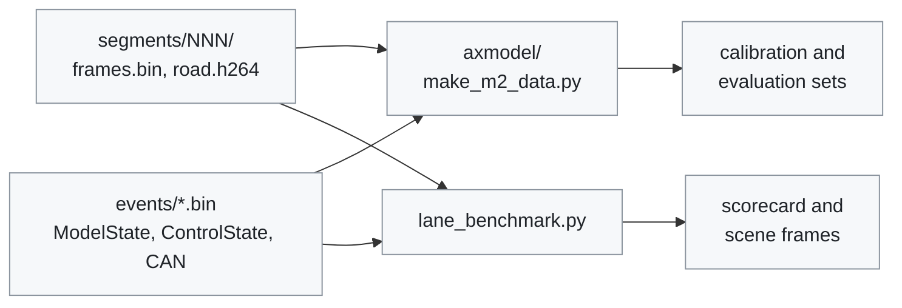

# Model tools

[← Documentation](../../docs/README.md)

Host scripts that read recorded routes and reproduce the device's model input
pipeline, and in [`axmodel/`](axmodel/README.md) the build of the model itself.
Use them to make a replay for the board, to measure lateral bias, to compare
the lanes with the stock camera's, or to rebuild
the axmodel.

Which tool reads which part of a route:



All of them decode the route through `recording_reader.py`, and
`make_m2_data.py` warps the frames with `model_warp.py`.

## axmodel pipeline

The MaixCAM2 model is built by [`axmodel/`](axmodel/README.md): it cuts the NPU
core out of the openpilot master `driving_supercombo.onnx`, builds calibration
and evaluation data, and compiles it with Pulsar2 6.0 into the axmodel that
`modeld` loads. See [Model package](../../models/README.md) for the contract and
the board numbers.

| File | What it does |
| --- | --- |
| `axmodel/extract_core.py` | cuts the history queues out of the released graph and rewrites the ops Pulsar2 does not accept (opset-20 Cast, GatherND, the `Where(-inf)` mask, 2D LpNorm) into equivalent ones; fp16 is promoted to fp32 |
| `axmodel/split_outputs.py` | exports every head as its own output so each gets its own U16 scale; the runtime puts them back together (`src/model/model_output_assembly.h`) |
| `axmodel/make_m2_data.py` | builds the calibration and evaluation sets from MaixCAM2 recordings with inputs built like the runtime's: the numpy device warp ([`model_warp.py`](#model_warppy)) with the recorded calibration and camera mount, t-4/t pairs, recorded desire, the fp32 core's own feature history; `m2_calib_20261004.json` is the spec used on 2026-10-04 |
| `axmodel/run_axmodel_assembled.py` | runs an axmodel on the board over a `make_m2_data.py eval` set and writes the outputs in the original 2576-float layout, for comparison with the fp32 reference |
| `axmodel/pulsar2_u16_u8in.json` | the Pulsar2 build config: AX620E / NPU1 (one core; the AI-ISP denoiser uses the other), U16 everywhere, SmoothQuant, uint8 image inputs |

## Host environment

```sh
python3 -m venv .model-venv
.model-venv/bin/pip install -r tools/model/requirements.txt
```

The requirements are `numpy`, `onnx`, `onnxruntime`, `av` (the H.264 decoder
behind `recording_reader.py`) and `pillow` (for `tools/ui/hud_tools.py`
compose). `axmodel/` needs `onnx` and `onnxruntime`, and the Pulsar2 6.0 Docker
image for the compile step; nothing here needs a GPU or a compiler.

## Recording-driven helpers

`recording_reader.py` decodes a route and `model_warp.py` is a numpy model-input
warp: the matrices of `src/model/model_input_transform.cc` and the fixed-point
bilinear sampling of the CPU warp earlier builds carried (the board warps on the
GDC, within 1 LSB).

| File | What it does |
| --- | --- |
| `recording_reader.py` | the Python mirror of `src/recording/recording_format.h` and `src/common/ipc_messages.h` for the analysis tools |
| `lane_benchmark.py` | compares the model's ego lanes with the stock camera's (K7 `LKA14`) per drive, and draws both on the video frames where they disagree |
| `model_warp.py` | the device warp in numpy, and the MaixCAM2 intrinsics in one place |

### `recording_reader.py`

It is checked against the C++ asserts by `tests/check_recording_reader.py`.
`iter_states` reads a route's event log one 60 s chunk at a time into NumPy
record arrays, and `RouteVideo` decodes one frame by `frame_id` from the
keyframe before it (`lane_benchmark.py` and `tools/ui/hud_tools.py`).
`scripts/web_console/` keeps its own standard-library copy of the layouts it
shows, checked by `tests/check_web_console.py`. ControlState's field at offset
56 is `cluster_speed_kph`, the cluster's display speed; `ego_speed_kph` is the
wheel speed the controller uses.

### `lane_benchmark.py`

```sh
python tools/model/lane_benchmark.py <route_dir> [<route_dir> ...] --out DIR [--scenes N] [--no-frames]
```

The K7's stock camera sends each ego lane line's position and heading in
`LKA14` (0x484, bus 2). The tool fits a cubic to each model lane over 0–50 m
and compares the position and slope at 1.5 m, where the two agree best. The
stock values arrive 0.3 s (position) and 0.1 s (heading) after the model's
capture. It prints one scorecard row per drive (the position RMS and
correlation per side, the lane-centre and width differences, and the heading
difference on straights) and writes `DIR/scorecard.json`.

It also picks the scenes where the two disagree: both see the line but differ
by more than 25 cm from the drive's median, or only one of them sees it. For
each scene it decodes that frame with `ffmpeg` from the previous keyframe and
draws both lanes on it (`DIR/<route>/scenes/*.jpg`, details in
`DIR/<route>/report.json`). The stock camera is not ground truth; the frames
are there to tell which one is on the paint. See
[Stock lane comparison](../../docs/diagnostics.md#stock-lane-comparison).

### `model_warp.py`

It holds the MaixCAM2 intrinsics once (`maixcam2_intrinsics`, the
`src/common/app_config.h` values) for `lane_benchmark.py` and the axmodel
calibration data, and the warp uses them.

It copies the 12-bit fixed-point sampling of the CPU warp earlier builds used
(the board's GDC matched it to about 1 LSB) and the runtime's projection:
openpilot's `get_warp_matrix` (a rotation about the camera centre) with the
camera-mount shift `modeld` applies (`camera_offset_m`, `camera_height_m`).
The runtime multiplies in single precision, so the matrices agree to a
relative 1e-5, well under a thousandth of a pixel.
`check_recording_reader.py` holds them to the golden values that
`gtest_model_input_transform` pins on the C++ side.

## Related

- [axmodel pipeline](axmodel/README.md): building the NPU model step by step
- [Model package](../../models/README.md): the shipped axmodel, its contract and
  board numbers
- [Model pipeline](../../docs/model-pipeline.md): the runtime warp and model
  that these tools reproduce
- [Recording](../../docs/recording.md): the route layout the reader decodes
- [Diagnostics](../../docs/diagnostics.md): the replay and lane-bias procedures
